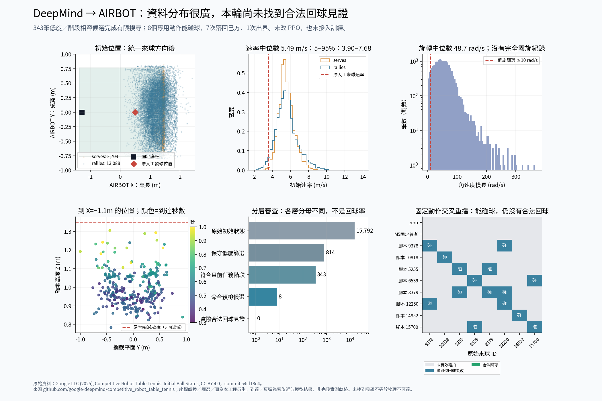

# DeepMind Dataset → AIRBOT 可行性審查

2026-11-21。**資料已分析，但這一版還不能直接接入M7回球訓練。** 在明確的零旋近似與現有控制限制下，我們找到8個能碰球的專用動作，卻沒有找到合法回球見證。這不等於證明其他球物理不可達。

**2026-11-23 補查：**前三個train接觸案例增加81組回球姿態候選，仍未找到滿足接觸位置與拍面法向的解；尚未進入新的PhysX重播。詳見§10。

本輪只做資料、候選軌跡、獨立PhysX及固定動作交叉檢查；沒有改PPO、增加訓練預算、換準備姿態或放寬碰撞。

## 1. 三個問題的答案

| 問題 | 本輪答案 |
| --- | --- |
| 真實來球有多廣？ | 15,792個實測初始狀態；速率5–95%約3.90–7.68m/s，橫向位置與方向都比現人工分布廣。旋轉中位數48.7rad/s，不能全部當零旋使用。 |
| 多少在現有控制下有回球軌跡？ | 814筆低旋篩選後，343筆符合現有任務階段。有限搜尋得到8個命令候選；8個專用腳本實際全碰拍，但7次落回己方、1次出界。已測合法回球見證為0，不能據此稱343筆全部不可達。 |
| 能建立不同球需要不同動作的訓練／測試分布嗎？ | 可先保留8個接觸診斷案例：自己的腳本都碰到球，任一已測固定腳本最多碰3/8。但目前沒有合法回球，因此尚不能交付合格的回球訓練／測試分布。 |



圖左下的到達位置與時間是**現有零旋模型推算**，不是資料集中附帶的完整實測軌跡。紅線只是原準備拍心高度，不是可達域邊界。右下藍格代表有效碰拍但回球失敗，沒有任何合法回球的綠格。

## 2. 官方資料到底給了什麼？

來源固定為Google DeepMind官方倉庫commit `54cf18e41a8f134d98ad38710001ed50aabb8ebc`，原檔與SHA256／Git blob由[來源清單](../../configs/deepmind_sources.json)固定。

- `serves.json`：2,704筆；`rallies.json`：13,088筆，合計15,792筆。
- 每筆是人或機械臂剛擊球後的初始位置、線速度、角速度，另有唯一ID。不是逐幀量測時序，也不是完整球路。
- 單位分別為m、m/s、rad/s。全部九個數值欄位有限，ID唯一且連續；未找到精確重複的完整狀態。
- 原始資料沒有session／完整rally關聯／時間戳／擊球者或旋轉類別欄位，不能自行補成已知標籤。
- 官方Notebook的欄位與球／桌XML已讀取核對，**沒有運行其MuJoCo模擬**。本輪物理重播是我們自己的Isaac／PhysX環境。

原檔只放本地`.agents/runs/foundation/deepmind_audit/source/`，不改寫原檔，不把幾MB的JSON或官方GIF放進Git。可用`python scripts/prepare_deepmind.py`從官方固定commit下載；既有檔案只驗證，不覆寫。它同時核對SHA256、byte數與Git blob SHA1。

## 3. 座標不能只交換X、Y

DeepMind原點在**桌面中心**：X為桌寬、Y為桌長、Z是桌面以上高度。AIRBOT目前X是桌長、Y是桌寬、Z以地面為0。

對原資料從正Y朝負Y飛的球，使用proper rotation：

```text
AIRBOT X =  source Y
AIRBOT Y = −source X
AIRBOT Z =  source Z + 0.76 m
```

對相反方向的1,089筆rally，先以繞Z旋轉180°統一成從對方來球，再用同一規則。等價地，令`s=sign(source pos_y)`：

```text
R = [[ 0, s, 0], [−s, 0, 0], [0, 0, 1]]
p_air = R @ p_source + [0, 0, 0.76]
v_air = R @ v_source
omega_air = R @ omega_source
```

每筆都檢查`R.T @ R = I`、`det(R)=+1`、反向變換能還原位置與角速度模長不變。這是旋轉，不是鏡射；若直接交換X/Y而不處理符號，會產生反射，尤其容易把軸向角速度轉錯。

官方Notebook將原角速度送入MuJoCo freejoint的angular qvel；該量為body軸角速度，但球初始姿態是identity，所以初始body／世界軸重合。這支持初始狀態的上述轉換，不能把整段MuJoCo angular qvel都說成世界座標。

## 4. 資料分布與到達幾何

下表為轉換、統一方向後的全部原始狀態。5–95%是分位範圍，不是排掉其他資料後的範圍。

| 指標 | 最小～最大 | 5–95% | 中位數 |
| --- | --- | --- | --- |
| 初始速率 | 2.05～13.75m/s | 3.90～7.68m/s | 5.49m/s |
| 初始橫向Y | −0.852～+0.818m | −0.563～+0.590m | +0.082m |
| 初始離地Z | 0.836～1.751m | 0.953～1.367m | 1.155m |
| 水平來球方向角 | −51.75～+55.86° | −20.71～+19.36° | −2.12° |
| 角速度模長 | 約0.00005～362.88rad/s | 9.72～99.99rad/s | 48.72rad/s |

水平角以正對機械臂的−X方向為0°。原人工來球Y只有±15mm、速率約3.59m/s，與這個資料分布明顯不同。不過初始狀態取樣時刻也不同，不能只比初始Z就推論到達拍面時一定差多少。

因此另用現有`predict_ball()`與`flight_state()`，在零旋近似下推算到原候選平面X=−1.1m：343筆階段相容低旋候選中，337筆在下一次桌面高度交會前能到該平面。

| 到X=−1.1m的指標 | 5–95% | 中位數 |
| --- | --- | --- |
| 從原始狀態起算的到達時間 | 0.395～0.769s | 0.529s |
| 橫向Y | −0.571～+0.495m | −0.018m |
| 離地Z | 0.868～1.141m | 0.980m |

這些值是模型估計，不是實測到達真值；沒有把時間平移到靠近機械臂後再假裝多了準備時間。未到該平面的6筆也保留在候選母集合中，沒有偷從分母刪除。

## 5. 為什麼15,792筆最後只拿343筆進當前搜尋？

篩選條件在分析前固定於[設定](../../configs/deepmind_audit.json)：

1. **保守低旋篩選：`norm(omega) ≤ 10 rad/s`。** 共814筆（serve424、rally390）。資料沒有完全零旋紀錄，所以物理階段全部明標「保留原omega，但模擬強制omega=0」。10rad/s只是本輪保守資料門檻，尚未經Magnus／旋轉反彈精度驗證，不能說低旋就等於零旋。
2. **符合目前任務階段與初始範圍。** 目前M7要求首次桌接觸在己方，並有原本的初始X/Y範圍。零旋預測下只剩343筆（rally342、serve1）。發球通常會先在對方桌面反彈，不能把這類球直接reset後被判`wrong_bounce`，再算作策略接球失敗。
3. **不另改球的起點、初速或任務階段。** 這輪沒有為serve做過網後裁切、時間平移或新的雙反彈任務。未相容的球保留原因，屬後續適配範圍，不是宣判原資料錯誤或機械臂不可達。

所有15,792筆都做了分布／現有零旋模型預測。高旋資料的預測只作反事實診斷，不構成真實高旋可行性結論；可達性搜尋的主集合是上述343筆。

## 6. 動態搜尋如何保留原AIRBOT條件？

固定原六維關節residual、每關節±0.6rad action範圍、48Hz命令、960Hz物理、50ms反應延遲、1.5rad/s速度上限、8rad/s²加速度上限、原ready／底座／247g末端近似與碰撞體。沒有換成末端action，沒有放寬碰撞或直接寫關節狀態來完成運動。

本輪用了三個清楚分開的有限候選族：

| 搜尋 | 範圍與結果 | 能說什麼 |
| --- | --- | --- |
| 固定原拍面方向的rest-to-rest攔截 | 事先hash排序的96筆，3個X平面，0個候選 | 這個固定姿態搜尋未找到見證，不能說球不可達 |
| 允許拍面隨關節改變的位置攔截 | 相同96筆先得到2個；再按同規則完成其餘247筆，合計8/343 | 8個命令能到達候選接觸狀態，尚未保證回球 |
| 原M5非零拍速回球規劃器 | 同343筆，原12個時間組合、中央目標(.75,0)m，0個規劃候選 | 原M5有限搜尋未找到見證，不是所有可能出球目標的不可達證明 |

第二輪放開的是候選拍面方向，不是關節／控制限制。它用URDF與`ready ± action_scale`交集作關節bounds，找使`TCP + radius × normal`對準球心的位置解，再經原`Trajectory`與碰撞預檢。得到2個後，為完成這343筆母集合的審查，將相同規則掃完剩247筆；沒有依物理成功結果挑資料或改門檻。

8個候選還要走原`PositionCommand`：48Hz固定action → 960Hz有界插值，核對實際命令q/v/a、攔截時FK誤差、全段碰撞及最後姿態。第一次候選預檢只看至攔截，審查時發現範圍不完整；已對8個通過候選補做至timeout的完整命令檢查，全部通過。攔截後hold與濾波超越也包括在內。

這些仍是離散碰撞預檢，不是連續幾何證明；rest-to-rest最短時間下界也只適用該候選，不代表PPO所有非零拍速動作都不可能。M5內部拒絕名稱`unreachable`在這份報告只解讀為「該候選IK未解出」。

規劃在發球前完成，屬**離線oracle見證**。計算時間沒有藏進50ms反應延遲，也沒有宣稱已做到線上實時規劃。

## 7. 真PhysX結果：能碰球，不等於能回球

真正重播了102個不同raw ID、合計176次首回合：96次zero，以及10條固定動作×8顆球的80次交叉重播。不是343筆全部做了PhysX。

- Zero在96筆上：0合法；68 out、19 miss、5 arm_fault、1 wrong_bounce、3 unexpected_contact。這些不拿來證明機械臂不可達，只是原準備姿態的對照。
- 8個專用腳本在各自的球上：**8/8有效碰拍，0/8合法回球**，7次wrong_bounce、1次out。
- 交叉矩陣包括zero、原M5中央script經M7 action接口的固定參考、8條專用腳本；全部80次中15次有效碰拍，0次合法回球。M5固定參考與zero都沒碰到這8顆球。

| 原始ID | 預先分組 | 專用腳本結果 |
| --- | --- | --- |
| 9378 | train | 碰拍，落回己方 |
| 10818 | train | 碰拍，出界 |
| 5255 | train | 碰拍，落回己方 |
| 6539 | validation | 碰拍，落回己方 |
| 8379 | test | 碰拍，落回己方 |
| 12250 | train | 碰拍，落回己方 |
| 14852 | train | 碰拍，落回己方 |
| 15700 | test | 碰拍，落回己方 |

所以本輪找到的是8個**動態接觸見證**，尚未找到合法回球見證。其他335筆是「有限搜尋未找到命令」，不是已證明不可達；不能報成「0/343策略成功率」，更不能外推15,792筆的真實可達比例。

模型與實際零旋PhysX也作了獨立核對：96次zero的首次己方反彈，位置誤差P95約4.78mm、時間P95約1.09ms，最大約7.49mm／1.33ms，通過既有20mm／10ms參考。這驗證的是我們的零旋近似一致性，沒有驗證原始非零spin的真實球路。

## 8. 是否真的需要不同動作？分布怎樣保存？

每條腳本的完整48Hz action序列在重播前固定。把`A_i`套到其他`S_j`時，不重新看球、求IK或移動時間零點。

自己的腳本8/8都能碰球；單一已測腳本最多只碰3/8。這支持「這些已測接觸案例需要依來球選擇動作」，但不能證明不存在未知的通用固定動作。尤其本輪沒有合法回球，不能把接觸矩陣直接升級成回球訓練驗收。

- 已建立raw-ID層級的固定split：343候選為train201／validation69／test73。所有旋轉與其他衍生資料跟隨同一母ID，不跨split；沒有精確重複狀態跨split。
- 8個接觸案例是5／1／2，另存本地`contact_cases.json`，標記contact diagnostics，不是成功回球示範。
- 合法回球候選清單`audited_candidates.json`的`rows=[]`，狀態`NOT_READY_NO_LEGAL_RETURNS`。沒有將空清單冒稱已完成訓練資料接合，也沒有讓trainer讀它。
- 原資料沒有session關聯；raw-ID分組不等於獨立賽段。這些test狀態已被可行性診斷查看，不能在日後宣稱是從未看過的策略效用測試，亦不得把test專用動作混入訓練。

研究決策：**先保留這一版分布審查與8個接觸診斷案例，不替換M7人工分布。** 下一步若要使用DeepMind資料，應先對少量代表球建立合法回球見證，再驗不同固定動作無法包辦、以及訓練／測試資料的獨立性。若要更換準備姿態、擴擊球候選或加入旋轉物理，均需另列可歸因的工作包，不在這次暗中改動。

## 9. 程式資料流與重跑

```text
官方原檔／固定commit／SHA與授權
  → proper旋轉＋桌高／保留raw ID與omega／先分split
  → 全資料分布與既有零旋predict_ball
  → 低旋＋當前任務階段相容343筆
  → 有限IK／Trajectory／全PositionCommand預檢
  → 8個候選固定action
  → 獨立PhysX＋zero／M5／固定腳本交叉矩陣
  → summary／contact診斷／空的合法回球清單
```

- `scripts/prepare_deepmind.py`：只從官方固定commit取得原檔，依`configs/deepmind_sources.json`驗byte、SHA與Git blob。
- `tests/deepmind_audit.py::load()`：欄位、單位、座標、raw-ID split及反向轉換檢查。`distribution()`重用原`predict_ball`，不是另寫一套球模型。
- `candidate_search()`：固定面／位置解診斷；`action_preflight()`重用原`PositionCommand`，檢查全命令曲線。`candidate_striker()`直接調原`plan_return()`，沒有把M5換成另一演算法。
- `replay()`：使用原`PaceEnv`，以原事件規則計有效碰拍、過網、落桌及失敗。普通運動的直接state write被守衛拒絕，reset保留原契約。
- `summarize()`：合併96+247的分母、不同raw ID與重播case數，統一圖表輸入；不把`position_remaining`單批的`unresolved=96`誤寫成整輪還有96筆未搜尋。
- `scripts/plot_deepmind_audit.py`：只讀結果，保留一張代表圖；沒有產生影片或逐幀圖片。

先準備官方資料，再在含NumPy／SciPy／PyTorch的專案環境執行CPU階段；本次使用既有Isaac容器內Python：

```bash
python scripts/prepare_deepmind.py
PYTHONPATH=src:tests python tests/deepmind_audit.py --stage distribution
PYTHONPATH=src:tests python tests/deepmind_audit.py --stage search
PYTHONPATH=src:tests python tests/deepmind_audit.py --stage position-search
PYTHONPATH=src:tests python tests/deepmind_audit.py --stage position-remaining
PYTHONPATH=src:tests python tests/deepmind_audit.py --stage striker-search
./run.sh --mode pace-check --pace-check dataset-audit --pace-envs 16 --device cuda:0 --headless --report .agents/runs/foundation/deepmind_audit/physics_gate.json
PYTHONPATH=src:tests python tests/deepmind_audit.py --stage summarize
PYTHONPATH=src python scripts/plot_deepmind_audit.py
```

各擷取／搜尋階段對既有完成證據拒絕覆寫；摘要與圖可由既有資料重算。既有目錄不是可以直接重跑全套的空目錄，重新擷取前需明確設定新實驗位置，不要刪原始證據。

原始檔、完整逐筆分類／規劃原因、固定action、PhysX與矩陣保存在本地`deepmind_audit/`；唯一統整入口是`summary.json`。工程執行PASS，物理重播exit0；**合法回球資料就緒度未通過**。核心物理／控制／碰撞與PPO設定SHA不變。

CPU搜尋入口初次誤匯入需要PhysX啟動的舊helper而失敗，已改為純檔案雜湊讀取後運行成功；不把入口失敗算資料拒絕。各階段保留當時的診斷程式SHA；各階段間另增加了M5搜尋與摘要入口，未改已執行的物理重播函式或生產碼，不宣稱全部歷史報告與目前整檔SHA相同。

## 10. 來源與授權

資料歸屬：Google LLC（2025），*Competitive Robot Table Tennis: Initial Ball States*，隨 *Achieving Human Level Competitive Robot Table Tennis* 發布。

- [官方資料與格式](https://github.com/google-deepmind/competitive_robot_table_tennis/tree/54cf18e41a8f134d98ad38710001ed50aabb8ebc)
- [論文](https://arxiv.org/abs/2408.03906)
- 原軟體Apache-2.0，JSON等其他材料**CC BY 4.0**；不能因repo LICENSE是Apache就把JSON也當Apache。
- 本工程衍生改動：座標旋轉、桌高平移、篩選、分組、零旋近似與圖表；保留原始ID、來源與改動說明。原資料與授權文字留在本地source，不修改或重發成原作者資料。

本輪沒有commit／push、真機操作或新的PPO訓練。


## 10. 從「碰得到」補查「打得回去」（2026-11-23）

**本次沒有取得新的合法回球見證。** 新增的81組候選都在擊球姿態求解階段失敗，沒有進入拍速／軌跡驗證或新的PhysX回球測試。這是有界搜尋負結果，不能解讀為PPO失敗或物理不可達。

### 做了什麼，為什麼這樣做？

前輪8條動作只是讓球拍移到球路上停住。碰得到球，並不代表拍面朝向與碰撞速度能把球送過網。原M5則先指定整個球拍姿態；對理想無摩擦拍面而言，決定出球的主要是法向，面內轉角可以有自由度。因此本次保留M5的飛行與碰撞公式，只在獨立診斷中改成「指定球心接觸位置與拍面法向，允許面內轉角自由」的姿態搜尋。沒有修改原M5規劃器。

事前固定原hash順序中的前三個train接觸案例9378、10818、5255，不另挑validation/test。每顆球嘗試：原接觸時刻−40／0／+40ms，落點X=0.30／0.75／1.10m且Y=0，出球飛行時間0.35／0.50／0.65s。每顆27組，共81組；每組從原接觸姿態及ready兩個起點求解，共162次局部IK。這不是完整落點、時刻或姿態空間的搜尋。

### 資料如何變成回球候選？

1. 原零旋模型從首次己方反彈推算候選接觸時刻的球位置與入射速度。
2. 原`return_velocity()`求能飛到指定落點且通過網截面的出射速度。
3. 用出射與入射速度之差決定理想無摩擦撞擊的法向：`n = normalize(v_out − v_in)`。
4. 在原關節範圍與ready±0.6rad內，求`TCP + 球半徑 × n = 球心`，並要求拍面法向對準n；不指定面內轉角。
5. 只有姿態解合格，才計算所需法向拍速`u_n = dot(v_out + e*v_in, n)/(1+e)`，接原`StrikeTrajectory`與完整`PositionCommand`預檢；之後仍需獨立PhysX確認。**本次全部停在第4步，第5步沒有實際執行。**

這裡的理想接觸點在拍心外沿法向一個球半徑，因此`n·(ω×r)=0`；M5的TCP法向速度公式對這個理想點成立。實際偏心接觸仍須量測`v_body + ω×r`，不能用這條理想公式代替實際接觸速度。

### 結果和限制

| 原始ID | 候選數 | 姿態求解合格 | 最小加權殘差候選的位置誤差 | 同候選法向角度誤差 |
| --- | ---: | ---: | ---: | ---: |
| 9378 | 27 | 0 | 13.82mm | 6.29° |
| 10818 | 27 | 0 | 36.05mm | 18.65° |
| 5255 | 27 | 0 | 48.91mm | 14.94° |

「最小加權殘差」按實際IK目標`位置誤差平方 + 0.2² × 法向向量差平方`選取，表中兩個誤差來自同一候選，不是各自挑最好值。這些是數值求解的殘差，**不是機械臂實測追蹤誤差**。姿態求解篩選為位置≤0.2mm、法向≤0.002rad；即使用既有2mm／0.02rad命令追蹤門檻作比較，這三個最小殘差候選仍不合格。沒有為了通過而放寬門檻。

全部81組都有可解的理想出球飛行，但未解出對應關節姿態。兩個初值與有限迭代並不構成全域無解證明；加權求解也可能在位置與角度間折衷。可支持的結論只是：**在所選時刻與中央落點組合中，目前的局部求解器還不能同時滿足碰球位置與所求回球法向。** 不能進一步說速度一定不足、關節表示無效，或所有DeepMind球都不可回。

本次CPU流程5.25s、正常退出0，生產控制／物理檔案SHA前後一致，PPO更新0。沒有新PhysX案例、實際落點或實測接觸速度；舊176次重播和8/8接觸、0合法的結果維持原意。H6合法回球的跨球固定動作比較為NOT_RUN，因為尚無新的合法回球動作；E-frozen亦未開始。

### 如何重跑與下一步

在既有含NumPy／SciPy／Torch的環境，以`PYTHONPATH=src:tests python tests/deepmind_audit.py --stage return-witness`執行。入口會保護已完成結果，不覆寫。協議與逐候選結果分別保存在本地`deepmind_audit/return_witness_protocol.json`及`return_witness_search.json`，原審核的`summary.json`不被改寫。

下一個有針對性的診斷是：**先在能精確碰到球的姿態附近，估計可取得的拍面法向與法向速度，再檢查其出球是否有任何合法落點**，而不是繼續指定中央落點反求。若開展，仍須獨立記錄有限搜尋範圍、原控制限制與全軌跡／PhysX驗證；本次尚未執行，也不改ready或訓練分布。


## 11. 只放寬動作範圍：±0.6對±1.0rad（2026-11-23）

**較寬範圍改善了姿態誤差，仍未找到合格回球姿態。** 不能直接把正式PPO改成±1.0後宣稱問題已解決，也不能將本輪陰性結果推論為較寬範圍完全無用。

依使用者授權，沿用§10的同三顆train球9378／10818／5255、每球27組候選、兩個IK起點及160次迭代上限。兩組各81候選／162次局部IK，只更改診斷的action_scale：六軸0.6改1.0。原安裝、ready、球路、目標、時間、物理、速度1.5rad/s、加速度8rad/s²及碰撞規則不變；兩組關節範圍均與URDF限制取交集。

先重跑±0.6：逐候選結果與前輪一致，位置／法向誤差在1e−10數值容差內重現。再跑±1.0，逐候選的時刻、目標、incoming/outgoing及法向與±0.6完全相同。每組仍81個`impact_ik_not_solved`，合格姿態0、完整命令候選0。

| 球ID | ±0.6：位置／方向誤差 | ±1.0：位置／方向誤差 | ±1.0該候選碰到的關節邊界 |
| --- | --- | --- | --- |
| 9378 | 13.82mm／6.29° | 12.51mm／5.60° | J5上限（URDF） |
| 10818 | 36.05mm／18.65° | 18.56mm／7.69° | J4上限（動作範圍）、J5上限（URDF） |
| 5255 | 48.91mm／14.94° | 46.74mm／14.31° | J3下限、J5上限（均URDF） |

各格取該組該球加權殘差最小的候選，規則同§10；不同組的最佳候選可能不是同一時刻／目標，這張表是各自最好解的描述，嚴格配對資料則完整保存在JSON。位置≤0.2mm、方向≤0.002rad的原IK門檻未改。

### 為什麼放寬後還會卡？

需要分清**我們設定的動作範圍**和**現用URDF的關節上下限**。

- J5 ready=1.1rad；URDF上限1.7628rad。±0.6時上限是1.7rad；±1.0時裁到1.7628rad，所以正方向只新增0.0628rad（約3.60°），不是新增0.4rad。
- J3 ready=0.4rad；URDF下限−0.087266rad。±0.6時已碰到這個下限，擴成±1.0也不能往負方向多轉。
- J4在10818的較寬範圍最佳候選仍貼到ready+1.0，因此動作範圍也不是完全無影響。

±1.0的81次候選最終解中，80次J5貼到上界（距離<1e−5rad）：9378為27/27，10818為26/27，5255為27/27。這支持「此候選族的姿態要求與現用關節／安裝幾何存在限制」這條排查方向；**不是全域無解證明，也不能證明J5是唯一根因**。局部求解、加權殘差、固定接觸時間／中央目標仍可能漏解。

上下限已核對目前`assets/airbot_play/airbot_play.urdf`與保留的官方MoveIt來源原檔，J3／J5一致；這是模型來源核對，沒有操作真機或驗證實機軟限位，不擅自提高URDF上限。

### 本次實際驗到哪裡？

CPU兩組約5.28s／5.43s，程序exit0；資料與生產source hash保持一致。沒有合格姿態，所以拍速求解、StrikeTrajectory、PositionCommand及新的PhysX回球都是NOT_RUN；無法對速度／加速度是否過慢下結論。沒有改正式action_scale、換舊checkpoint倍率、增加PPO預算或做真機運動。

入口：`PYTHONPATH=src:tests python tests/deepmind_audit.py --stage return-radius`。本地證據為`return_radius_0.6_search.json`、`return_radius_1.0_search.json`及各自protocol，`return_radius_comparison.json`檢查基線重現和配對輸入。舊`return_witness_search.json`保留，不覆寫；已有結果時入口拒絕重跑覆寫。

下一步不建議只把六軸一起擴到更高數字。優先查**同一接觸位置有哪些真能擺出的法向，配上可實現拍速後能否打到其他合法落點**；如研究ready或末端安裝方向，另作受控變因。正式±0.6基線保留，±1.0仍是已測但未取得回球見證的診斷變體。


## 12. 已開始用Actor驗證小題目

2026-11-23後續不再把成功回球腳本作為小型PPO探索的硬門檻。已對五個train接觸案例完成[三seed A組固定預算實驗](deepmind_ppo.md)：每seed6144transitions，最後Actor仍0/5有效碰拍／合法回球；隨機訓練9/346碰拍、0合法。這是新的策略負結果，不能倒寫成原審查已測PPO，也不等於這批球不可回。完整分布343筆仍未接入正式訓練／評測。
