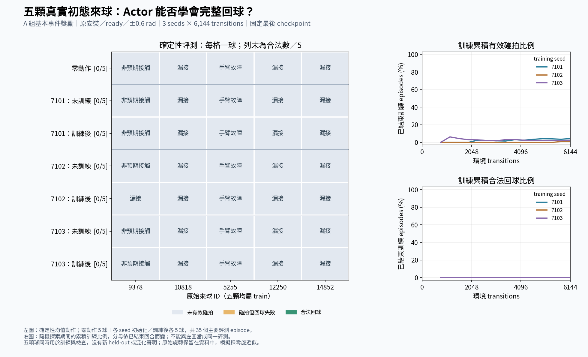
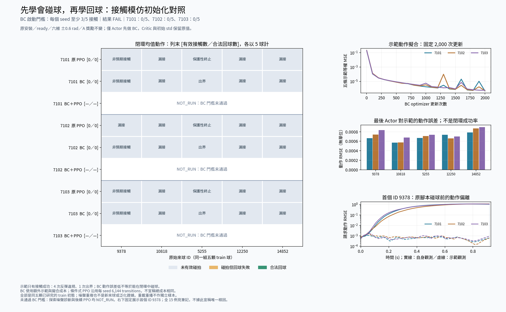
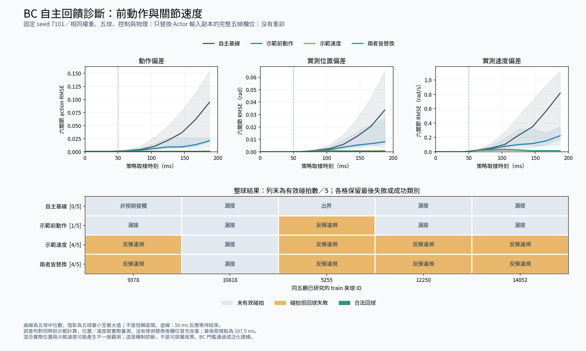
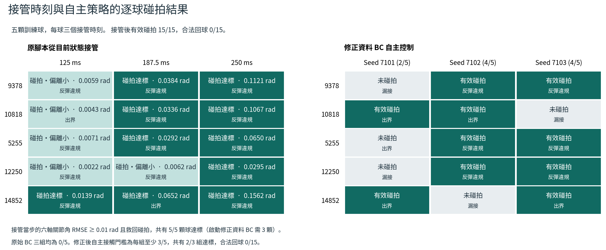
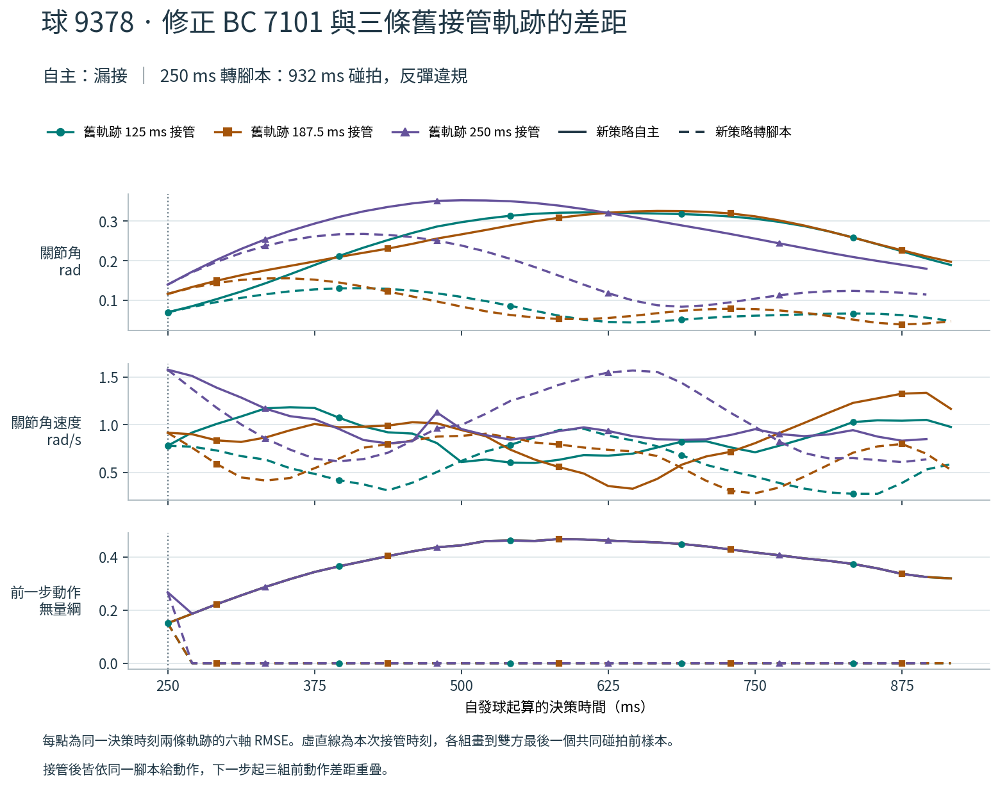
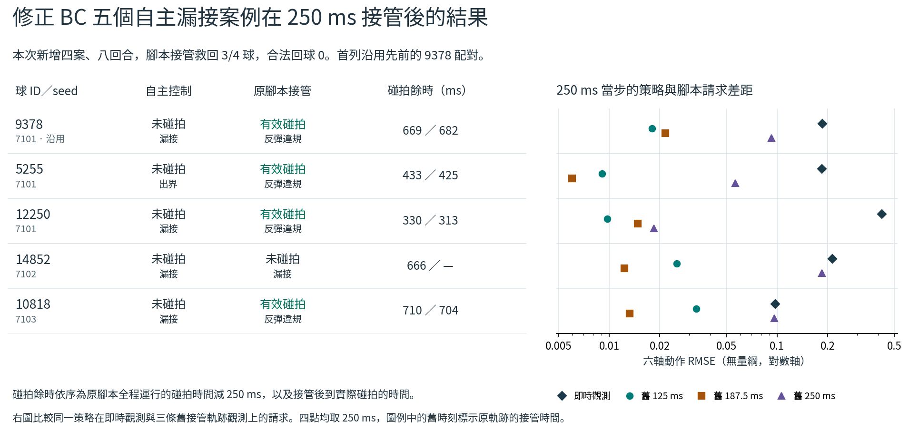
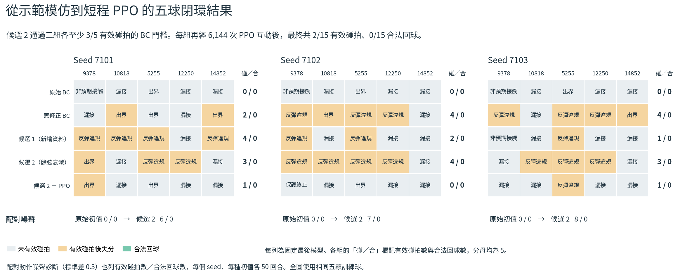

# 五顆DeepMind來球：讓Actor嘗試學完整回球

2026-11-23。第一輪把問題收斂為：**對五顆已知能碰到、但腳本沒有打回去的球，PPO更新能不能改善完整回球？** 執行結果與逐球圖見下方；這不是廣泛泛化測試。

較早階段：已追加[接觸BC初始化對照](#接觸bc初始化結果離線擬合很好閉環仍未碰球)。三個Actor都能擬合示範，但自主執行仍0/5碰拍；依事前門檻沒有啟動BC＋PPO。其後的[同球影片對照](#同球影片原腳本bc預算動作與bc自主控制)進一步驗證：seed7101的BC預先讀取保存觀測、算好整條動作再播放，可以5/5碰球；即時讀自己觀測仍0/5。

**2026-11-24最新結果：修正BC的三seed自主碰拍已達3/5、4/5、3/5，通過初始化門檻；300次噪聲診斷及各6144 transitions短PPO也已完成。PPO後碰拍降至1/5、0/5、1/5，合法回球仍0。** [完整結果與判讀](#短ppo完成初始化已可用但原配方未保住碰拍)保留候選退化、全部失敗與來源驗證。這是固定五個train案例的門檻進展，尚不是穩定回球能力。

## 第一輪結果：完成探索，這個短預算沒有學會接回球

**三個seed的最後Actor都為0/5有效碰拍、0/5合法回球；零動作與各自初始化也都是0/5。** 不是程式沒訓練：三組Actor／Critic參數均有更新、loss有限，最後checkpoint重載後逐球結果一致。工程流程PASS；本輪沒有取得策略回球的局部成功見證。



| Seed | 訓練transitions | 完成訓練回合 | 隨機探索有效碰拍 | 隨機探索合法回球 | 最後均值動作有效碰拍／合法 |
| --- | ---: | ---: | ---: | ---: | --- |
| 7101 | 6,144 | 116 | 5 | 0 | 0/5、0/5 |
| 7102 | 6,144 | 112 | 1 | 0 | 0/5、0/5 |
| 7103 | 6,144 | 118 | 3 | 0 | 0/5、0/5 |

訓練合計346個**已完成**回合，9次有效碰拍（約2.60%）、0合法回球。尚未結束的回合也已計入18,432個transitions，只是不進完成回合比例分母。9次碰拍集中在12250（7次）與9378（2次），最後8次wrong_bounce、1次out。這些是訓練時隨機動作，不能當作最後確定性策略的成功率。

零動作、全部initial以及7101／7103最後Actor，逐球結果都是：9378非預期接觸、10818漏接、5255 arm_fault、12250漏接、14852漏接。7102只將9378變成漏接，仍沒有有效碰拍或合法回球。`arm_fault`是原接觸力／關節越界保護的結果，不等於硬體壞掉；本輪沒有保存足夠細分觸發量去斷言它是哪個門檻造成。

### 現在能判斷什麼？

**這個A組短配方，首先缺少有效接觸探索機會。** 原腳本在同一接口能5/5碰球，Actor的隨機探索卻只有9/346碰拍，因此不能只把問題描述成「已會碰球，只差回球方向」。另一方面9次碰拍也都沒有合法回球，表示偶爾碰到不會自動產生成功。

控制診斷沒有顯示大量raw action被±1裁切：各seed的最大「每輪平均限幅比例」約0.26–0.30%。實測q對已施加q的每輪追蹤RMSE最大約0.00089–0.00100rad，但請求q與已施加q的每輪平均絕對差最大約0.166–0.170rad。這提示必須區分「致動器追蹤已施加命令」與「有界控制器能否即時跟隨變動請求」；目前沒有單變因對照，不能據此認定限速是唯一根因或直接放寬。整批更新KL最大約0.028–0.035，沒有NaN／無更新問題，也不因有限loss就宣稱策略有效。

因主要評測完全沒有有效拍面接觸，對應的接觸前拍面／拍速、離拍與實際落桌欄位維持缺失；沒有拿末態速度冒充碰撞速度。原接觸腳本的量測保存在bank gate，可作後續對照。

下一步若繼續研究，應先針對接觸探索選一個單變因，例如以已有接觸軌跡做明確獨立的初始化對照，或檢查12250上請求與施加動作的時間差；不要同時改ready、reward、action和預算。本次沒有啟動這些分支，也沒有藉延長訓練改寫負結果。

### 驗證與成本

35個主要評測episode＋15個重載重播均完整；來源、manifest、checkpoint與評測helper hash核對一致，每seed實際transitions與洗牌序列已核查。主訓練流程包含內建評測約225.22s，這是流程wall time，不是精確GPU計量；沒有追加原定更新。

## 為什麼不繼續等規劃器找到解？

[前輪審查](deepmind_feasibility.md)找到8個動態接觸見證，但沒有合法回球。後來有限的回球姿態搜尋、±0.6／±1.0rad對照，也沒有找到通過條件的完整候選。這些搜尋有指定時刻、中央落點與局部求解限制，不能推出Actor不可能學到其他回球方式。

Actor每秒輸出48次六關節目標，負責從接球前準備到碰撞、減速的整段動作。第一輪不把接觸腳本交給Actor接管，不做BC，也不要求先有合法回球teacher；腳本只用來檢查新資料接口沒有改變既有碰球結果。

## 這次到底給Actor什麼題目？

只取既有train側的5個raw ID：**9378、10818、5255、12250、14852**。不加入任何位置／速度擾動，保留官方初態，座標沿已審核的proper rotation與桌高換算；原旋轉保留在資料中，模擬初始旋轉仍強制為零。

來源是Google LLC的Competitive Robot Table Tennis初始狀態資料，固定commit `54cf18e41a8f134d98ad38710001ed50aabb8ebc`，資料CC-BY-4.0。轉換、取子集與零旋近似是本工程的衍生處理，並非作者提供的AIRBOT訓練配方。

- 原安裝、ready、±0.6rad、速度1.5rad/s、加速度8rad/s²不改。
- 使用A基本事件reward：有效接觸、合法回球、動作變化成本與fault；沒有hit／return guidance或predictor。
- 沿用原PACE ActorCritic／PPO，Actor115維、Critic200維，960Hz物理／48Hz策略；critic仍保留原特權資訊。
- 任意合法對方半桌落點都算回球成功。中央目標命中另報，不能用它取代本輪成功定義。

五顆球既訓練又評測，所以回答的是**這個固定小題目能不能學會**，不是未見來球能力。

## 程式如何確保每次重置都還是這五顆？

`pace_serves.py`先逐檔核對固定官方JSON hash，從原九維狀態重新做座標變換，對照接觸證據與raw-ID train split。小型manifest記錄五球初態、raw omega、模擬zero-spin、來源與證據hash；沒有把大型原始資料放進Git。

`PaceEnv(..., serve_bank=...)`在初始化及每次自動reset都從這個bank取球。每環境有自己的洗牌循環，每五次發球各球出現一次；其他環境提早失敗、增加reset，不能改變本環境的隨機序列。沒有設定bank的既有人工發球流程維持原行為。

```text
固定來源 → 五球manifest → 每環境獨立洗牌序列
  → reset球與原ready／清除該env歷史
  → 原Actor觀測 → 六關節動作 → 原PositionCommand／PhysX
  → 原事件與A reward → terminal觀測 → 保存原始球ID與初態
  → 自動reset下一顆bank球 → 原PPO更新
```

每個episode在reset前保存raw ID與初態；每個transition在`env.step`前按當前球ID計數，避免把reset後的新球誤算給上一顆。保存每環境實際發球序列及各球transitions；因球的飛行／結束時間不同，不宣稱五球的互動時間完全相等。

## 訓練與評測如何公平比較？

三個seed7101／7102／7103，各16環境×24步×16輪＝6,144 transitions，共18,432。沿用既有初始learning rate 1e−5及adaptive scheduler，其餘PPO參數不改。固定最後checkpoint，不看結果挑中途模型，也不追加更新。

每個seed在訓練前保存並評估自己的`initial.pt`；評測後恢復Torch CPU／CUDA隨機狀態，重新設定訓練bank序列與episode計數，再開始PPO。初始能力與訓練收益分開，不把碰巧有效的隨機初始化算成學習成果。

主要評測35個episode：zero5、initial15、final15。使用actor均值動作，每條件把同五球各測一次；16環境中的其餘11個填充槽與自動reset後的episode不入分母。最後模型重載後再測15個episode確認重現，**不把重複播放當成更多獨立樣本**。

評測在960Hz旁讀接觸前TCP、法向、角速度、首次離拍、球網接觸及實際碰拍後落桌。局部接觸速度由球心投影到拍面平面估算`v_TCP + ω×r`，明標為幾何近似，沒有solver真實接觸點。`motion.landing`可包含落回己方，合法性仍由原事件機決定；沒有接觸或落點時保留缺失。

## 訓練前已驗證的關卡

34項PACE相關單元測試PASS，包含新bank的8項來源／序列測試。當前source的lifecycle、parity、control均在實際PhysX通過，舊人工來球結果／控制追蹤未被bank接入破壞。

新的bank關卡通過全量／局部reset、非零env origin、觀測平移不變、歷史隔離、洗牌重現、正常運動不寫state及episode ID歸屬。原五條接觸腳本重播為5/5有效碰拍；9378／5255／12250／14852仍wrong_bounce，10818仍out。不同env槽可能有微小浮點差，這裡核對接觸與分類，不冒稱逐幀完全相同。

## 重跑與交付入口

先依[DeepMind審查筆記](deepmind_feasibility.md)準備固定官方原檔與接觸證據。在專案既有含NumPy／SciPy的Python環境生成小manifest：

```bash
PYTHONPATH=src python -m airbot_tt.pace_serves \
  --output .agents/runs/foundation/m7/deepmind_five/manifest.json
./run.sh --unit pace
```

再依序執行lifecycle、parity、control，使用獨立報告目錄保留舊結果。下面`CHECK`需依序換成這三個名稱：

```bash
./run.sh --mode pace-check --pace-check CHECK --pace-envs 16 \
  --device cuda:0 --headless \
  --report .agents/runs/foundation/m7/deepmind_five/gates/CHECK.json
./run.sh --mode pace-check --pace-check bank --pace-envs 16 \
  --pace-serve-bank .agents/runs/foundation/m7/deepmind_five/manifest.json \
  --device cuda:0 --headless \
  --report .agents/runs/foundation/m7/deepmind_five/gates/bank.json
```

全部PASS且來源吻合後，執行已凍結的三seed訓練；已存在policies目錄時拒絕覆寫，不自動追加預算：

```bash
./run.sh --mode pace-ab --pace-groups A --pace-envs 16 \
  --pace-serve-bank .agents/runs/foundation/m7/deepmind_five/manifest.json \
  --pace-gate-dir .agents/runs/foundation/m7/deepmind_five/gates \
  --pace-output .agents/runs/foundation/m7/deepmind_five/policies \
  --device cuda:0 --headless \
  --report .agents/runs/foundation/m7/deepmind_five/training.json
python scripts/plot_deepmind_ppo.py
```

只有重畫圖不會訓練。日後只評估固定checkpoint可用`--mode pace-eval`，同時指定上述`--pace-serve-bank`與`--pace-checkpoints .../policies`，另給新的`--pace-output`及`--report`；manifest、有效配置及checkpoint hash不符即拒絕，不悄悄換球或改倍率。

完整manifest、checkpoint、learning曲線、發球序列、逐球motion與gate報告留本地`m7/deepmind_five/`。來源與測量helper hash保存，沒有commit／push或真機操作。這一輪不自動接D/E、±1.0或ready對照；下一步依逐球結果再決定。


## 接觸BC初始化結果：離線擬合很好，閉環仍未碰球

2026-11-23追加。**三個seed的BC Actor仍然都是0/5有效碰拍、0/5合法回球。** 原先訂明每seed至少3/5有效碰拍、三個seed都過才進PPO；這一關沒有通過，因此噪聲試驗及BC＋PPO均為**NOT_RUN**。沒有追加擬合次數、降低門檻、挑seed或改原控制。



| Seed | 最後示範MSE | 五軌跡等權動作RMSE | 閉環有效碰拍／合法回球 | BC＋PPO |
| --- | ---: | ---: | --- | --- |
| 7101 | 4.7394×10⁻⁷ | 0.000688 | 0/5、0/5 | NOT_RUN |
| 7102 | 5.1551×10⁻⁷ | 0.000718 | 0/5、0/5 | NOT_RUN |
| 7103 | 5.9745×10⁻⁷ | 0.000773 | 0/5、0/5 | NOT_RUN |

動作RMSE是六維、限幅前的無單位action誤差，不是公尺、不是實際關節追蹤誤差，也不是成功率。逐球結果三個seed一致：9378非預期接觸；10818／12250／14852漏接；5255出界。出界不是碰球成功，原事件機的hit仍為false。

### 做了什麼：讓網路學腳本的「當時觀測 → 當時命令」

BC是Behavior Cloning，也就是把示範的觀測與動作配成監督學習資料。這次示範是原有五條接觸腳本，並非M5原版精準回球資料，更不是Google公開的完整動作示範；腳本在本機物理下仍5/5碰球，但結果4wrong_bounce、1out。

先重播zero、各seed原initial與原final共35球，確認原環境、控制、資料與結果沒有漂移，再重播五腳本。每個48Hz時刻，在`env.step(action)`**之前**複製115維Actor觀測及六維requested action；從reset收至該環境第一個episode結束，包含碰球後的控制。資料共237筆：9378有52筆、10818有55筆、5255有39筆、12250有37筆、14852有54筆。

這裡有三個容易做錯的地方：

1. 標籤是送給環境的請求action，不能換成限速後的命令或量測關節位置。
2. `step`會自動reset，所以用各環境初始serve_id追蹤，只收第一次回合；11個填充環境與reset後資料均排除。
3. 張量要複製成快照，不能讓後續步驟覆寫已收的觀測。球ID、時間和phase只作資料標記，沒有餵給Actor。

訓練從各seed**同一份原initial權重**開始，沿用固定PACE的115→512→512→128→6 Actor、ELU與原觀測尺度。只對`policy.actor.parameters()`建立Adam，學習率5e-4，每seed固定2000次全資料更新、不加scheduler或擾動。損失先在每條軌跡內按步／關節平均，再對五軌跡等權，避免較長軌跡取得更多權重。固定最後模型，不從中途選最好的一個。

Critic及std逐值確認沒有變化；BC階段沒有PPO更新。未更換上游Actor/PPO：已核對固定來源的Distillation，但它要求StudentTeacher介面，這裡只用PyTorch Adam/MSE訓練現有Actor子網。

### 為什麼誤差很小，實際仍然碰不到？

**餵保存的示範觀測，與讓Actor自己走下去，是不同的測試。** 在示範資料裡，每一步的關節、速度與前動作都是原腳本走出來的。Actor自己執行時，只要動作有少量差異，下一步看到的狀態也會改變；訓練資料沒有示範遇到這些偏差時要怎麼修正。

因此在不再訓練的情況下，追加15次有界重播，同時比較：

- 同一BC網路讀取保存的示範觀測時，預測動作與腳本相差多少。
- 同一BC網路讀取自主執行的實際觀測時，請求動作與同時刻腳本相差多少。
- 實際量測關節位置與同時刻示範位置相差多少。

比較只取**原腳本首次接觸之前**的共同時間段，避免把碰撞後已不同的球路當成偏差起因。15個案例的首次動作RMSE只有0.000442–0.002121；讀取保存觀測的最大逐步誤差不超過0.002121。但自主執行時，動作RMSE在0.146–0.271s已超過0.05，關節位置RMSE在0.125–0.208s已超過0.01rad。這些偏差都早於原腳本0.579–0.959s的接觸前時刻。

例如固定列表第一顆9378、seed7101：初始動作RMSE約0.000759，0.167s超過0.05；原腳本約0.918s才接觸。在碰球前，自主執行的最大請求action RMSE約1.13，而讀示範觀測的最大值仍約0.00109。實際關節RMSE也已擴大，並非只有神經網路輸出數字變化。圖中使用固定第一顆球展示三seed；完整15案例保存在重播報告。

0.05 action／0.01rad是定位偏差出現時刻的描述尺度，**不是新增或放寬的驗收門檻**。Raw action可超過±1，環境仍照原規則限幅；不能把大於1的raw誤差直接當作實際關節偏轉。這次支持「閉環偏離後沒有維持示範」的判斷，尚未隔離是前動作、關節速度、其他觀測敏感度或控制器耦合佔主要作用，不能說已證實唯一根因。

### 為什麼這次沒有繼續PPO？

事先條件是BC先在無探索噪聲下建立接觸起點；這一步就失敗。使用者選擇的「即使探索噪聲破壞接觸也繼續PPO」，只適用於**已通過BC閉環接觸門檻**之後。因此沒有進300次配對噪聲試驗，也沒有花新的18,432 PPO transitions。

這輪沒有回答BC＋PPO能否改善回球，只回答了：**這份只有五條精確軌跡、使用固定離線MSE的BC配方，尚不足以得到可執行的接觸初始化。** 不把它擴大成所有模仿學習無效，更不能據此認定機械臂碰不到這五球；原腳本在相同控制下仍可5/5碰到。

下一個候選應針對偏離後的修正能力，而非繼續降低同一份示範的訓練誤差。例如先驗證能否對Actor實際偏離的狀態提供有效修正示範，再決定做有界的資料聚合或局部修正資料對照。現有按時間播放的腳本不是任意狀態下的閉環teacher；不能把原時刻action直接貼到所有偏離狀態就宣稱是正確修正。這些新資料／方法本輪均未實作。

### 接口、重現與驗證

資料流為：

```text
固定五球＋原接觸腳本
  → 原環境實際重播
  → pre-step Actor觀測／requested action快照
  → 五軌跡等權MSE，只更新Actor
  → 最後權重閉環重播＋重新載入
  → 三seed接觸門檻：本輪FAIL
  → 噪聲診斷／BC＋PPO：本輪NOT_RUN
```

核心入口是`scripts/contact_bc.py`，純擬合與載入契約在`src/airbot_tt/pace_bc.py`，固定配方在`configs/pace_bc.json`。主流程透過現有啟動器執行；需先具備前述五球manifest、原policies與來源一致的gates，且輸出目錄不能已存在：

```bash
./run.sh --mode pace-bc --pace-envs 16 --device cuda:0 --headless \
  --pace-serve-bank .agents/runs/foundation/m7/deepmind_five/manifest.json \
  --pace-checkpoints .agents/runs/foundation/m7/deepmind_five/policies \
  --pace-gate-dir .agents/runs/foundation/m7/deepmind_five/gates \
  --pace-output .agents/runs/foundation/m7/deepmind_five/bc \
  --report .agents/runs/foundation/m7/deepmind_five/bc_run.json
python scripts/plot_deepmind_ppo.py \
  --bc .agents/runs/foundation/m7/deepmind_five/bc \
  --output doc/notes/images/deepmind_five_bc.png
```

`--pace-actor-init <BC目錄>`是之後接原`pace-ab`的研究接口。載入前核對三seed門檻、資料／原初始權重／程式hash，重新建構原seed網路確認一致後僅載Actor，並隔離RNG、重設發球循環、使用fresh PPO optimizer；BC來源與配方不寫進原物理／PPO cfg。本輪產物的`contact_gate_pass=false`，此接口會拒絕啟動PPO。下游實際PPO接合及噪聲診斷仍NOT_RUN，不能把單元驗證寫成完整訓練已驗證。

額外閉環定位入口為`tests/pace_bc_rollout.py --directory <BC目錄> --headless --device cuda:0`，須用同一固定Isaac image內的Isaac Lab Python啟動；它只重播既有模型，拒絕覆寫已有診斷結果。輸出每步誤差及關節／TCP資料，不訓練或修改原BC報告。

在該image內、已掛載專案且位於專案根目錄時：

```bash
PYTHONPATH="$PWD/src:$PWD/tests" /workspace/isaaclab/isaaclab.sh -p \
  tests/pace_bc_rollout.py \
  --directory .agents/runs/foundation/m7/deepmind_five/bc \
  --device cuda:0 --headless
```

已有`rollout_diagnostic.json`／`.npz`時此入口拒絕覆寫；重看結果只需使用繪圖入口。

44項PACE單元測試PASS，包含10項新增BC行為測試。原35球基線重播、原腳本5/5、BC三seed主評測15球與重載15球完成，主流程PASS／exit0，但BC研究門檻FAIL。主流程約127.23s wall time，其中三個Actor的6000次擬合更新合計11.46s；這不是精確GPU耗用，也不包含額外15次定位重播。後者不當成新獨立樣本。補充工具前兩次量測完成後在Kit退出階段卡住，對齊既有`SimulationContext.clear_instance()`、`post_quit`與fast shutdown流程後，完整重播PASS／exit0；三份量測逐元素一致。實際補充重播共45個episode，仍只有15個案例，不當作三倍證據，也沒有重做BC訓練。保留退出失敗記錄，確認重複後只保留一份逐步NPZ。

原始資料、Actor權重與逐球重播保留在本地`m7/deepmind_five/bc`；Git只加入實作、測試、說明及一張被引用圖。沒有新增影片、改物理或放寬碰撞，也沒有commit／push或真機操作。


## 同球影片：原腳本、BC預算動作與BC自主控制

2026-11-23，依使用者要求追加無訓練的實際PhysX重播。**同一個BC模型，預先讀取示範觀測算好動作，再按時間播放，能5/5有效碰拍；直接讀自己的即時觀測控制，仍0/5。** 這把前述「命令層的小誤差」推進到實際物理接觸驗證，支持優先研究自主狀態回饋後的偏離。

固定seed7101、原五球bank與所有控制／物理設定，三條件各五球，共15個計分episode：

| 控制方式 | 動作怎麼產生 | 有效碰拍 | 合法回球 |
| --- | --- | ---: | ---: |
| 原接觸腳本 | 原本已保存的96步六關節請求 | 5/5 | 0/5 |
| BC預算動作 | 同一BC網路先讀取保存的示範觀測、算出完整action序列，執行時不再讀即時觀測 | 5/5 | 0/5 |
| BC自主控制 | 同一BC網路每步讀自己的即時115維觀測，產生下一個action | 0/5 | 0/5 |

前兩組逐球結果一致：9378／5255／12250／14852為wrong_bounce，10818為out。自主控制仍為9378非預期接觸、10818／12250／14852漏接、5255出界，與此前seed7101結果一致。沒有加入噪聲、梯度更新、額外力或狀態寫入，也沒有把預算動作當成可部署反應式策略。預算序列比原96步短，若執行超過該球示範末步，僅保持最後action；本次各球仍按原失敗類別結束。

影片只展示固定列表的**第一顆9378**，選擇在看新結果之前固定，並非挑最有利案例。原腳本與預算BC都在約0.919s接觸、最後落回己方；自主BC沒有有效碰拍，約1.035s因非預期接觸結束。三欄共用時間，0.25倍速；上方3D展示整顆球與機械臂，下方側視放大己方接球區。紫色線表示拍面法線、綠色線表示拍心速度，BC欄的灰虛線是同時刻原腳本拍面位置。各組到自己的真實終止時刻定格。

這是**960Hz物理量測、120Hz姿態記錄後重繪**，不是相機實拍或原生Isaac渲染；機械臂連桿與球拍外形簡化，球路、關節位置、拍面姿態與事件來自實際模擬。影片和預覽圖留本地`m7/deepmind_five/bc/replay_comparison.mp4`／`.png`，不加入Git。

在同一固定Isaac image內、專案根目錄執行擷取（已有結果時拒絕覆寫）：

```bash
PYTHONPATH="$PWD/src:$PWD/tests" /workspace/isaaclab/isaaclab.sh -p \
  tests/pace_bc_rollout.py \
  --directory .agents/runs/foundation/m7/deepmind_five/bc \
  --capture-comparison --device cuda:0 --headless &&
python - <<'PYREPORT'
import json
from pathlib import Path
p = Path('.agents/runs/foundation/m7/deepmind_five/bc/replay_comparison.json')
report = json.loads(p.read_text())
assert report['status'] == 'PASS'
report['process_exit_code'] = 0  # 前一個擷取程序實際退出0，才會執行此段。
p.write_text(json.dumps(report, indent=2) + '\n')
PYREPORT
```

確認程序退出0並核對報告後，以現有繪圖入口產生影片：

```bash
python scripts/plot_motion_comparison.py \
  --bc-report .agents/runs/foundation/m7/deepmind_five/bc/replay_comparison.json \
  --video .agents/runs/foundation/m7/deepmind_five/bc/replay_comparison.mp4 \
  --poster .agents/runs/foundation/m7/deepmind_five/bc/replay_comparison.png
```

擷取PASS／exit0；原環境與來源、示範、原腳本及模型hash一致，權重逐值不變。它只是同一seed在已研究五球上的隔離對照，沒有測試另外兩個seed的預算動作，也沒有證明關節速度是唯一致因。該輪未做觀測介入；後續四組介入見下節，噪聲試驗、修正示範及BC＋PPO仍未執行。


## BC前動作與速度回饋診斷

2026-11-24，**只讓Actor讀取示範中的關節速度，實際手臂仍由Actor自主驅動，就把有效碰拍從0/5提高到4/5；只替換前動作則是1/5。** 這使「速度回饋進入網路後的偏差傳播」成為下一步優先研究方向。它不表示速度量測錯誤、控制器已被證實有bug，或應直接刪掉速度欄位。

這輪沒有訓練。固定既有seed7101、同一份BC權重、原五球、ready、六維±0.6rad、速度／加速度限制、控制器及物理設定，四組各五球，共20個計分episode：

| 條件 | Actor讀到的前動作歷史 | Actor讀到的速度歷史 | 有效碰拍 | 合法回球 |
| --- | --- | --- | ---: | ---: |
| 自主基線 | 自己先前輸出的action | 自己執行後的實測速度 | 0/5 | 0/5 |
| 前動作介入 | 同時刻示範值 | 實測速度 | 1/5 | 0/5 |
| 速度介入 | 自己先前輸出的action | 同時刻示範值 | 4/5 | 0/5 |
| 共同介入 | 同時刻示範值 | 同時刻示範值 | 4/5 | 0/5 |



前動作介入只救回5255的接觸；速度及共同介入都救回9378、5255、12250、14852，10818仍漏接。所有碰拍後均落回己方（wrong_bounce），沒有合法回球。原示範也只有接觸成功、0/5合法，因此這輪仍在定位「維持接觸動作」的問題。

### 為什麼要拆這兩個欄位？

Actor每次輸出action後，有兩條路回到自己的下一次輸入：

```text
action → 插值／限幅／驅動 → 實際q、qd → 五幀觀測 → Actor
   └──────────────────→ previous_action ────────┘
```

第二條不必等手臂移動。前50ms反應等待期間，Actor仍在0、20.83、41.67ms輸出，`previous_action`也每步更新。控制器的request／previous_request與三次插值時間同樣繼續推進，只把送向驅動的q／v保持在ready／零速度。放行落在第三個策略區間中間；這是現有流程的事實，不單憑這點判為錯誤。

未觸發裁切時，位置請求差分對端速度要求的影響為：

\[
\delta v^{end}_t=43.2\delta a_t-57.6\delta a_{t-1}+14.4\delta a_{t-2}\quad\mathrm{rad/s}.
\]

係數來自原`PositionCommand`的0.6rad尺度與48Hz週期。若只有當步action多0.001，端速度要求會多0.0432rad/s，但位置請求只多0.0006rad。這是命令層計算，還要經插值、速度／加速度限制及實際驅動；連續三步相同偏移會相消，不能說任何微小偏移都必然放大。已完成的預算BC在同一控制器下仍5/5碰拍，故本輪沒有改控制器。

### 早期量測說明了什麼？

**前50ms，四組的實際q與qd都尚未偏離示範，但前動作介入已改變Actor輸出。** 在41.67ms，五球action RMSE的中位數由0.001081降至0.000827；單獨速度介入的前三步輸出與自主基線完全一致。這直接支持前動作路徑能在手臂放行前影響輸出，但改善幅度不能代表其後整條失敗的因果占比。

放行後，速度介入對偏差的抑制更強。以下是**187.5ms這個取樣時刻、五顆球各自六關節RMSE的中位數**；位置和速度都從未替換的實際機械臂量測計算，不是把示範值拿來算出零誤差：

| 條件 | action RMSE | 實際q RMSE（rad） | 實際qd RMSE（rad/s） |
| --- | ---: | ---: | ---: |
| 自主基線 | 0.09437 | 0.033620 | 0.81681 |
| 前動作介入 | 0.02094 | 0.008076 | 0.22401 |
| 速度介入 | 0.001223 | 0.000804 | 0.01528 |
| 共同介入 | 0.000665 | 0.000441 | 0.01410 |

四組的早期窗口完全相同：0–50ms三個取樣點、50–200ms七個點，200ms右端不包含。原始報告另存各球窗口RMS、最大值及最後值；圖是五球中位數與最小／最大範圍，不是信賴區間。較晚的偏差只比較實際與示範兩者第一次接觸前的共同窗口，避免把接觸後正常分歧當作最初失穩原因。

共同介入進一步縮小早期action與q偏差，但碰拍數未比速度單獨介入增加。10818在兩組仍漏接，表示兩個欄位的介入沒有重建完整示範軌跡。速度介入下該球接觸前q偏差最大約0.00144rad；共同介入約0.000715rad。不能把誤差已小直接換算成必然接觸，仍須看拍面幾何與碰撞時刻；本輪未據此宣稱漏接的唯一原因。

前動作介入也不是逐球都改善：12250在187.5ms的action RMSE反而比自主基線高約12%，qd偏差高約63%。因此上述中位數不能掩蓋單球退化，更不能把它當作所有球都具有相同回饋機制的證據。

### 怎麼確保這不是改了手臂狀態？

實作只在`tests/pace_bc_rollout.py::intervene_observation()`對傳入Actor的觀測做`clone()`。每幀23欄、共五幀，替換qd的6:12及／或前action的12:18；q、球位置、valid與age維持當前實測值。引用的是保存的**完整示範觀測**，不是當步action標籤，因而保留前動作的一拍延遲與reset時五幀填充。

`feedback_audit()`負責讀取既有權重、驗證資料與來源、事前寫protocol，再呼叫原`evaluate_bank()`重播。每次推論前後核對原obs、actor_history、真正previous_action、實測q／qd，以及控制器的q、v、request、previous_request、start_v、c2、c3、t逐值不變；下一步再核對真正previous_action等於上一步實際送出的action。共226次推論隔離核對通過。介入沒有更改環境、控制、reward或PPO生產程式。

只記錄及介入前五個canonical環境的第一個serve_id，另外11個padding環境及已reset環境照常自主執行但不計分。按整數tick對齊，另存實測elapsed避免浮點累積造成錯位。參考耗盡就使用實際觀測，**不重複最後一筆示範**。依ID順序9378／10818／5255／12250／14852，參考耗盡後步數為：

- 自主基線：0／0／13／7／3；基線原本就沒有替換。
- 前動作介入：7／0／2／7／3。
- 速度及共同介入：全部0；各成功接觸發生時參考仍完整可用。

因此四組都有完整早期參考；尾段fallback不能用來解釋最初200ms的差異。整球接觸數則依上述預先規定的尾段行為報告，不隱藏參考不足。

### 結論與下一步

這輪支持的是：**現有BC的自主回饋不穩定，前動作路徑在最早幾步已影響輸出，而速度相關回饋在放行後是更有力的定位方向。** 它仍不能證明速度是唯一根因、移除速度即可修復，或其他seed也有相同程度的改善。

用實際q配示範qd可能形成不完全一致的觀測；示範速度也提供部署時拿不到的資訊。因此4/5是診斷結果，不升級原自主BC接觸gate。原三seed門檻仍FAIL，噪聲試驗及BC＋PPO仍NOT_RUN。

下一個有界候選應先驗證**偏離後的有效修正動作**：從已觀測到的早期偏離狀態，接續原參考動作，量測是否能恢復並碰球，以及有效範圍。只有驗證可恢復的樣本，才有理由作為補充監督資料；若腳本無法恢復，就需要另外驗證的修正teacher。不能只給觀測加噪聲、沿用原action標籤便稱為正確修正或DAgger。本輪沒有執行這個後續候選，也沒有重新擬合237筆資料或增加PPO預算。

### 重跑與證據

沿用上述固定Isaac image、專案掛載及工作目錄；已有同名結果時拒絕覆寫：

```bash
PYTHONPATH="$PWD/src:$PWD/tests" /workspace/isaaclab/isaaclab.sh -p \
  tests/pace_bc_rollout.py \
  --directory .agents/runs/foundation/m7/deepmind_five/bc \
  --feedback-audit --device cuda:0 --headless &&
python - <<'PYREPORT'
import json
from pathlib import Path
p = Path('.agents/runs/foundation/m7/deepmind_five/bc/feedback.json')
report = json.loads(p.read_text())
assert report['status'] == 'PASS' and report['episodes'] == 20
report['process_exit_code'] = 0  # 僅於前一程序實際exit0後記錄。
p.write_text(json.dumps(report, indent=2, allow_nan=False) + '\n')
PYREPORT

python scripts/plot_deepmind_ppo.py \
  --feedback .agents/runs/foundation/m7/deepmind_five/bc/feedback.json
```

本地`feedback_protocol.json`凍結條件／尾段規則及來源hash，`feedback.json`保存逐球結果、早期與共同接觸前統計，`feedback_traces.npz`保存完整原始／替換／參考觀測、實測q／qd、動作及推論前控制記憶。重畫圖不載入模型、不訓練，核對報告退出碼及資料hash，並拒絕圖檔覆寫證據。

工程驗證**PASS／程序exit0**，47項PACE單元通過，包含3項新增介入測試。自主基線逐球結果及逐步action／q均重現之前記錄；權重逐值不變，資料與生產來源hash一致。獨立只讀重算核對全部20條完整歷史、替換欄位、動作回饋、尾段與統計，最大統計差2.38×10⁻⁷；重載原Actor重算輸出最大差2.98×10⁻⁷，沒有額外物理重播。四組診斷約35.37s流程wall time，不是精確GPU計量；五球重複與padding不當成獨立訓練重複或泛化測試。只新增一張被引用圖，原始證據留本地；未commit／push或操作真機。

## 偏離後接管與修正示範 BC

**腳本從三個早期偏離時刻接管，15/15 次都恢復有效碰拍。將實際走出的接管軌跡加入示範後，三組 Actor 自主碰拍由 0/5、0/5、0/5 提高至 2/5、4/5、4/5。** 每組各需 3/5，7101 少一次，這輪停在 BC。接管與自主兩階段各有 15 個主要案例，均為 0 合法。每次重新載入也重現相同逐球結果。



### 哪些偏離能夠救回？

原先的速度觀測替換實驗，讓 Actor 在推論時讀到示範速度。這一輪讓舊 seed 7101 讀真實五幀觀測並自主控制，直到第 6／9／12 個 48 Hz 決策 tick（125／187.5／250 ms），才將下一個請求動作換為原腳本的同時刻動作。控制器從剛才的命令和速度接續插值，關節、球、前動作及五幀歷史都沿真實物理前進。每個時點由正常 reset 開始，各跑五球。原自主控制的五球皆無有效碰拍。

下表每格依序列 **六軸關節角 RMSE（rad）／關節速度 RMSE（rad/s）／動作 RMSE（無量綱）**。前兩項比較接管當下的實測狀態與同時刻示範，動作比較「當下由舊 Actor 在實際觀測上會要求什麼」及「接手腳本實際要求什麼」。

| 原始 ID | 125 ms | 187.5 ms | 250 ms |
|---|---|---|---|
| 9378 | .006 / .231 / .022 | .038 / .864 / .103 | .112 / 1.471 / .249 |
| 10818 | .004 / .175 / .017 | .034 / .817 / .094 | .107 / 1.508 / .240 |
| 5255 | .007 / .235 / .025 | .029 / .457 / .066 | .065 / .740 / .140 |
| 12250 | .002 / .038 / .006 | .006 / .174 / .019 | .029 / .664 / .084 |
| 14852 | .014 / .495 / .050 | .065 / 1.129 / .155 | .156 / 1.783 / .330 |

事前以關節角 RMSE≥.01 rad 衡量明顯偏離，要求至少三個不同球能從這種偏離救回。三個時點分別有 1、4、5 顆符合，合計 10/15 案，涵蓋全部五球。15 次接管的終局為 13 次錯誤落桌、2 次出界。先前速度介入仍漏掉的 10818，三個真實接管時點都能碰拍。這把腳本的有效範圍具體限定到這個 Actor、這五個球與這三個時點。

### 實際軌跡如何成為標籤？

`tests/pace_recovery.py` 的 `SwitchPolicy` 保留同一個環境與控制器，先記錄推論前的 115 維觀測，再將選好的六維請求送入原 `PaceEnv.step`。每球只記 canonical 環境的首個 serve；`inspect_case` 將切換前綴與既有自主物理量測逐步比對，只留下接管後到首次有效碰拍所在決策區間的實際觀測／執行動作。960 Hz 的實際碰拍時間可獨立查回最後一個標籤。首拍後的請求、重置後的資料及平行環境填充都不進訓練。

覆蓋門檻通過後，15 條實際成功軌跡全部採用，包含較小偏離的 5 條。按上述 ID 順序，三個接管時點合計各貢獻 107、109、72、57、107 筆，共 **452** 筆。加上原 **237** 筆後，每組 Actor 看到同一批 689 筆。五球各占損失的 1/5。每球的一條原軌跡占總損失 10%，三條接管軌跡合占 10%，各約 3.33%，每條內再按步數平均。較晚接手所得的短軌跡因此仍能影響更新。

`scripts/contact_recovery_bc.py` 逐值核對原始 Actor/Critic/std 後，從各 seed 原始 Actor 開始，以 Adam 5e-4 做 2000 次全資料更新、取最後模型。修正初值版本記為 `airbot-recovery-bc-v1`。原 BC 與新 BC 的控制、架構、評測、更新次數相同。新增的輸入同時改變了資料覆蓋及各點有效權重，所以這次比較能衡量整套修正示範配方的收益，無法拆分兩者的個別貢獻。三次有效擬合計 5.89 秒 wall time，689 筆資料、2000 步每 seed，相當於相對原 237 筆每組多處理 904,000 筆樣本次數。不同裝置／實作的計時只作成本紀錄。

### 自主策略做到了什麼？

| 固定末模型 | 有效碰拍 | 各 ID 的終局（順序同上表） | 加權訓練 MSE |
|---|---:|---|---:|
| 7101 | 2/5 | 漏接、碰拍出界、未碰拍出界、漏接、碰拍出界 | 0.000243745 |
| 7102 | 4/5 | 碰拍錯誤落桌、碰拍出界、碰拍錯誤落桌、碰拍錯誤落桌、漏接 | 0.000110613 |
| 7103 | 4/5 | 碰拍錯誤落桌、漏接、碰拍錯誤落桌、碰拍錯誤落桌、碰拍出界 | 0.000112486 |

三個新 Actor 在正常 reset 後只讀取當下真實觀測，自行完成全部動作。兩組的接觸達標，7101 現能接到 10818 與 14852，但未接到 9378／5255／12250。5255 的終局也是出界，而現行事件判定的有效碰拍旗標為假；只看終局會把它誤算為第三次接觸。三組分別重載，再次從正常 reset 重播，一致的 15 次重載只作重現性檢查。所有評測用的都是原五顆 train 球，三個隨機種子衡量初始化敏感度。

舊 7101 產生的偏離軌跡提供了可用監督，但新 7101 在自身閉環中仍有三球漏拍。新策略走出的狀態可能已離開這批修正示範的範圍；這個機制待驗。若另開一輪，最小檢驗可以固定新 7101 的 9378（清單首個漏接）與原定第 12 tick，查自主軌跡距對應修正軌跡的偏差，再用同時刻真實接管驗回可恢復性。這次沒有執行這個候選。先決門檻要求三組各達 3/5，因此配對噪聲與 BC＋PPO 均為 **NOT_RUN**，本輪新增 PPO transitions 為 0。

### 驗證、入口與實驗成本

固定 image 由 `scripts/run_recovery_bc.sh` 啟動。收集前需要上述原五球基線、腳本、BC 示範與回饋證據，原檔 hash 須與其既有 protocol 一致。指定一個未使用的目錄可重跑，入口會保留已完成的證據。正式結果已完成，以下為重現命令。

```bash
study=.agents/runs/foundation/m7/deepmind_five/recovery_bc_reproduction
bash scripts/run_recovery_bc.sh collect "$study"
# recovery.json 的 coverage_gate 為 PASS 時才執行
bash scripts/run_recovery_bc.sh fit "$study"
./run.sh --unit pace
python scripts/plot_recovery_bc.py .agents/runs/foundation/m7/deepmind_five/recovery_bc/recovery.json
```

已完成的證據在 `.agents/runs/foundation/m7/deepmind_five/recovery_bc/`。事前 `protocol.json` 記兩道門檻、取樣、權重及來源，`recovery.json` 記 15 次真實物理結果及逐 tick 證據指紋，`recoveries.pt` 為收錄的原樣本，`fit/` 保存三組最後權重、逐球與重載結果。工程流程與獨立驗證均 PASS/exit 0，接管 30.97 秒；獨立重算 720 個真實控制步，接管前舊基線觀測、關節與控制記憶最大差 0，以 CPU 重推舊 Actor 的最大動作差 2.38×10⁻⁷。從物理碰拍時刻重建的 452 筆觀測／動作逐值相符，亦從三個權重獨立重算上表 loss。

最初兩次擬合啟動都在建立 Adam 時中止，無優化更新或 checkpoint。例外重現顯示 Isaac 啟動前匯入 PyTorch 混用了兩套套件。研究入口改為既有仿真入口的順序，先啟動 Isaac，再載入 Kit 的 PyTorch 2.5.1+cu118，保留原 15 次收集資料。舊採集入口的精確指紋可由 `collection_source.patch` 還原，獨立核對採集函式、類別與常數一致。兩次失敗日誌與正常退出結果分開留存。

## 新7101的9378：250ms接管診斷

**這顆球自主執行仍漏接，但從同一個250ms真實狀態接續原腳本，能在932ms碰拍。** 這直接給出新策略偏離後的一條可執行延續。接管後球落在己方桌面，仍不是合法回球；本輪沒有重新訓練，也沒有使原三seed自主接觸門檻過關。

| 固定新7101、球9378 | 有效碰拍 | 首次碰拍 | 終局 |
|---|---:|---:|---|
| 全程自主、真實觀測 | 否 | — | 漏接 |
| 自主至250ms，再交原腳本 | 是 | 932.288ms | 己方落桌，`wrong_bounce` |

兩個計分回合全部保留，合法回球0/2。接管回合在1092.702ms的實測落桌XY約為 **(−1.063, −0.265)m**。這與原示範的定位一致：它是一條接觸延續，尚未解決出球方向及合法回球。



### 這次到底換了什麼？

模型固定為上一節 `recovery_bc/fit/actor_7101.pt` 的最後權重。它先從正常reset自行控制至第12個48Hz決策tick。自主組繼續用自己的Actor；接管組從這一步開始改送原腳本第12步及以後的請求動作。腳本依原時間往前走，沒有從第一步重新播放。

切換當下不移動或重置手臂，不注入示範速度，不清除五幀觀測、previous_action或插值器記憶。切換前兩次執行的關節、觀測、Actor輸出及控制記憶逐值相同；接管組第一個不同的內容就是第12步的請求動作。其後仍透過原驅動、速度／加速度限制與960Hz PhysX執行。兩次都沒有正常運動的直接狀態寫入。

所以能說的是：**即使新Actor已走成這個狀態，在250ms仍存在一條已實際驗證的接觸延續。** 尚不能說任何偏離、任何接管時點或所有漏接球都能救回。原腳本是在已知球ID及時間下執行，也不能當作新Actor已會自主恢復。

### 與已加入訓練的修正軌跡差多少？

參考是同一顆9378、由**舊7101**在125／187.5／250ms交給腳本的三條成功軌跡。下表全部比較**250ms這一個相同時刻**。此時三條參考均已進入其真正收錄的修正後綴。

| 舊參考的接管時刻 | 新自主狀態對參考：q RMSE（rad） | qd RMSE（rad/s） | 前動作RMSE（無量綱） | 新Actor在該舊觀測上對腳本標籤的動作RMSE |
|---|---:|---:|---:|---:|
| 125ms | 0.07003 | 0.78024 | 0.15058 | 0.01797 |
| 187.5ms | 0.11620 | 0.91702 | 0.15058 | 0.02160 |
| 250ms | 0.13976 | 1.57918 | 0.26715 | 0.09254 |

q／qd各自按六軸平均，不把它們與無量綱動作加成一個距離。q使用實測關節相對ready值，兩條軌跡有相同ready，所以相減等於實測關節角相減。前動作是環境保存的上一個raw requested action，與控制器裁切後的關節目標分開。

在新自主的250ms觀測上，Actor要求的動作與同時刻腳本相差 **0.18618 RMSE**。在舊三條訓練觀測上，差距較小，但250ms才接管的舊樣本仍達0.09254。這些舊樣本已進訓練，因此「網路連舊狀態的要求都尚未完全擬合」仍是有效線索。不能只因新狀態離參考有距離，就宣稱失敗唯一來自沒有見過它。

圖比較接管後的共同碰拍前窗口。125及187.5ms參考用tick12–44，250ms參考用tick12–43，因後者較早碰拍。圖中各線對應同一條完整參考，沒有將不同欄位各自最小值拼成不存在的「最近狀態」。關節角差距在自主組持續擴大；腳本接管後較小，但仍不必逐值回到舊軌跡才有機會碰拍。前動作差距在接管下一步起為零，是兩者開始執行同一腳本的必然結果，**不是Actor學會恢復的證據**。單球、三條離散參考也不能描述完整115維觀測分布的覆蓋範圍。

### 根據這一輪，下一步怎麼選？

目前應研究**新策略實際遇到、且已證明能恢復的狀態**。這一球的32個接管後pre-step樣本（tick12–43）加上造成首次碰拍的tick44，共33筆候選，已隨完整trace保存；未加入訓練，不能把切換前Actor的錯誤請求當作修正標籤。

下一個有界候選可固定同樣250ms，補查剩下四個自主漏接案例：7101的5255與12250、7102的14852、7103的10818。本次9378結果沿用，不為湊數重跑。各案若接管成功，才有實際修正監督；接管失敗則保留失敗分母，查該案例的可恢復時機。這仍是**下一輪建議，未執行**。新資料選擇與權重、固定擬合預算及停止條件要在下一輪訓練前另行凍結；本輪沒有追加epoch、改觀測、換控制或開始第二輪BC。

原自主結果仍為7101 **2/5**、7102 **4/5**、7103 **4/5**。三者都需至少3/5才能做原定300次配對噪聲診斷，再各6144 transitions的BC＋PPO。腳本救回不計入自主接觸分數，噪聲與PPO維持 **NOT_RUN**。這次沒有驗證新資料BC能提升自主接觸，更沒有驗證合法回球或held-out泛化。

### 程式、重現及驗證

`tests/pace_recovery_probe.py`重用原`SwitchPolicy`記錄器和`pace_bank._MotionCapture`。其單球迴圈在16環境中只計環境0的第一個episode，其餘15個為padding；記錄物理終局後立即停止該回合。新回合再次正常reset。舊採集入口及生產程式保持原hash，新入口獨立保存protocol，避免改寫前輪證據。

資料流為：

```text
原來源／腳本／修正BC權重指紋核對 → 凍結兩回合protocol
  → 正常reset → 真實obs115 → 新7101／到tick12換腳本
  → 原驅動與PhysX → 實際碰拍／終局＋pre-step快照
  → 三條同時刻舊修正後綴比較 → 只讀重推Actor及獨立核算
```

重現使用新輸出目錄；模型與原資料仍取既有 `deepmind_five/bc`、`recovery_bc/fit`，不是在新目錄重新訓練：

```bash
bash scripts/run_recovery_bc.sh probe \
  .agents/runs/foundation/m7/deepmind_five/recovery_bc/probe_reproduction

# 只讀重畫已完成診斷的代表圖
python scripts/plot_recovery_bc.py --probe \
  .agents/runs/foundation/m7/deepmind_five/recovery_bc/probe/probe.json
```

正式本地證據位於 `recovery_bc/probe/`：`protocol.json`、`probe.json`、`traces.npz`及`probe.log`；`verify.py`／`verification.json`保存獨立只讀重算。物理流程PASS／實際exit0，20.85s流程wall time，非GPU精確計量。自主59步、接管53步，112筆完整控制快照；自主舊終局的數值、位置／速度逐值重現，兩組共同前綴最大差0。獨立CPU重推模型最大動作差2.38×10⁻⁷，六組比較統計最大差4.94×10⁻⁸，來源／模型／資料指紋鏈均通過。50項既有PACE單元通過；繪圖前後證據未變，舊五球圖重畫像素一致。原資料留本地，只新增這一張被引用圖，未commit／push或操作真機。

## 其餘四案：固定250ms接管

**新增四個自主失敗案例中，三個能被原腳本救回有效碰拍，7102的14852仍漏接；八個新計分回合均無合法回球。** 原先9378的結果只讀沿用，沒有再次物理重播，連padding也未使用9378。



| seed／球ID | 原自主終局（皆未有效碰拍） | 250ms接管結果 | 原腳本參考餘時 | 本次接管至碰拍 | 新候選樣本 |
|---|---|---|---:|---:|---:|
| 7101／5255 | 出界 | 675.000ms有效碰拍，己方落桌 | 433.3ms | 425.0ms | 21 |
| 7101／12250 | 漏接 | 562.502ms有效碰拍，己方落桌 | 330.2ms | 312.5ms | 15 |
| 7102／14852 | 漏接 | 仍漏接 | 665.6ms | — | 0 |
| 7103／10818 | 漏接 | 954.163ms有效碰拍，己方落桌 | 710.4ms | 704.2ms | 34 |

「原腳本參考餘時」是原腳本完整執行時的首次實際碰拍時間減去250ms，來自既有`bc/replay_comparison.json`。它不是球最後可達的期限，也不是新策略必須在該刻碰球。本次實際餘時則由新回合的接管量測時刻到物理碰拍事件計算，失敗案保持空值。14852雖有較長參考餘時仍失敗，故不能僅憑秒數判定接管必能成功或把失敗直接稱為太晚。

四案在原評測的空間索引2／3／4／1執行，場景仍有16個環境，其他15個都是當前球的padding。這避免更換環境原點造成的數值差異。各案自主與接管都正常reset起步，保留同一模型、即時觀測、前動作與命令記憶；兩條前綴到tick12推論前逐值一致，前12個動作亦一致。5255的自主終局為`out`而有效碰拍旗標仍為false，報告沒有把出界誤算為接觸。

### 新狀態差距與既有資料擬合

下表為250ms的新自主狀態對**同一顆球、舊7101於250ms接管的修正軌跡**之六軸RMSE。完整結果同時保留125／187.5ms兩條參考，沒有挑最近參考隱藏差異。

| seed／球ID | q（rad） | qd（rad/s） | 前動作（無量綱） | 新Actor在自身觀測上對腳本的動作差 | 新Actor在舊250ms接管觀測上對標籤的動作差 |
|---|---:|---:|---:|---:|---:|
| 7101／5255 | .08524 | .92081 | .19674 | .18477 | .05629 |
| 7101／12250 | .13216 | .99993 | .34426 | .42242 | .01841 |
| 7102／14852 | .20544 | 2.16503 | .44852 | .21390 | .18469 |
| 7103／10818 | .11484 | 1.43296 | .22081 | .09760 | .09627 |

12250在自身觀測上的請求差明顯大於三條舊觀測上的差，且實際接管能救回，支持研究新策略遇到的狀態。14852在舊接管邊界樣本上已存在明顯擬合誤差；它在整條舊250ms接管後綴上的平均動作RMSE為.03368，但單一邊界點達.18469。平均損失較小不保證關鍵轉換點都擬合良好。10818的新舊當步差接近，腳本仍能救回。這些結果沒有把失敗唯一歸因於資料覆蓋或速度欄位。

成功後綴只取tick12開始、到首次有效碰拍所在區間的真實pre-step觀測及實際requested action，分別21／15／34筆，共70筆；14852完全不進候選資料。加上先前9378的33筆，現有103筆候選覆蓋四種來球。它們是接觸示範，沒有合法回球標籤；此診斷也未改原自主三seed的2/4/4成績。

`tests/pace_recovery_probe.py`與原launcher擴充`remaining`，沿用已有記錄與物理迴圈：

```bash
bash scripts/run_recovery_bc.sh remaining \
  .agents/runs/foundation/m7/deepmind_five/recovery_bc/remaining_probe_reproduction
python scripts/plot_recovery_bc.py --remaining \
  .agents/runs/foundation/m7/deepmind_five/recovery_bc/remaining_probe/probe.json
```

主證據位於`recovery_bc/remaining_probe/`，包含protocol、逐案probe、396步完整trace、70筆`candidates.pt`、實際退出log與獨立驗證。物理程序PASS／exit0，58.76s流程wall time。CPU獨立重算全部八回合、24組同時刻比較、16條舊來源擬合及所有候選樣本，最大動作差2.38×10⁻⁷、統計差3.75×10⁻⁸，前綴與歷史自主終局最大差0。八案全部保留，沒有接管時刻掃描或額外物理重跑。

舊9378記錄釘住當時兩份診斷入口。擴充後以`source_probe.patch`／`source_launcher.patch`在暫存還原精確舊SHA，再將還原檔唯讀掛載給**未修改的原驗證器**；既有數值報告完整重現，沒有改receipt／來源檢查或重播舊物理。正式程式的物理、控制與模型未變。舊兩張圖重畫逐像素一致，新圖保留失敗案。其後的自主修正目標是追加授權，與這八回合的無訓練診斷分開記錄。

## 自主修正BC：最多三個候選

使用者在四案診斷期間追加goal：在固定五球／觀測／控制／物理下，自主選擇最多三個主要修正候選，每候選三seed各最多2000次BC更新、固定最後checkpoint。三者各至少3/5自主碰拍並通過重載後，直接完成原300次配對噪聲診斷及各6144 transitions的短PPO；噪聲不新增否決門檻。三候選耗盡仍未達標便停止擴張，不能以完成診斷冒稱解決。每個候選都保留退化，研究同一個固定train題目，沒有held-out泛化宣稱。

### 候選1：只增加新策略的有效恢復資料

沿用原237筆與舊452筆，再加入上述103筆，總計792筆／24條軌跡。各球仍占總損失20%，原示範占10%、全部恢復軌跡合占10%。四顆有新恢復的球各有四條恢復軌跡，每條占2.5%；14852仍只有三條舊恢復，各占約3.33%。同球同tick的新舊恢復以採集Actor權重SHA區別，沒有把它們誤當重複資料丟掉。

三個seed都從各自原始Actor開始，Adam5e-4、2000次全資料更新、只更新Actor，Critic和初始std不變。資料以外不改配方。相較前一輪2/4/4，本次為 **4/5、2/5、1/5**，全部0合法；重載重現同樣結果，共同門檻FAIL。改善7101伴隨7102和7103退化，不能只選7101進PPO。

| seed | 前一輪自主碰拍 | 候選1自主碰拍 | 最後加權MSE | 本次未有效碰拍的ID |
|---|---:|---:|---:|---|
| 7101 | 2/5 | 4/5 | .000106301 | 12250 |
| 7102 | 4/5 | 2/5 | .000138090 | 10818／12250／14852 |
| 7103 | 4/5 | 1/5 | .000159099 | 9378／10818／12250／14852 |

程序PASS／exit0，60.78s含自主及重載評測；三次擬合分別2.027／1.983／1.976s，6000次BC更新、PPO0。獨立CPU核對792筆／24軌跡逐值來源、權重、三個最後Actor與72項逐軌跡誤差，PASS／exit0；最大權重差1.40×10⁻¹⁰，RMSE差9.19×10⁻⁹。未追加資料或更新把本候選救到過關。

### 候選2：資料不變，只讓後段更新逐步縮小

候選1的後段loss仍有波動，7103在第1300步的loss一度從約2×10⁻⁴跳到1.36×10⁻³。這不足以證明固定學習率是唯一根因，但支持一個低成本、可分辨的第二候選：資料、每筆權重、初始化、Adam、MSE與2000次更新全不變，只將學習率從5e-4按cosine逐步降至1e-5，無restart，仍取最後checkpoint。

直接使用[PyTorch v2.5.1官方CosineAnnealingLR](https://github.com/pytorch/pytorch/blob/v2.5.1/torch/optim/lr_scheduler.py)，`T_max=2000`、`eta_min=1e-5`，每次optimizer更新後推進scheduler。官方文件站此輪讀取403，改核對官方固定tag原碼，沒有自行重寫排程公式。每seed最多1800s的既有擬合保護及三seed完整評測仍保留。


實測候選2三seed自主及重載為 **3/5、4/5、3/5**，全部0合法，共同接觸門檻PASS。與候選1資料／權重逐值相同，沒有額外增加更新或選取較早checkpoint；最後加權MSE反而略高，分別.000164589／.000179867／.000173585。這再次顯示離線MSE更小並不保證閉環更穩，不能用loss排名代替實際驗收。7101碰9378／5255／12250；7102碰除14852以外四球；7103碰10818／5255／12250。14852三者仍漏接，已通過的只是每seed至少3/5接觸初始化門檻。

候選2程序PASS／exit0，59.07s；fit三次2.024／1.964／1.950s。獨立CPU核對全部資料、模型、逐球重載、2000排程步與63筆紀錄lr，最大lr差4.23×10⁻¹⁸，逐軌跡RMSE差1.03×10⁻⁸。沒有啟動候選3；接著直接執行已授權的300次配對噪聲與三seed短PPO。舊BC與候選1的FAIL保留，不把新結果倒填舊報告。

重現入口如下；輸出目錄須為新的路徑，已存在研究產物會拒絕覆寫。歷史精確來源及其inverse patch留在本地runs，這些命令要求相容來源與已驗證的原資料鏈。

```bash
python3 tests/pace_bc_refine.py --launch --stage fit --candidate 2 \
  --output .agents/runs/foundation/m7/deepmind_five/refinement/candidate_2 \
  --device cuda:0 --headless
python3 tests/pace_bc_refine.py --launch --stage noise \
  --output .agents/runs/foundation/m7/deepmind_five/refinement/candidate_2 \
  --device cuda:0 --headless
./run.sh --mode pace-ab --pace-groups A --pace-envs 16 \
  --pace-serve-bank .agents/runs/foundation/m7/deepmind_five/manifest.json \
  --pace-gate-dir .agents/runs/foundation/m7/deepmind_five/gates \
  --pace-actor-init .agents/runs/foundation/m7/deepmind_five/refinement/candidate_2 \
  --pace-output .agents/runs/foundation/m7/deepmind_five/refinement/ppo \
  --report .agents/runs/foundation/m7/deepmind_five/refinement/ppo.json \
  --device cuda:0 --headless
```

### 用歷史來源重算接管與候選 1 紀錄

上文的 `run_recovery_bc.sh` 四種模式都會核對當時的 BC 來源。加入候選初始化後，工作區 `pace_bc.py` 的 SHA-256 已改變，直接套用舊命令會停在來源核對。要從現有軌跡重算這些結果，可在保存原始 runs 的工作區根目錄執行下列 Bash。原協議包含該工作區的絕對路徑，容器沿用同一路徑。反向補丁寫入暫存目錄，倉庫與每個還原檔皆唯讀掛載，三個原驗證器將結果印到標準輸出。

```bash
(
  set -euo pipefail
  runs=.agents/runs/foundation/m7/deepmind_five
  rec=$runs/recovery_bc
  ref=$runs/refinement
  image=sha256:9c5b00fb775c65913f78f22eadb56912853c1f9f1c38828e53fb99369e29c49e
  sources=$(mktemp -d)
  trap 'rm -r -- "$sources"' EXIT

  restore() {
    patch --batch --reverse --fuzz=0 --output "$sources/${1##*/}" "$1" < "$2"
  }
  verify() {
    local verifier=$1
    shift
    local mounts=() file
    for file in "$@"; do
      mounts+=(-v "$sources/${file##*/}:$PWD/$file:ro")
    done
    docker run --rm -e NVIDIA_VISIBLE_DEVICES=void -v "$PWD:$PWD:ro" -w "$PWD" \
      "${mounts[@]}" --entrypoint /isaac-sim/python.sh "$image" "$verifier"
  }

  bc=src/airbot_tt/pace_bc.py
  restore "$bc" "$ref/legacy_pace_bc.patch"
  expected=$(jq -er --arg key "$bc" '.bc_source_sha256[$key]' "$rec/remaining_probe/protocol.json")
  printf '%s  %s\n' "$expected" "$sources/pace_bc.py" | sha256sum -c -
  verify "$rec/remaining_probe/verify.py" "$bc"

  probe=tests/pace_recovery_probe.py
  launcher=scripts/run_recovery_bc.sh
  restore "$probe" "$rec/probe/source_probe.patch"
  restore "$launcher" "$rec/probe/source_launcher.patch"
  verify "$rec/probe/verify.py" "$bc" "$probe" "$launcher"

  study=tests/pace_bc_refine.py
  restore "$study" "$ref/candidate_1/study_source.patch"
  verify "$ref/candidate_1/verify.py" "$study"
)
```

四案接管使用舊 BC 模組，較早的 9378 單球接管還需要當時的 probe 與 launcher。候選 1 已採用新版 BC 模組，只掛載原研究入口。以上三個 CPU 驗證均 PASS／exit 0。四案重算 396 個控制步與 70 筆修正樣本，9378 重算 112 步，候選 1 重算 792 筆並重現三 seed 的 4/5、2/5、1/5 及接觸門檻 FAIL。新增 PhysX 回合與訓練更新均為 0。


### 配對探索噪聲：能碰到不等於耐受隨機動作

沿原`noisy_evaluation`，三seed×原始initial／候選2×每球10重複×五球，共300個計分首episode。每個(seed, raw ID, repetition)使用獨立固定亂數流，兩種策略配對相同標準常態抽樣，std=.3；Actor仍依各自真實閉環觀測產生均值，沒有讓兩者共享狀態或強制同樣動作。

| seed | 無噪聲候選2 | 加噪聲原initial | 加噪聲候選2 | 噪聲下合法回球 |
|---|---:|---:|---:|---:|
|7101|3/5|0/50|6/50|0/100|
|7102|4/5|0/50|7/50|0/100|
|7103|3/5|0/50|8/50|0/100|

程序PASS／exit0，407.33s。獨立核對150個配對鍵各有兩種策略、每組50及全部300終局，PASS／exit0。逐步噪聲沒有另存，配對依已固定的每球RNG實作與metadata核對；不冒稱逐步向量已有獨立存檔。模型核對未變、0 optimizer更新。重複的是原五個train案例，不是新增150顆獨立球。

候選2比原initial多了可用接觸，但原std下只有12–16%碰拍，顯著低於其無噪聲3–4/5的描述性表現。這支持「原探索幅度容易破壞既有接觸動作」的機制線索，尚未隔離較小std是否有助PPO學合法回球。本診斷依事前規則沒有否決後續短PPO，也沒有調std、改reward或追加BC。


### 短PPO完成：初始化已可用，但原配方未保住碰拍

候選2通過後直接用既有runner，固定原A獎勵、六維控制、物理、五球及PPO預算。三seed各6144 transitions，共18432；沒有第三候選、額外smoke或追加訓練。**接觸初始化的門檻已通過，合法回球仍未解決；原PPO配方反而使最後確定性策略的接觸退化。**



| seed | 原從零PPO最後碰拍 | 候選2 BC初始碰拍 | BC＋PPO最後碰拍 | 最後合法回球 | 本次訓練完成回合／碰拍 |
|---|---:|---:|---:|---:|---:|
|7101|0/5|3/5|1/5|0/5|109／13|
|7102|0/5|4/5|0/5|0/5|112／6|
|7103|0/5|3/5|1/5|0/5|111／23|

全部初始／最後／重載均正常reset並讀自己的實際觀測，沒有腳本接管或混合示範觀測。最後僅7101的9378有效碰拍後出界、7103的5255碰拍後落回己方。7102的9378為arm_fault；其餘失敗和保護停止完整保留，不放寬原判定。arm_fault只說明原保護條件被觸發，本輪不足以斷定具體哪個接觸力或越界閾值造成。

訓練共332個已完成回合、42次碰拍（12.65%）、0合法；原從零PPO為346回合、9次碰拍（2.60%）、0合法。這說明初始化提供了更多隨機探索時的接觸機會，但沒有轉化為最後策略的穩定接觸或合法回球。未完成回合仍計入transitions，沒有用完成回合數取代固定互動預算。三seed最大整批KL約.03161／.03681／.03318；參數與loss有限，不能以工程正常推出研究成功。

**本輪支持的判斷**：只補資料可能改善一組並傷害另外兩組；保持相同資料、讓後段學習率縮小後，三組通過了既定接觸門檻，且離線loss不是最小。隨後原std=.3下接觸率很低，原短PPO又讓無噪聲最後策略退化。這兩項證據指出後續優先問題已變成「如何在探索與更新時保留接觸能力」，不宜繼續把全部問題都歸為BC資料不足。

**尚不能下的結論**：沒有證明cosine是唯一修復原因、PPO演算法無效、五球不可合法回球或低噪聲必然更好。腳本與修正示範只教接觸，原本就沒有合法回球；本輪也沒有產生一次合法訓練回合。噪聲與PPO更新幅度各自的因果占比仍未隔離。五球已反覆研究，三seed不能以多次評測假充額外獨立訓練重複。

下一個有根據的候選是**固定這份已驗BC，只隔離探索噪聲強度**，檢查能否提高訓練接觸覆蓋並保留最後策略能力；較低噪聲也可能減少有益的擊球探索，仍需實驗，不能直接當修正。本次到此交付，不延長PPO、不使用剩餘候選去追逐合法回球分數，不合併E-frozen。

### 交付驗證、來源與計算成本

- BC候選1／2各三seed×2000，共12000次研究BC更新；候選3 **NOT_RUN**。792筆由原237＋舊452＋新增來源103構成；其中33筆沿用已完成9378診斷，本輪八回合接管新增70筆，不重播既有球取重複證據。
- 噪聲300計分回合、0更新；短PPO18432 transitions、每seed320次實際Adam更新。PPO附zero5球、BC初始15球、最後15球、重載15球，共50個確定性評測回合，與訓練分母分開。
- 流程wall time：四案接管58.76s；候選1 60.78s、候選2 59.07s（兩候選實際擬合合計約11.92s）；噪聲407.33s；短PPO含評測402.42s。這些不是精確GPUh，且不包含前輪已付的示範／資料成本、容器啟動及CPU核對成本。
- 相應54項PACE單元PASS／exit0，涵蓋新版初始化拒絕錯誤資料、三seed門檻、只載Actor與兩種擬合配方不動Critic/std；原三種圖重畫逐像素一致。語法與diff檢查PASS。獨立CPU讀取真實產物，確認PPO initial的Actor逐值等於候選2，Critic/std逐值等於原同seed initial，fresh optimizer、每seed預算／發球消耗、來源／模型及逐球重載相符。
- 所有研究程序及獨立核對PASS／exit0，這是執行與記錄完整性；PPO回球效用未成立。舊BC與候選1的失敗receipt不改，新schema不是繞過舊門檻。歷史來源重算命令見上節。

本地正式證據在`.agents/runs/foundation/m7/deepmind_five/refinement/`：`candidate_1/verification.json`、`candidate_2/{verification.json,noise.json,noise_verification.json}`、`ppo.json`與`ppo/verification.json`，另保留三seed模型、learning.jsonl、逐球事件與發球序列。影片沒有新增，因本次問題以完整逐球矩陣和已有接管軌跡即可判讀；沒有為製作展示而增加物理回合。原始資料留runs，Git只新增被引用的代表圖。只讀重畫：

```bash
python scripts/plot_recovery_bc.py --refinement \
  .agents/runs/foundation/m7/deepmind_five/refinement/ppo.json
```

工作樹仍為原`exp/ball-physics`／`df329ea`加既有與本次未提交修改；沒有commit、push或真機操作，E-frozen隔離工作樹保持獨立。候選1研究配方保留供負結果重現，沒有改PPO預設或新增無驗證的控制路徑。


## 從單拍任務重審獎勵與PPO（2026-11-24；設計討論）

使用者希望先把任務定義與學習問題想清楚，避免大量不能改變決策的測試。據此，下一步不再預設先掃噪聲，而是先定義「什麼行為值得學、何時給訊號、PPO能否把後果歸到擊球前動作」。本節僅只讀程式與既有結果並作設計推導，沒有改reward／控制／PPO配置、重播、測試或訓練；原有驗收與負結果不變。

現階段目標是合法回到對方半桌任意位置。球拍在碰撞前的位置、方向與局部速度共同決定離拍球路；不需要各自指定唯一最優值。優先用離拍球路評估這個組合，避免同時獎勵快拍、固定朝向、固定中央落點，把有用的其他解排掉。安全碰撞與關節限制仍由原約束執行。

建議的最小結構是實際合法回球主獎勵、首次有效離拍的一次性有界品質、小額單次碰拍獎勵，加必要故障成本及輕微平滑成本。離拍品質應衡量對方桌面集合與可用過網餘量，能區分打回己方、差一點過網、過網但偏出與可落桌的球路；過高、過快不額外變成目的，合法擦網仍按實際結果計分。若要擴展參考預測到失敗鄰域，須明確其模型域，不把預測無效等同非法或補造落點。

原C不是這個完整設計的現成替代：它偏好(.75,0)中央落點和1.11m網截面高度，且return_teacher要求向前、有net及對方landing等條件才給valid。部分失敗／桌邊情況會一起變成0引導，不能保證為目前五球提供連續的改善方向。原PACE／A–E比較保留；若落地上述整半桌設計，須另標變體。

「足夠」不是獎勵項夠多或工程測試夠多，而是：有機會實際拿到；在失敗附近也能分辨有用改善；同等安全條件下，折扣後的總分不鼓勵以碰拍失敗取代合法回球；訊號能及時影響碰球前動作；不能靠停留、重複觸碰或模型漏洞刷分。預設不增加新的接近點reward；若BC接觸仍不足，再判斷是否真的缺少碰拍前引導。

本輪從已有332個訓練回合反算A：42次碰拍、20個arm_fault、0合法；總未折扣reward約21.6737。扣除事件項後的平滑成本約−.3263，每回合約−.00098、範圍約−.00148至−.00054。故先前「平滑懲罰可能太大」沒有量級支持；7102是6次碰拍、15次fault，該seed安全故障成本值得保留其解讀，不能泛化成每個seed都被懲罰壓倒。這是重讀既有JSON的計算，不是新增評測。

PPO原碼仍是固定PACE的標準clipped surrogate／GAE，既有工程證據支持更新鏈與重載可用，沒有因此證明全部實作無錯或配方適合任務。原PACE tt_env_config.py確實gamma=.95、lambda=.95；本機按48Hz轉為gamma≈.94797、lambda同值。從某動作看，延後.5s／1s的直接獎勵折扣為.2774／.07694，半衰期約.2703s。原PACE另有密集與離拍引導，因此照搬這個時間尺度到稀疏A仍需任務論證，不應因同源就視為適配已完成。

可先用希望保留的終局權重rho及實際延遲T推導gamma=rho^(dt/T)，而非盲掃。例如1s後保留90%對應48Hz gamma≈.9978，僅為設計示例，未選定或驗證。lambda控制優勢估計的取捨，應與gamma分開決定，不能修改gamma時意外連帶改lambda。24步rollout為.5s，但可跨更新以Critic bootstrap傳遞資訊；不是過了.5s就完全無訊號。BC只預訓練Actor、Critic仍為原初值，也意味早期價值估計不能假定已可靠。

PPO clipping限制的是相對收集該批資料之策略的代理目標，不能保證維持BC動作或每球成功。探索及更新應按已學接球技能的尺度設計；是否需要更低噪聲、BC約束或Critic預熱，要由完整配方選擇，這裡未把它們同時加入。先寫清這些設計決定，再用既有軌跡少量重算檢查獎勵排序和覆蓋；有明確需要才新增相應檢查，不重新跑所有已相容工程關卡。
