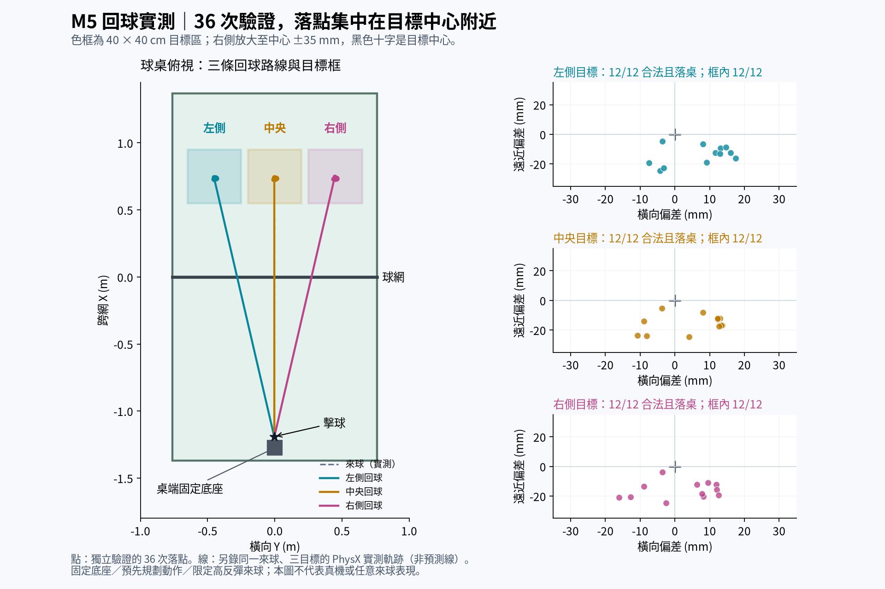

# M5：有速度的擊球與三目標 scripted 回球

日期：2026-11-16（America/New_York）。本階段驗證的是未標定、零旋、無摩擦的仿真模型；真機沒有運行。正式狀態見 [ROADMAP](../../.agents/docs/ROADMAP.md)，允收門檻見 [SPEC](../../.agents/docs/SPEC.md)。

## 1. M4之後還缺什麼

M4回答「球接下來在哪裡、什麼時間到」。M5要再回答「球拍應該怎樣動，才會把球送到目標」。原本的`Trajectory`在每個路點都停住；若把擊球點當成普通終點，球拍到達時速度是零，不能主動調整回球能量。

本次加入三個可分別驗證的部分：

- **有速度的擊球軌跡**：在指定時間到達指定關節位置，而且此時仍有指定關節速度；擊球後有完整減速段。
- **物理規劃器**：預測來球，反求落點需要的出球速度，再求拍面方向、法向速度及關節解。
- **三目標scripted基線**：先用同一名義來球，為三個目標各算一條軌跡；實際發球帶小幅擾動，測固定腳本是否仍能回球。沒有對驗證球逐球調參。

M3的保持球拍基線是0/4合法回球。M5另有版本化的高反彈來球分布，不能把兩組不同來球的成功率當成嚴格同條件消融。

## 2. 非零速度軌跡怎樣建立

入口：[trajectory.py](../../src/airbot_tt/trajectory.py) 的 `StrikeTrajectory`。

兩段路徑的邊界為：

```text
起點：q_start, qd=0, qdd=0
擊球：q_hit,   qd=qd_hit, qdd=0
終點：q_end,   qd=0, qdd=0
```

每段長度為T，令`u=t/T`，使用`q(u)=c0+c1*u+...+c5*u^5`。起點給出`c0=q0`、`c1=T*v0`、`c2=0`；終點的位置、速度和加速度形成3×3線性方程，解出`c3…c5`。速度和加速度要分別除以T、T²，不能把正規化時間的導數當成rad/s。

兩段共用擊球點的位置、速度、加速度，所以是C2連續；加加速度可以不連續，這裡沒有宣稱jerk受限。相較引入完整運動規劃依賴，這個解法可直接滿足明確的擊球時刻和狀態。Ruckig做過接口核對，但本次沒有安裝或複用它。

**只檢查三個端點不夠。** 有速度的五次曲線可能中途超越端點，甚至先往反方向移動。程式分別求位置／速度／加速度導數的實根，把區間內的極值點連同端點一起檢查；任何中段越界都拒絕。碰撞則沿實際曲線採樣，沒有用起終點直線取代它；採樣步距受峰值關節速度約束。這仍是離散碰撞檢查。

`sample(t)`保持舊控制器的`(q,qd,qdd)`接口，因此 [runtime.py](../../src/airbot_tt/runtime.py) 的逐步驅動仍送位置、速度及原有重力補償。沒有直接改寫關節位置來追軌跡，也沒有增加PD增益或驅動力矩。

## 3. 從目標落點倒推球拍

入口：[planning.py](../../src/airbot_tt/planning.py)。資料流是：

```text
名義球狀態 + 目標XY
 → M4預測己方反彈
 → 候選擊球時間的球位置p、入球速度v_in
 → 求能落到目標的v_out
 → 拍面法線n、法向速度u_n
 → IK得到q_hit
 → Jacobian求qd_hit
 → StrikeTrajectory檢查限位、速度、加速度及碰撞
 → 可執行路徑或具體拒絕原因
```

### 3.1 出球速度

`flight_state`以DOP853積分重力和三維二次阻力，不處理接觸；呼叫者在反彈處分段。`return_velocity`固定候選回球飛行時間，以無阻力拋物線作初值，再用`least_squares`調整三維初速度，使球心抵達目標桌面的`z=桌高+球半徑`。

數值解還要交回M4事件預測器：必須越網、不能先撞網／提前落桌，第一個落點要接近目標。解出某個時間的座標，並不自動代表中途路徑合法。

### 3.2 法線及法向速度

在目前無摩擦模型中，撞擊只改變球速的法向分量。令球拍接觸點速度為u、恢復係數為e：

```text
v_out = v_in − (1+e) [(v_in−u)·n] n
n     = normalize(v_out−v_in)
u_n   = (v_out+e*v_in)·n / (1+e)
```

TCP在拍面中心，想讓球心正對TCP，就把目標TCP設在`p−r*n`。所有球狀態用世界座標，IK先減去底座世界位置；底座沒有旋轉。TCP的Z軸是n，X軸沿所選拍頭方向，Y完成右手座標。

### 3.3 為何不指定完整六維速度

最初診斷強迫「球拍只沿n平移，角速度為零」，部分候選需要超過4 rad/s的關節速度；那是額外約束造成的成本。無摩擦、中心擊球真正需要的是`n·v_TCP=u_n`。

取`a=nᵀJ_linear`，解單一線性約束`a*qd=u_n`的最小範數解：

```text
qd = aᵀ*u_n / (a*aᵀ)
```

因此允許切向平移及角速度，由實際關節解決定，再檢查整段路徑。這不是忽略旋轉：碰撞測試使用`v_contact=v_TCP+omega×(contact−TCP)`，並量測真實拍面法線。若未來加入摩擦、切向衝量或旋轉球，這個單一法向約束就不足以描述擊球。

## 4. 為何現階段採三條預先規劃軌跡

完整IK加曲線碰撞預檢的診斷耗時約2秒，但來球約0.6秒後到達。不能停住模擬等CPU算完，再宣稱機器人有即時反應能力。

目前基線明確採**發球前準備、發球後選用**：

1. 共同準備姿態及名義來球在 [strike.json](../../configs/strike.json) 固定。
2. 每個目標只算一條路徑，共三條，保留準備耗時和拒絕原因。
3. 每次reset都回同一準備姿態；發球後等待50 ms。
4. 依目標選用已檢查路徑。`start_prepared_strike`再次核對模型、碰撞檢查器、採樣紀錄、靜止起點和速度上限，才交給原關節驅動。
5. 開發與驗證球帶擾動，但不以其精確狀態重新求軌跡。測試報告記錄腳本選用成本。

這是model-based scripted基線，不是在線重規劃。規劃器可以接受不同來球狀態，但其計算時限仍是未解決限制；接下來仍以PACE的reward、predictor與關節策略遷移為主線，M5保留作對照；不把規劃加速或技能庫擴展列為進入M6的前提。

## 5. 如何驗證，不靠影片猜測

入口：[tests/strike.py](../../tests/strike.py)，純數值測試在 [test_strike.py](../../tests/test_strike.py) 與 [test_planning.py](../../tests/test_planning.py)。

- **軌跡數值**：端點與擊球速度、C2連續、有限差分導數、內部超限、曲線撞障及多關節極值。逆向飛行另外對照無阻力解析解，不只用同一數值積分自證。
- **空揮拍**：先六組受限動作，再檢查實際三條script。TCP來自PhysX球拍剛體；用相鄰實測姿態差分取得線／角速度，而不是把指令或FK當作實測。擊球時間用實際關節穿過擊球態截面插值，要求小於兩個物理步。
- **移動拍撞擊**：短程發球在指定時間撞向實際揮動拍面。量測入球、接觸點速度、拍面法線與出球，對照相對速度公式；再比較240／480／960Hz的出球向量、接觸時間及真實落桌位置；最後一對未通過時追加1920Hz，選擇其後細化都合格的最粗步長。相對法向動能也由報告中的入／出球、表面速度及法線核對；5%速度容差對應平方後約10.25%能量容差，不能把移動拍增加的世界動能誤判為憑空產能。
- **合法回球**：沿用M3的事件規則，須己方反彈→拍面→合法過網→對方落桌。三目標使用同一發球集合；拒絕、漏接、故障均不能移出分母。正常運動禁止狀態寫入，底座保持固定。

空揮拍門檻在正式多關節試驗前固定：位置2 mm、方向0.02 rad、線速度0.03 m/s、角速度0.08 rad/s、時間2個步長、停止後0.01 rad/s。三條實際腳本的線速度誤差接近門檻，不能以此宣稱能任意加速。

## 6. M5現在做到哪裡？



**先看圖：** 左邊三條線是同一來球、三個目標的實際仿真回球路線；右邊把原本36次驗證的落點放大，每個點代表一次落桌。黑色十字是目標中心，色框是40×40 cm目標區。路線來自另錄的三次展示，落點統計仍使用原驗證集。

想看手臂實際怎樣動，可用下方命令錄製三個目標的仿真影片。影片按原本960 Hz物理步進、60 Hz取畫面，以四分之一速度播放；色框與橙色球心標記只供觀看，不改碰撞或球拍尺寸。三次展示的事件順序、位置與時間均與原驗證中對應來球完全一致。

```bash
./run.sh --headless --mode return-demo \
  --video .agents/runs/foundation/m5_visuals/m5_returns.mp4 \
  --report .agents/runs/foundation/m5_visuals/recording.json
python3 scripts/plot_m5_results.py \
  --validation .agents/runs/foundation/return_validation.json \
  --recording .agents/runs/foundation/m5_visuals/recording.json \
  --output doc/notes/images/m5_returns.png
```

繪圖需NumPy與Matplotlib；圖中的繁體字使用主機Noto CJK字型。原始報告及影片留本地，圖與重跑入口隨筆記保存。

**在這次限定來球中，手臂已能主動揮拍，把球送進左、中、右三個目標區。** 先用9次開發測試確認流程，再換一組來球做36次驗證，全部合法回球並命中目標框。

- **球拍能帶著速度經過擊球點。** 三條回球動作都通過空揮拍檢查，擊球時的位置誤差不到0.6 mm，時間誤差不到0.6 ms；擊球後也能減速停住。
- **落點平均離目標中心約2 cm。** 左、中、右目標各測12次，使用同一組來球，方便比較改變目標後的表現。每個目標框是40×40 cm。
- **原本的功能仍正常。** 31項數值測試、裸臂與固定球拍的FK／IK／軌跡／碰撞，以及M3單拍和M4同場景預測回歸都通過。

| 目標 | 合法回球且命中 | 平均落點誤差 | P95落點誤差 |
| --- | --- | --- | --- |
| 左側 | 12/12 | 18.21 mm | 24.30 mm |
| 中央 | 12/12 | 19.00 mm | 25.56 mm |
| 右側 | 12/12 | 18.89 mm | 25.42 mm |

P95用來看較差那一端的表現：這次各目標的95百分位誤差約為2.4–2.6 cm。

### 為什麼最後用了960 Hz？

**球拍動得快時，模擬每一步的時間必須夠短。** 我們用同一個撞擊案例，逐步提高物理更新頻率，檢查算出的出球和落點是否穩定。

- **480 Hz還不夠。** 換成960 Hz後，實際回球動作的落點仍改變約10.2–10.7 mm，超過事先訂好的10 mm門檻。
- **960 Hz通過檢查。** 再提高到1920 Hz，落點最大只差3.35 mm，出球速度向量差約0.57%，符合門檻。因此M5使用960 Hz。
- **這次踩坑的重點：靜止拍測過，不代表揮動中的拍也適用。** 低速揮拍和實際回球動作需要分別檢查，不能沿用之前的步長結論。

這個調整只套用於M5。M3／M4保留480 Hz，裸臂與固定球拍的Foundation測試保留240 Hz。

### 36次全中，能說明什麼？

**它證明這三條預先規劃的動作，在小幅變動的來球下可以可靠完成這組測試。** 要擴大到其他來球，還有幾個明確限制：

- **來球變化很小。** 這次是合成的高反彈球，橫向位置只變動±15 mm，高度±10 mm，速度也只作小幅擾動。低球、快球、強旋和大幅橫移仍未驗證。
- **目前靠預先規劃的三條動作回球。** 每條完整規劃要約1.8–2.0秒，比來球約0.6秒的時限長，所以先算好，再於發球後按目標選用。即時根據新來球重算動作，仍未完成。
- **速度追蹤已接近目前門檻。** 實測最大線速度誤差約29.2 mm/s，允收值是30 mm/s。若要再加速，必須重新驗證控制能力。
- **結果仍屬仿真。** 球與拍的物理係數尚未實測標定；本階段沒有做PPO、模仿學習或真機擊球。

三個目標共用12個不同來球，因此36次試驗不等於36個獨立來球。這裡的100%是這組小型測試的結果，不能當作一般來球的成功率。

### 查數據與重跑測試

上面保留影響判斷的結果；需要核對精度、失敗案例或重跑時，再看以下資料。

<details>
<summary>完整量測、測試條件與報告位置</summary>

**控制精度**（三條實際回球動作的最大誤差）：

| 項目 | 實測 |
| --- | --- |
| TCP位置 | 0.579 mm |
| TCP方向 | 0.00136 rad |
| TCP線速度 | 29.22 mm/s |
| TCP角速度 | 0.0714 rad/s |
| 通過擊球截面的時間 | 0.577 ms |

較早的開發檢查曾量得約0.56 mm／28 mm/s；上表採最終960 Hz結果。六組基礎空揮拍、恢復停止、固定底座及正常運動禁止直接狀態寫入的檢查均通過。

**步長與碰撞的負結果：**

| 測試動作 | 頻率比較 | 最大差異 | 判定 |
| --- | --- | --- | --- |
| 低速揮拍 | 240→480 Hz | 反向揮拍出球2.30%、落點11.6 mm | 未通過 |
| 低速揮拍 | 480→960 Hz | 出球約0.98%、落點4.5 mm | 通過 |
| 實際回球動作 | 480→960 Hz | 落點10.2–10.7 mm | 未通過 |
| 實際回球動作 | 960→1920 Hz | 出球0.57%、落點3.35 mm、接觸時間1.042 ms | 通過 |

四個步長的相對法向能量與碰撞公式最大差約1.33%。過程沒有調整恢復係數來貼合測試，也沒有放寬允收門檻。

**測試條件：** 名義球位置(0.5,0,2.2)m、速度(−3.3,0,−1.4)m/s；Y位置±15 mm、Z位置±10 mm、X速度±0.02 m/s、Z速度±0.01 m/s。三目標中心為(0.75,−0.45)、(0.75,0)、(0.75,+0.45)m。每目標12/12的95% Wilson區間約75.8%–100%。

**計算耗時：** 每條名義軌跡準備1.78–1.99秒；發球後選用已算好的軌跡最多0.108 ms。後者不包含規劃成本。

**保留的工程條件：** 固定件、球拍、247 g質量近似、安裝TCP及桌端固定位置均不變。M5新增獨立準備姿態與運動設定；原M3／M4回歸已完成。未重錄影片，也未重跑未變更的靜態CAD拍面測試。

**錄影時的踩坑：** 曾嘗試直接替物理物件綁定顯示材質，出現球的水平運動與基線不符；此做法已移除，未把該影片當成功結果。最後保留物理物件原材質，只著色獨立目標線，並在畫面上疊加實測球心標記。三個案例逐事件回歸的位置／時間差均為0，17.2秒影片共258幀且完整解碼通過。

**來源界線：** 新文獻讀取曾遇SSL失敗。本次採自行推導的五次曲線與無摩擦碰撞關係；文獻閱讀與採用狀態見[SOURCES](../../.agents/docs/SOURCES.md)。

**本地報告：** `.agents/runs/foundation/` 下的 `return_development.json`、`return_validation.json`、`impact_{240,480,960,1920}.json`及`impact_convergence.json`。低速和480 Hz失敗保留於`impact_low_speed/`、`impact_480_failure/`。報告含來源雜湊、執行識別碼及退出碼；命令見[README](../../README.md)。

最終回歸包含31項數值、六組空揮拍、裸臂9項、固定球拍10項及原單拍9項，全部通過且退出碼為0。實作發布紀錄見[ROADMAP](../../.agents/docs/ROADMAP.md)；本地計畫及原始報告不推Git。

</details>
