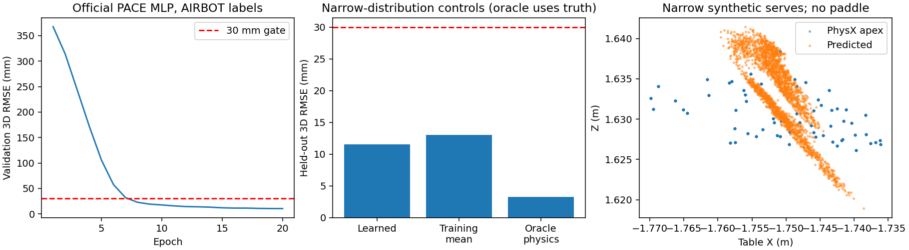

# M6：我們準備了什麼，機械臂又還沒學到什麼？

2026-11-19。**M6是在準備機械臂學習打球時需要的兩種工具：一個幫它預測球會去哪裡，一個幫它評分。**

這輪確實訓練了一個小神經網路，但它學的是「預測球的位置」。機械臂如何揮拍，還沒有開始學。

先讀前面的過程與例子，就能理解M6；想對照程式、參數和測試，再看後面的技術細節。這裡的測試都是仿真或離線程式測試，沒有操作真機。

## 1. M5已經可以回球，為什麼還要M6？

M5是在限定來球下，事先用數學模型算好揮拍軌跡，讓機械臂照著執行：

```text
預測來球 → 算出需要怎樣擊球 → 求關節軌跡 → 機械臂執行
```

接下來研究的PACE，希望讓一個「策略網路」根據觀測，自己選擇關節動作。策略網路可以先理解成：輸入眼前情況，輸出這一步怎樣動手臂的程式。

但策略最初什麼都不會。如果只告訴它「成功回球才有分」，它可能試很久都碰不到球。因此PACE提供一些學習幫助：

- **預測提示**：球接下來可能到哪裡？
- **擊球引導獎勵**：拍子有沒有朝有用的位置準備？
- **回球引導獎勵**：打出去的球，方向和落點是否合理？

M6先把這些工具準備好、檢查清楚。**M7才會讓策略使用它們學揮拍。** 本輪沒有改M5的控制、工具安裝、247g質量近似或既有球物理係數。

## 2. 第一步：讓球飛起來，收集資料

這輪採集場景有球、球桌和球網，沒有球拍介入。因為我們要觀察：**球如果沒有被提前打走，反彈後最高會到哪裡？**

```text
發球 → 球飛行 → 在己方桌面反彈 → 上升 → 到達最高點
```

最高點的英文叫 **apex**，後面的程式與資料會用到這個名字。

仿真引擎PhysX以960Hz計算物理，也就是每秒更新960次球的運動。預測網路不需要全部960筆資料，因此每隔20個物理步取一次球位置：

```text
960 ÷ 20 = 每秒48次位置觀測
```

最終資料分成三組。三組使用不同發球，不能把同一球的前半段放訓練、後半段放測試。

| 資料 | 發球數 | 用途 |
| --- | --- | --- |
| 訓練集 | 128 | 用來教網路 |
| 驗證集 | 32 | 檢查學習情況、選模型 |
| 獨立測試集 | 64 | 最後驗收，不參與訓練或選模型 |

這些球沿用M5的窄分布：位置與速度只有小幅變動。先在容易控制的範圍內驗通流程，不代表已涵蓋各種快球、低球或旋轉球。

## 3. 第二步：用物理教師準備參考答案

**物理教師，就是用已知物理公式替網路準備參考答案的程式。**

它知道球目前的位置、速度，以及是否已在己方反彈，然後用M4的模型考慮重力、空氣阻力和桌面反彈，計算：

> 這顆球反彈後的最高點在哪裡？還要多久到達？

輸出除了XYZ位置和剩餘時間，還有「是否有效」。例如球已經過了最高點、已被打回對方、會撞網，或沒有在己方合法反彈，就不能隨便編一個點讓網路學。

對應程式是[pace_guidance.py](../../src/airbot_tt/pace_guidance.py)裡的`apex_teacher()`，它呼叫既有`predict_ball()`。無效時以`valid=False`表示；零座標只用來占位，不參與獎勵或監督訓練。

教師也不一定完全準確，因此我們**另外觀察PhysX中真正發生的最高點**，檢查教師算得有多準。實際位置由球的垂直速度從正變負時，相鄰樣本插值取得，不把教師自己的答案當真值。

結果，教師的位置誤差P95約5.6mm，時間誤差P95約2.2ms。P95可以先理解為：這批有效樣本中，約95%的誤差沒有超過這個數值。

這裡已經有一項原版差異：我們使用本機球物理與有效apex，沒有PACE原碼中人體專用的X裁切或機身附近備用點。也沒有偷偷把最高點改成機械臂最容易到的位置。

## 4. 第三步：訓練predictor，只看五個位置就猜最高點

物理教師知道目前速度，但predictor不直接取得仿真真值速度。我們讓它從連續位置中學習運動趨勢。

每次輸入最近五筆位置，最老的在前面：

```text
第1筆：X₁、Y₁、Z₁
第2筆：X₂、Y₂、Z₂
第3筆：X₃、Y₃、Z₃
第4筆：X₄、Y₄、Z₄
第5筆：X₅、Y₅、Z₅
```

五筆，每筆三個數字，共15個輸入。輸出只有三個數字：預測最高點的X、Y、Z。

直接使用的PACE官方小網路長這樣：

```text
15個輸入 → 64 → 64 → 3個輸出
```

中間的64是網路內部特徵數，不是關節數或發球數。這種小型全連接神經網路叫MLP；不需要先學懂它每一個權重，就能理解本輪在教它什麼。

一次學習的過程是：

```text
五個球位置 → 網路猜最高點
                    ↓
          與物理教師的答案比較
                    ↓
              計算預測誤差
                    ↓
           調整網路內部的參數
```

我們用的損失叫MSE（均方誤差）：猜錯越多，損失越大；訓練調整參數，讓下次的答案更接近教師。

**這裡沒有控制機械臂，也沒有用回球成功率訓練網路。學習目標只有預測最高點。** 這叫監督學習，因為我們為每筆輸入準備了參考答案。M7的PPO才會根據動作之後得到的獎勵來學習策略。

五筆位置首尾相隔約83ms。一組五筆資料稱為一個「窗口」。同一球可以產生很多窗口，但不能把上一球結尾與下一球開頭拼在一起，否則就像球突然瞬間移動。`windows()`負責這項檢查，也會排除缺樣、時間不連續及沒有有效教師的窗口。

窗口可以跨一次真實反彈，因為那仍是同一顆球；它不能跨發球重置。

## 5. 同時準備另一項工具：怎麼給打法評分？

先分清兩個功能：

| 工具 | 回答的問題 |
| --- | --- |
| Predictor | 球反彈後的最高點可能在哪裡？ |
| Reward（獎勵） | 目前準備位置或這次擊球，應該得到多少分？ |

M6已寫好引導評分函式，但**還沒有讓揮拍策略用這些分數學習**。以下是評分程式的例子，不是策略已學出的動作。

**接球前：拍子是否靠近引導點？**

TCP就是我們選定的球拍參考點，可先理解成拍面中心。TCP距引導點30cm時，原始分數約0.30；距15cm時約0.55。因此這項分數鼓勵策略提前把拍子移向相關位置。

原公式在15cm內有一個平台：距10cm不會比15cm獲得更多這一項分數。靠近引導點也不等於真的碰到球。

**離拍後：預測落點是否接近目標？**

概念是：`落點分數 = 3 − 落點到目標的距離（m）`。

誤差10cm時原始分數約2.9；誤差50cm時約2.5。同樣打到球，預計落得更接近目標的打法會得到更高分。

**離拍後：預測過網高度是否接近期望值？**

原PACE配置把球心高度1.11m作為這一項的目標。越接近，分數越高；它是評分偏好，不代表每一種來球都應該這樣打。1.11m也不是「球高出球網1.11m」。

落點／過網在球有效離拍後評一次，不能讓球在接觸區停留幾步就重複領分。`ReleaseLatch`負責記住接觸與離開，只觸發一次；超時或合法性失效就取消。

真正「球是否合法回到對方桌面」，仍由既有`ShotEvents`根據物理事件判定。**預測得分高，不能取代實際合法回球。** 離拍接口目前只做了合成測試，還沒有串進可動機械臂RL環境。

## 6. 為什麼還做了接口和存檔？

模型算對了，使用它的程式也可能接錯。例如，程式先把舊觀測交給策略，再更新prediction，策略就會晚一步才看到提示。

我們補的hook可以理解成接線接口，保證順序是：

```text
收到本次球位置 → 更新五筆歷史 → 算本次預測 → 放進本次觀測
```

`PredictionHook.observe()`管理每個仿真環境的歷史；某個環境重置，只清它自己的資料。`actor_frame()`把關節資料、球觀測和本步預測組裝成未來策略可讀的單幀資料。

這是準備好輸入，還沒有建立或訓練actor。actor是將來「根據情況選動作」的策略網路；critic是訓練時評估狀態價值的網路，兩者都留在M7。

Checkpoint就是模型存檔。除了參數，還要記住有沒有訓練過、更新多少次、用哪份設定和球物理參數。否則，一個沒訓練過的隨機網路，讀回後可能被誤認為已經可用。

做這些檢查，是為了讓M7遇到問題時，能分清楚是策略學不好，還是資料根本沒有正確送進去。

## 7. 最後測到了什麼？

64次獨立測試發球，共產生2,341個有效窗口。每球在不同時刻可以預測多次，所以這不是2,341次獨立發球。

預測最高點的3D RMSE為 **11.6mm**，通過原定30mm門檻。RMSE是一種整體誤差指標，較大的錯誤會受到更重的計算權重；不表示每次都只差11.6mm。



讀圖時可以按左到右看：

- **左圖**：隨訓練進行，validation誤差下降；紅線是30mm門檻。
- **中圖**：網路、永遠猜訓練平均點，以及知道真值速度的物理教師。最後一個資訊更多，只作參考。
- **右圖**：藍點是實際最高點，橙點是網路在不同時刻作出的預測。範圍只有幾公分，因此圖上的差異被放大了。

第一次其實失敗了，驗證誤差約54.5mm。我們根據訓練／驗證結果調整批次大小，增加小資料集的參數更新次數，沒有換網路或放寬門檻。最後用新的一組獨立發球驗收；首次失敗有保留，細節放在後面。

## 8. 比「通過」更重要的兩個發現

**第一：這批球太相似，簡單猜測也很好。**

如果什麼位置歷史都不看，永遠猜訓練集的平均最高點，誤差也只有13.0mm。

```text
網路：11.6mm
永遠猜平均點：13.0mm
```

網路有改善，但差距不大。這不能證明它能處理陌生的快球、低球或旋轉球。若只報11.6mm，不放這個簡單對照，很容易把結果看得過於樂觀。

此外，在不跨反彈的窗口，用位置估速度再做物理預測，比這次MLP更準。跨反彈時速度突然改變，簡單估速法才會嚴重失準；不能只看整體平均就說網路全面勝過物理模型。

**第二：預測最高點很準，但機械臂可能到不了那裡。**

這64球的實際最高點到機械臂底座約0.982～1.004m，而TCP距離底座的保守幾何上界約0.944m，因此全部都在上界外。

這個上界是把六個URDF關節原點平移長度和link6到TCP長度相加，依三角不等式得到；連關節限制和碰撞都還沒考慮，所以實際可達範圍只可能更小。這不是單純IK求解失敗。

於是研究問題變成：

> 我們準確預測了一個機械臂無法精確到達的點，用它引導策略，究竟有沒有幫助？

現在還不能說一定沒用，因為接球引導有15cm平台，容許接近而不必完全重合；但也不能說有效，因為還沒做策略學習。

我們保持原定apex教師與全部發球，沒有擅自換成可達點。M7先用對照實驗檢查引導效果；如果確實無效，再把「可達擊球點」當獨立改良研究。

## 9. M6完成後，我們手上到底有什麼？

可以想像我們準備教一個人打球。M6做的是：

- 準備一個能說「球大概會升到這裡」的預測工具。
- 準備一套「準備位置好不好、打出去的方向好不好」的評分規則。
- 檢查提示、分數和模型存檔可以正確傳遞。

**還沒有開始讓這個人反覆練習，學會怎樣揮拍。那是M7。**

因此，M6完成的是離線教師、引導reward、官方predictor與接入接口。完整六軸RL環境、actor／critic、五幀策略歷史、GPU批量教師、在線訓練排程及真機部署都尚未完成。48Hz也只完成這輪觀測／預測驗證，不能直接說已適合高速機械臂控制。

## 10. 想對照程式或重跑時，再看這裡

| 想找什麼 | 程式入口 | 主要看什麼 |
| --- | --- | --- |
| 物理答案、評分 | [pace_guidance.py](../../src/airbot_tt/pace_guidance.py) | `apex_teacher`、`return_teacher`、`guidance_rewards`、`ReleaseLatch` |
| 五點資料、MLP、接口、存檔 | [pace_predictor.py](../../src/airbot_tt/pace_predictor.py) | `windows`、`Predictor`、`PredictionHook`、`actor_frame` |
| 真正的仿真資料 | [pace_m6.py](../../tests/pace_m6.py) | PhysX發球、48Hz取樣、實測apex |
| 訓練和最終評測 | [verify_m6.py](../../scripts/verify_m6.py) | 先validation選模型，再開held-out；基線與分段診斷 |
| 集中設定 | [pace.json](../../configs/pace.json) | 頻率、分割、batch、epoch、獎勵參數與驗收門檻 |

下面保留精確參數和踩坑，方便之後追溯；不需要第一次閱讀就全部記住。

<details>
<summary>官方來源與為什麼不照搬整個runner</summary>

[prepare_pace.py](../../scripts/prepare_pace.py)依[來源清單](../../configs/pace_sources.json)下載固定commit缺少的文字原檔並逐檔驗SHA256，保留MIT／BSD授權。已有來源若被改過直接報錯，不覆寫。

[pace_predictor.py](../../src/airbot_tt/pace_predictor.py)的`original_mlp()`校驗來源後，直接載入官方runner模組裡的`_MLPPredictor`。沒有另抄一個相同MLP，也沒有將actor／critic搬進來。若程序已import另一版`rsl_rl`，明確拒絕混用。

本機新增的是AIRBOT需要的資料窗口、訓練／推論接口與checkpoint契約。原runner曾確認跨reset取樣、晚一步回填與未訓練flag遺失；這些問題由本機測試阻止，不修改上游原檔。

官方Isaac Lab2.1 wrapper接收`policy`／`critic`觀測，並將terminated與truncated合成done；其timeout欄位還取決於finite-horizon設定。它不會自動解決本工程的terminal observation與teacher時序，因此完整接合仍須在M7實測，不能只換21→6就開始長訓練。

</details>

<details>
<summary>資料分布、訓練參數與首次失敗</summary>

本次名義位置(0.5,0,2.2)m、速度(−3.3,0,−1.4)m/s；Y位置±15mm、Z位置±10mm、X速度±.02m/s、Z速度±.01m/s，都是未標定的合成來球。

| 分割 | seed | 發球數 | 有效窗口 |
| --- | --- | --- | --- |
| 訓練 | 6101 | 128 | 4,680 |
| 驗證／選模型 | 6102 | 32 | 1,176 |
| 最終獨立測試 | 6104 | 64 | 2,341 |

測試原始2,624筆取樣中，283筆無法形成有效窗口，包含每球初始不足五筆及末端無有效教師。64個發球都進入評測；報告另外保留逐serve誤差。

網路與原PACE相同：15→64→64→3，兩層ReLU。只使用獨立Adam（lr=5e-4）和XYZ平均MSE；沒有額外輸入真值速度、teacher或phase。小資料集最終採batch32、20個epoch，以validation挑checkpoint；這不是原PACE4096環境的20輪在線更新復現。

第一次batch128、同樣20epoch時，validation仍有約54.5mm，未過30mm。原因從學習曲線看是仍在收斂，不是教師標籤超差；改小batch增加每epoch的optimizer steps，沒有換模型或降低門檻。最終validation約10.5mm。

初版評測程式在開發門檻失敗後仍讀了seed6103的held-out，這份結果因此退役為失敗證據。已修正為**validation不過就停止、不開held-out**；最終另用6104，沒有拿6103調成績後仍稱它獨立。首次報告、checkpoint、測試資料與log留本地`m6/initial_failure/`。

這次沒有使用完整8GPUh預算，MLP在既有容器CPU執行。predictor初始化與shuffle使用隔離RNG，不改日後PPO的隨機狀態；optimizer清梯度後才推論，回傳tensor不帶梯度。

</details>

<details>
<summary>獎勵公式、權重與原PACE的差異</summary>

`guidance_rewards()`分開回傳raw（原始分數）、weighted（乘權重／時間尺度）及total。距離均用m。

| 引導 | 原始公式 | 具體例子 |
| --- | --- | --- |
| 接球位置 | `exp(-max(distance, 0.15)/0.5²)` | 10cm與15cm均0.5488；30cm為0.3012 |
| 落點 | `3 - ||landing_xy-goal_xy||` | 目標(0.75,0)m，誤差10cm時raw=2.9 |
| 過網 | `exp(-abs(net_z-1.11)/0.4)` | 球心Z=1.11m時raw=1 |

接球項乘權重2與實際dt=1/48。落點和過網事件保留原單次`weight×.02`尺度，權重分別60和100；上述落點例子貢獻3.48分，完美高度貢獻2分。遠於3m的落點可為負分。無有效落點／過網預測時return引導為0並保留原因，不把占位值補成目標。

`return_teacher()`以本機三維阻力模型求離拍後落點／過網；原PACE過網函式用無阻力近似。本輪保留獎勵形狀，不宣稱完全相同教師。`ReleaseLatch`只在合法接觸結束且球相對TCP沿法線離開時評分，超過50ms或合法性失效即取消。

</details>

<details>
<summary>完整誤差、噪聲診斷與同資訊比較</summary>

主指標是`3D RMSE = sqrt(mean(||prediction - PhysX_apex||²))`。訓練MSE先對XYZ平均，開根不等於這個3D指標；筆記與驗收都用同一定義。

| 方法／檢查 | 最終結果 | 解讀 |
| --- | --- | --- |
| Learned predictor | RMSE **11.6mm**；P95 **19.6mm** | 通過30mm門檻 |
| 永遠預測訓練教師平均點 | RMSE **13.0mm** | 分布很窄，簡單常數也很好；MLP優勢有限 |
| 真值速度物理教師 | 同窗口RMSE **3.3mm** | oracle參考，不是可部署同資訊基線 |
| 教師全部有效取樣 | P95位置 **5.6mm**、時間 **2.2ms** | 通過20mm／10ms門檻 |
| 2mm合成位置噪聲 | learned RMSE **11.9mm** | 診斷，沒有重訓 |
| 7mm合成位置噪聲 | learned RMSE **15.0mm** | 不是Gemini實測噪聲 |
| 一個策略步感知延遲 | learned RMSE **11.6mm** | apex目標本身不變，不代表控制延遲沒有代價 |

同資訊基線用同五個位置做因果二次曲線擬合估計末端速度，再做物理預測；等速基線用相同歷史推算出的事件時間直線外推，不偷用真值apex時間。它們在共同2,341個窗口上都有輸出，覆蓋率100%。等速法不建模重力與反彈，在apex任務上很弱；通過「優於等速」只是原定基本門檻。

**不能只看物理基線的整體誤差就說MLP更準。** 分段後：

| 窗口 | 數量 | Learned RMSE | 估速＋物理 RMSE |
| --- | --- | --- | --- |
| 反彈前 | 1,123 | 11.4mm | **5.8mm** |
| 五筆跨反彈 | 242 | **12.1mm** | 1,048.8mm |
| 反彈後、不跨反彈 | 976 | 11.6mm | **2.3mm** |

二次曲線跨速度跳變會嚴重估錯；非跨反彈窗口，物理法反而更準。分段只用真值作事後診斷，沒有將真值phase塞進基線或MLP。更好的反彈辨識／估速器可以改善基線，但這輪沒有以它取代PACE主線，也未宣稱現有基線代表最好的狀態估計。

</details>

<details>
<summary>Hook、checkpoint與重跑命令</summary>

`PredictionHook.observe()`每環境維護五筆可觀測位置；serve_id改變、缺樣或時間間隔不符就清該環境。先算prediction再回傳，`actor_frame()`直接把本步的3D＋valid接到23維基礎欄位後，得到27維。無predictor版本實際為23維。歷史輸出不會被下一次呼叫原地改寫。

這裡驗證單幀欄位和同一步時序，尚未建actor網路或宣稱在PhysX控制迴圈使用它。測試用實測held-out序列逐步重播hook，與批次predictor一致。API不接收teacher／真值速度；後續部署感知來源仍待接入。

Checkpoint保存網路、Adam、trained、更新數、predictor RNG、完整設定及官方來源／球參數hash。未訓練存檔載回仍不可用；配置或來源不相容直接報錯，不吞例外後悄悄停用。每輪最多20次fit更新有明確上限。

```bash
# 倉庫根目錄；需要既有Isaac映像與GPU供PhysX採集
./verify_m6.sh --collect .agents/runs/foundation/m6/new_trial

# 已有匹配的本地資料時：校驗來源與資料，再跑單元／訓練／獨立評測
./verify_m6.sh --reuse-data .agents/runs/foundation/m6/new_trial
```

主入口先執行官方來源下載／校驗，再透過既有`run.sh --mode pace-data`採集，沿用run token與程序退出碼判定。獨立CPU訓練入口為`scripts/verify_m6.py`；不是PPO入口。參數集中於[pace.json](../../configs/pace.json)，資料與模型不入Git。

本地結果：`.agents/runs/foundation/m6/collection.json`、`dataset.json`、三份NPZ、`validation.json`和`predictor.pt`。圖由同一驗證程式生成，倉庫只留一張代表圖；首次失敗單獨保留必要證據，不累積逐幀圖片。

</details>

## 11. 驗證範圍

- M6八項契約測試通過：教師有效性、獎勵算例與時間尺度、離拍只評一次、窗口邊界、官方網路更新、checkpoint、RNG隔離及hook／actor frame。
- 物理／運動／PACE相關測試使用Isaac容器；相機測試使用既有相機venv。根分割區滿時改用本地runs下TMPDIR；不能把容器缺Orbbec SDK造成的錯誤當相機程式回歸。實際完成數與退出狀態見ROADMAP。
- 本輪PhysX只重新跑M6球軌跡，未重跑未改動的完整裸臂／工具影片或M5三目標回球；沒有新增真機結果。

M6證明離線教師、公式、MLP與接入契約可用。下一個需要回答的問題是：六軸策略真的用到這些資訊後，能否學會打球？這屬M7，需要向量環境、真實動作接口、timeout與terminal observation整合、控制與吞吐測試，再開始PPO。GPU教師與在線近期buffer排程也在該整合階段處理，不能把這輪CPU離線驗收當作已完成。

### 研究流程補充（2026-11-19）

訓練與評測已可分階段執行，重畫圖改用 `scripts/plot_m6_results.py` 讀既有 JSON，無須重新訓練。新結果存新的輸出目錄，原 M6 證據不覆蓋。操作與回歸範圍見[研究流程筆記](research_workflow.md#5-已落地m6-訓練評測畫圖分離)。本次沒有調整 MLP、資料分布或驗收門檻。
