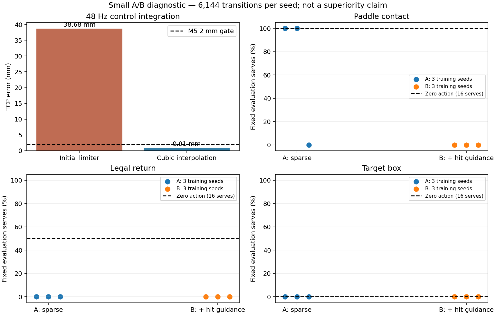
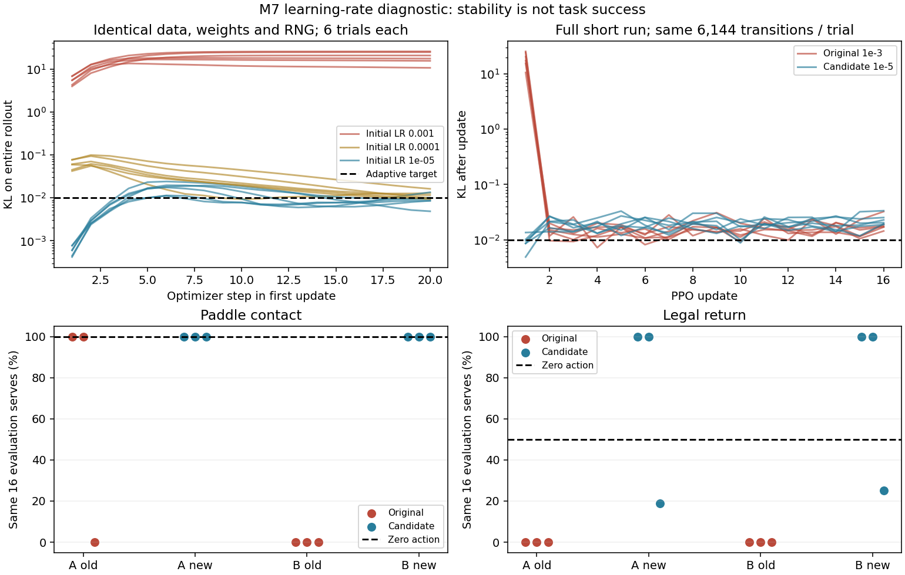
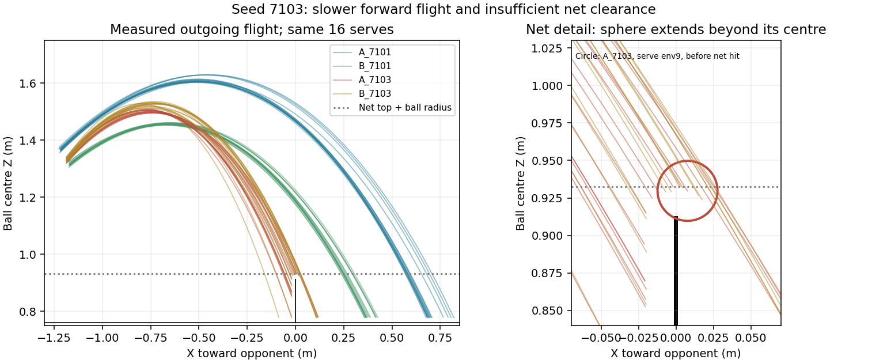
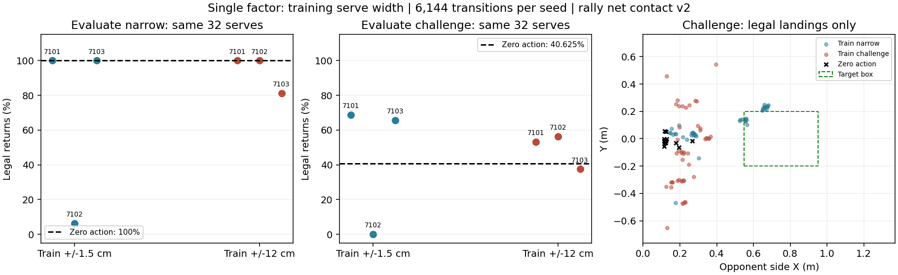
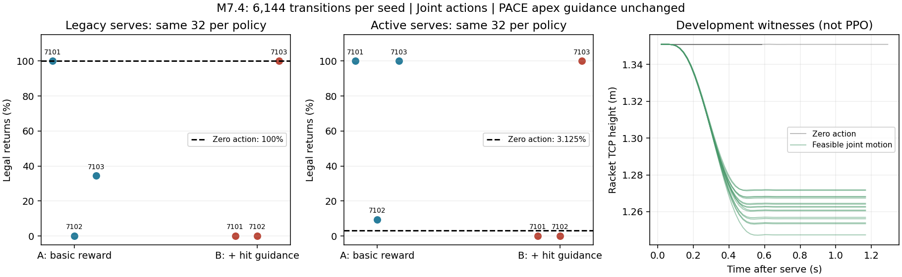
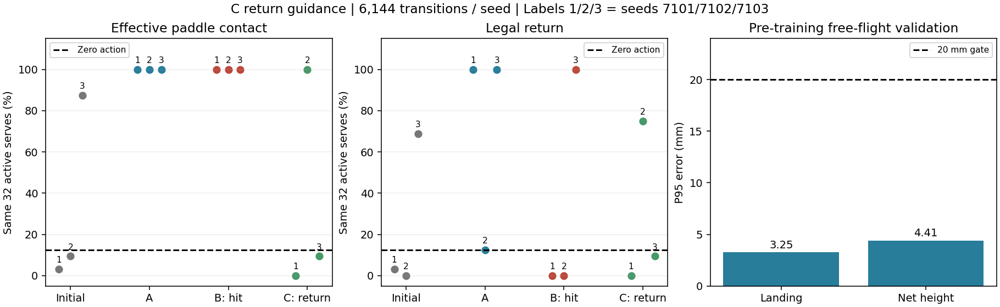
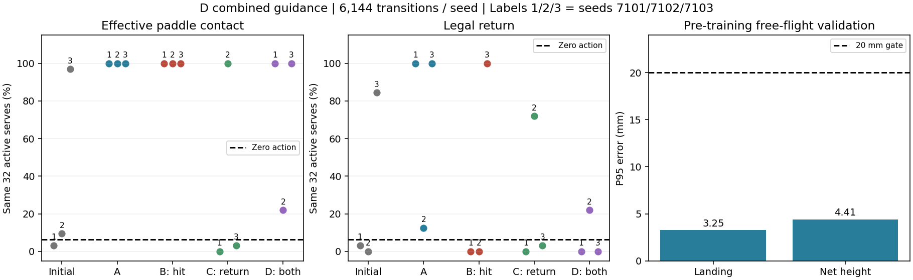

# M7：把環境接到 PPO，再檢查引導是否有用

M6 教會我們怎樣預測、怎樣計分；M7 才開始讓策略用自己的動作與環境互動。目前已完成 M7.1–M7.3 整合，並推進 M7.4 的 A／B／C／D 短對照，尚未完成五組正式研究。

最新進度：E的新Z=2.3m資料與接口驗證見[E predictor筆記](m7_predictor.md)。離線MLP達10.88mm，真向量與runner接口通過；後續20次資格診斷仍只得到20–37次optimizer更新，validation誤差1.28–1.88m，不能沿用離線精度。batch32及資料交叉診斷（E筆記§8–9）已完成：在線32仍有自身buffer擬合不足與後段覆蓋差異；離線模型在在線buffer約10mm，座標／快照核對通過。E-frozen為下一優先提案，尚未實作；正式配置不變。尚未進行D/E三seed效用對照，第16節保留D負結果。

2026-11-21新增[DeepMind資料可行性審查](deepmind_feasibility.md)：完整資料分布與零旋近似篩選已完成，343候選中找到8個動態接觸腳本，但沒有合法回球。保留接觸診斷案例，沒有替換M7人工分布或增加PPO預算。

新增[同球動作對照](motion_comparison.md)：固定原M5 validation_0重播M5／zero／A7101／B7101，量測拍面、拍速及實際落桌，附圖與本地0.25倍慢放。A合法但未命中中央框，B碰拍時退讓而落回己方；這是單球展示，沒有新增訓練或E-frozen。

## 1. 這次要解決什麼

先回答「訓練鏈是否正確」，再回答「引導是否幫忙」。順序是：

1. 建立多份互不干擾的機械臂／球桌／球環境。
2. 確認六維 action 經驅動，確實能做出已知可行的動作。
3. 用官方 PPO 收集資料、更新 actor／critic，保存及重載模型。
4. A 不加 hit guidance；B 加同一個 apex 距離獎勵，其他條件相同。

A／B 測的是**獎勵引導**，不是 MLP 是否有用。兩組 actor 都沒有 predictor 欄位，沒有載入 M6 checkpoint；D／E 的預測提示比較留在後續。

## 2. 環境怎樣變成可以訓練

[pace_env.py](../../src/airbot_tt/pace_env.py) 使用固定版本 Isaac Lab 的 `InteractiveScene` 複製場景。各環境有自己的球、關節狀態、接觸、發球亂數、時鐘及觀測歷史；碰撞群組隔離。位置先扣除各環境的 origin，否則同一個姿態放在第二張桌上，網路會誤以為球跑遠了。

資產沒有重新畫一套：沿用原 URDF、固定件／球拍、247 g 質量近似、TCP 與驅動設定。`runtime.configure_racket_colliders` 是舊單環境與新環境共用的工具建構；`BallTestbed` 補上場景路徑參數，球桌、球網與球的物理設定仍共用。

事件由 [TensorShotEvents](../../src/airbot_tt/pace_control.py) 在 tensor 上批量處理，並與原 `ShotEvents` 對照：己方先反彈 → 合法拍面接觸 → 過網 → 對方首次落桌。撞柄、fixer、手臂、球網等不當成成功；接近球不等於碰球。

一個策略步的資料流：

```text
115 維 actor 觀測 → 六維抽樣動作 → 限制與插值 → 20 個 PhysX 子步
                                    ↓
                        接觸／事件／分項獎勵
                                    ↓
                    保存末態觀測 → 局部 reset
                                    ↓
                    原版 storage → GAE → PPO
```

actor 每幀 23 維、5 幀共 115 維：關節位置差、關節速度、前動作、球位置、量測 valid 和 age。critic 每幀 40 維、5 幀共 200 維，另外可看真值球速度、教師點、TCP、任務階段等訓練特權。actor 沒有偷看 critic。

目前是同步、無噪聲的仿真觀測。影像偵測、相機延遲、缺樣及在線 predictor 仍未接入。

## 3. 控制整合實際踩到的坑

**M5 能成功，不代表把 M5 位置直接送給新 action 就會成功。**

初版把每個位置目標當成需要靠近並煞停的目的地。M5 卻需要連續通過擊球點，帶著指定拍速走過去。兩種介面的意思不同。

實測直接重播，在 48 Hz 下產生約 **38.7 mm** TCP 位置誤差；即使提高到 960 Hz，仍約 **27.8 mm**。這表示主因是指令處理，而不是 PPO、apex 或單純取樣頻率。

曾檢查煞車距離補償及局部動作擬合。它們沒有讓原定 48 Hz 達到原 M5 門檻；未把失敗抹掉，也沒有把策略悄悄改成 960 Hz。這些補償未留在生產控制器。

現在 [PositionCommand](../../src/airbot_tt/pace_control.py) 把 action 解讀為**本策略區間結束時要求的位置**：

\[
q_{request}=q_{nominal}+s\odot clip(a,-1,1)
\]

用目前指令位置／速度作起點，從最近三筆位置要求估計終點速度，建立三次插值。每個 960 Hz 子步再限制速度與加速度，經驅動施加；不直接改機械臂狀態。

這裡的三次曲線是低階指令平滑，不是 M5 規劃器。訓練時 actor 仍只輸出六個數字，不會取得已知軌跡、IK 或未來擊球答案。

M5 中央擊球軌跡經此接口，在原 48 Hz 設定下通過原驗收：位置約 **0.91 mm**、線速度約 **24.8 mm/s**、時刻約 **0.58 ms**。尺度目前是各軸 0.6 rad 候選包絡，已確認中央軌跡最大 residual 約 0.33；不代表整個 action 空間都無碰撞，隨機動作仍由物理接觸與故障終止。

## 4. 怎樣避免「重置後的球」污染上一球

例如球因時間用完而結束，critic 應評估的是**舊球結束時的狀態**，而不是重置後又出現的新球。

因此環境先計分、保存 `terminal_actor`／`terminal_critic`，再只 reset 已結束的環境。每一步重新產生 terminated／truncated。

- 真正失敗或成功：`terminated`，不補未來價值。
- 本輪 timeout 按既定計畫視為人工截斷：`truncated`，補 `gamma × V(terminal_critic)`。這是所選任務語義，不可無條件外推到其他任務的自然截止。

[train_pace.py](../../scripts/train_pace.py) 在呼叫官方 `process_env_step` 前補一次末態價值；不傳原版 `time_outs` 欄位，避免原版再用舊 value 補第二次。測試把終止與截斷放在同一批，核對真正進入官方 storage／returns 的值。

Gaussian 的原始動作及 log probability 存進 PPO；環境的 action clip 是另外一個明確轉換，不把限幅後的動作冒充原抽樣值。

### PPO 更新實際發生在哪裡

薄接合的核心流程可以對照這幾行理解：

```python
action = algo.act(obs, critic)       # 保存舊觀測、原始動作、log_prob 與 V
obs, critic, reward, done, info = env.step(action)
value = policy.evaluate(info["terminal_critic"])
corrected = bootstrap_timeout(reward, value, info["truncated"], gamma)
algo.process_env_step(corrected, done, {})
# 收滿 24 個策略步之後：
algo.compute_returns(critic)
losses = algo.update()
```

16 個環境 × 24 步，形成一次更新的 384 筆 transition。官方 storage 用 reward、value 和結束遮罩算 returns／GAE；actor 調整動作機率，critic 擬合回報。PPO 每次做 5 epochs、4 minibatches，並限制機率比的變化。保存的是收集時真正使用的觀測，更新時不重新生成舊觀測。

例如某個動作最後導致錯誤反彈，它可能仍拿到首次碰拍分，但拿不到合法回球分。critic 與 advantage 會受整段結果影響；不能只看碰拍那一瞬間就說策略學得對。完整原版公式與對應檔案見 [PACE 資料流研讀](pace_pipeline.md)。

## 5. A／B 到底比較什麼

共用 reward：首次合法碰拍 1 分、合法回球 5 分；動作變化懲罰按 dt 計算，故障扣分。這些是 AIRBOT 單拍任務設定，不冒稱原版 T1 的完整 reward。

B 額外使用原 hit guidance 形狀：

\[
r_{hit}=\exp[-\max(d,0.15)/0.25]
\]

乘權重 2 和實際子步 dt。進入 15 cm 內就是同一個最高分平台；8 cm 不會比 12 cm 得到更多這一項分數。拍面方向和時間不對，位置分很高仍然可能漏球。

環境逐物理子步記錄 apex 有效秒數、平台停留時間、累積 guidance 和拍球最近距離；用真實事件記碰拍與回球。**不能拿 B 的總 reward 比 A 高，就說 B 學得更好。** 要比較相同互動步數下的共同任務指標。

教師目前採用 M6 CPU 參考，在每次發球初始化時求未受拍影響的 apex；後續使用剩餘時間與事件遮罩，不在每個策略步逐環境呼叫 SciPy。這是乾淨零旋來球下的初始整合，尚未完成 batched GPU 教師或感知擾動後的重估。

## 6. 短試跑如何判讀

先量得 2／16 環境的單拍吞吐，再以 16 環境進行診斷；不預設 4096 環境可以跑。48 Hz 策略、960 Hz 物理不變，5 幀跨度 83.33 ms。

- smoke：A 組，4 次 update × 24 步 × 16 環境 = 1,536 transitions；上限 30 分鐘。確認參數更新、非 NaN、episode、保存和重載，不要求學會回球。
- A／B：各 3 個 seed，每次 16 update，即每個 seed／方法 6,144 transitions。這是小規模診斷，遠少於正式訓練預算。
- 固定評測 seed 7201，每環境預先指定第一顆來球；等待每一顆都有結果。較快失敗的環境不能以第二顆球取代其他環境尚未完成的第一顆球。
- 記錄 KL、PPO clip fraction、entropy、value／surrogate loss、action clip、指令追蹤及共同任務結果。評測取 actor 均值，不需要 critic 決策。

checkpoint 保存 policy、optimizer、RNG、設定與來源，但目前沒有提供正式 resume；保存這些項目不等於已驗證續訓。此次也不包含 C／D／E、M8 或真機操作。

## 7. 重跑入口與證據

在 repo 根目錄，先完成既有 Isaac 安裝及官方 PACE 來源準備：

```bash
python3 scripts/prepare_pace.py
./run.sh --unit pace
./run.sh --mode pace-check --pace-check reference --pace-envs 1 --device cuda:0 --headless --report .agents/runs/foundation/m7/reference.json
./run.sh --mode pace-check --pace-check parity --pace-envs 1 --device cuda:0 --headless --report .agents/runs/foundation/m7/parity.json
./run.sh --mode pace-check --pace-check lifecycle --pace-envs 16 --device cuda:0 --headless --report .agents/runs/foundation/m7/lifecycle.json
./run.sh --mode pace-check --pace-check control --pace-envs 1 --device cuda:0 --headless --report .agents/runs/foundation/m7/control.json
./run.sh --mode pace-smoke --pace-envs 16 --device cuda:0 --headless --pace-output .agents/runs/foundation/m7/new_smoke --report .agents/runs/foundation/m7/new_smoke_summary.json
```

A／B 使用 `--mode pace-ab`，同樣指定新的 `--pace-output` 和 `--report`。訓練入口先核對三份 gate 報告為 PASS，且來源雜湊與目前一致。結果、checkpoint、逐次更新及失敗紀錄留本地 runs；不能重用已存在的訓練輸出目錄。

實際結果見下節；重跑命令本身不代表已完成訓練。


## 8. 這輪實際得到什麼（2026-11-19）

**工程鏈已接通，但這次短跑沒有得到有效回球策略。**

- 16-env 的觀測、reset 隔離、重置後 TCP 運動學、末態觀測／timeout 均 PASS；固定姿態單環境與舊 SingleShot 的同時刻球位置差約 `1.5e-11 m`，結果一致。這是特定案例交叉檢查，不是所有動作等價的證明。
- 48 Hz 中央軌跡控制 PASS；本機 16-env 單拍流程約 **85.5 policy samples/s**，包含此流程的 reset／教師成本，不是純 GPU 物理 benchmark，也不外推 4096-env。
- smoke PASS：1,536 transitions，actor／critic 更新範數分別約 1.816／1.354，checkpoint 重載輸出一致，含評測約 33.1 秒。
- A／B 各 3 seeds、每次 6,144 transitions，共 **36,864 transitions**；完整流程約 522 秒。每個環境實際只累積約 8 秒模擬經驗，所以只把它當小試，不當充分訓練。

每個 seed／方法評測相同的 16 顆預先指定來球，全部計入：

| 方法 | Training seed | 碰拍 | 合法回球 | 目標框 | 主要失敗 |
| --- | --- | --- | --- | --- | --- |
| A | 7101 | 16/16 | 0/16 | 0/16 | wrong_bounce |
| A | 7102 | 16/16 | 0/16 | 0/16 | wrong_bounce |
| A | 7103 | 0/16 | 0/16 | 0/16 | out |
| B | 7101 | 0/16 | 0/16 | 0/16 | out |
| B | 7102 | 0/16 | 0/16 | 0/16 | out |
| B | 7103 | 0/16 | 0/16 | 0/16 | out |
| 零動作固定準備姿態 | 非訓練策略 | 16/16 | 8/16 | 0/16 | 另 8 顆未合法回球 |



讀這張圖時注意三件事：

1. **碰拍不等於回球。** A 的兩個 seed 能碰球，但下一次落桌順序／位置不合法，沒有完成過網後對方落桌。
2. **此輪沒有看到 B 的幫助。** 但 A 自己也有一個 seed 完全漏球，而且訓練很短；目前結論是 INCONCLUSIVE，不是已證明 apex 引導無效。
3. **零動作已能完成部分合法回球。** 目前學出的動作尚未優於這個簡單基線；不能把「網路權重改了」當成任務進步，也不能拿舊 M5 的其他評測集直接充當本次同球對照。

平台診斷也有用：六次評測都沒有進入 15 cm 最高分平台。以 seed 7101 為例，A 的有效引導平均約 0.640 秒、累積分 0.156；B 約 0.844 秒、累積分 0.219。B 的累積分較高同時伴隨更長的有效階段，不能只看累積值就說位置準備更好，更不能說已觀察到在最高分平台停留刷分。

### 保留的工程負結果

首次 smoke 的更新／保存已執行，但切換評測時，Isaac 的可變張量遇到 PyTorch InferenceMode 限制，因此整次記 FAIL。改用 `no_grad` 並補齊官方 reset 後的 `sim.forward()`，重新通過生命週期 gate 和 smoke。失敗 checkpoint／報告留本地 `smoke_initial_failure/`，不當作成功模型或額外獨立 seed。

控制器的原始煞停、頻率診斷及局部擬合失敗報告也保留；未把 480 Hz 的 30.83 mm/s 誤差放寬為通過。最終修正在指令插值，不是調整門檻或替換 apex 教師。

### 接下來應查什麼

先理解 A 的接觸後出球與 B 的漏球行為，再決定下一個對照預算。需要分辨拍面姿態／拍速、探索、動作限制與 reward 的影響；不能僅憑這輪短跑換教師或轉向其他架構。C／D／E、在線 predictor、正式多 seed 效果推論及 M8 仍未完成。

圖由 `scripts/plot_m7_results.py` 只讀既有 JSON 產生，不載模型或重訓。Git 只收這一張代表圖；逐次更新、checkpoint 和完整報告留本地。

收尾驗證：73 項分組單元通過；原 M5 development 的三條空揮拍及 9/9 合法回球通過。原 36 球獨立驗證未重跑，這次回歸不增加新的研究樣本。

另有一輪 M5 回歸在數值報告完成後，外層程序退出 143，未得到完成確認；保留為 `m5_regression_shutdown_incomplete.json`。退出原因未定位，不能把該次稱為完整 PASS。重跑同入口後三條空揮拍、9/9 回球及退出碼 0 均確認完成。

## 9. 為什麼這次沒有學會回球？（2026-11-19 失敗分析）

本節保留當時的診斷與未決項；後續首次更新定位與修正見第10節。

**直接原因有兩種：碰到了，但球先落回己方；或球拍沒有攔到球。訓練上最值得優先查的是第一次 PPO 更新過大，而不是直接加長訓練或否定 PACE。**

這次只讀六次訓練日誌，並載入原 checkpoint 重播，沒有重新訓練、調參或改物理。16 個環境、7201 評測種子、原來的 16 顆球與 actor 均值評測均不變。六個策略加零動作，共 112 顆預定評測球的碰拍／結果分類全部重現；程序退出 0。它們是重播，**不是新增獨立樣本**。細緻的逐物理步追蹤只記 env0 的代表案例，不能把其數值當成整組平均。

### 9.1 球到底怎樣失敗？

座標中，球網在 `x=0`，己方是 `x<0`。下面是同一顆來球在不同策略下的實測：

| 策略 | 發生了什麼 | 為什麼失敗 |
| --- | --- | --- |
| A／7101 | 0.640 秒碰拍，出球向對方速度約 1.94 m/s、向上 1.69 m/s；之後在 `x=-0.248 m` 落桌 | 球向前了，但飛行距離不足，離球網還有約 25 cm 就落回己方 |
| A／7102 | 0.552 秒碰拍，出球向前約 2.71 m/s、向上只有 0.76 m/s；之後在 `x=-0.101 m` 落桌 | 向前較快卻較早下降，離網約 10 cm 就落桌；光提高向前速度不等於合法回球 |
| A／7103、B 三個 seed | 都未碰拍，約 0.961 秒球到達 `x=-2 m` 邊界 | `out` 是來球漏接後出界，不是把球打飛出界 |

A／7102 接觸時拍面法線約 `(0.915,-0.006,-0.404)`；零動作約 `(0.985,0,-0.170)`。拍面更朝下，與較低的出球向上速度一致。A／7101、7102 接觸步的 TCP X 速度約 −0.23、−0.30 m/s，也都不是朝對方送拍。**拍面方向、接觸高度、拍速一起決定出球**；這些是實測伴隨現象，沒有單獨固定其他因素的反事實實驗，不能說只改一個角度就一定修好。

B／7101 的代表球與 TCP 最近仍差約 32 cm；B／7102 約 12 cm、B／7103 約 16 cm。TCP 是拍面中心，距離不能單獨當作碰撞判定，但接觸感測與事件紀錄都確認沒有碰拍。

零動作基線則仍為 **8/16 合法、8/16 撞網**。它證明目前幾何與來球允許回球；不表示零動作足以完成指定落點任務。代表 env0 恰好是撞網的一顆，不能拿它代表另外八顆合法球。

### 9.2 最明顯的訓練異常：第一步就改得太多

PPO 應在舊策略附近小幅改善。KL 可以理解為「更新前後的動作分布改變了多少」，不是成功率。

- 設定的目標 KL 是 **0.01**；六次訓練第一次完整更新後，實測卻是 **10.62–25.57**。
- 同一批資料的 PPO probability-ratio clip fraction 達 **99.74%–100%**。這不是機械臂的動作限幅比例，而是幾乎所有已採樣動作的機率比都超出 PPO 的設定區間。
- 學習率由 `1e-3` 降到 `1e-5` 下限；後面 16 次更新中，有 12–16 次停在下限附近。
- 第一次更新時，還沒有任何已完成 episode。網路尚未看完整次回球結果，就已大幅改變策略。

原版 `PPO.update()` 每個 minibatch 根據當下 KL 調低後續學習率，**不會撤回已做過的權重更新**；PPO clipping 也是損失設計，不是禁止策略變化超標的硬限制。因此，日誌裡「後來 KL 降回約 0.02」不代表第一輪的大跳已被修復。

這是已確認的更新穩定性問題，卻還不是底層原因的完整定位。初始學習率、網路對輸入的敏感度、早期 critic／advantage、minibatch 資料一致性都需要檢查。現有日誌沒有保留第一輪逐 minibatch 資料，**目前不能斷言是其中某一項，更不能把它當成已證實的 PPO 原碼 bug**。程式審查可確認環境輸出觀測有 clone、原 Gaussian action 與 log-prob 交給官方 storage；這仍不能替代更新前分布一致性的實測檢查。

### 9.3 「訓練曾成功」為什麼最後仍是零？

訓練會從 Gaussian 分布抽樣動作；評測只使用均值。以下是全部訓練過程的累積結果，混合了不同更新階段，不能當作最終策略成功率：

| 訓練 | 合法回球／已結束回合 | 最後均值策略評測 |
| --- | --- | --- |
| A／7101 | 0/116 | 0/16 |
| A／7102 | 25/117 | 0/16 |
| A／7103 | 0/122 | 0/16 |
| B／7101 | 0/122 | 0/16 |
| B／7102 | 9/117 | 0/16 |
| B／7103 | 9/123 | 0/16 |

例如 B／7103 的 9 次合法回球在第 3 次更新時就已全部出現，後面沒有再增加；A／7102 到最後仍累積出現成功。這說明「一次都探索不到成功」不是六組共通原因。**偶爾抽到能成功的動作，不等於均值策略已學穩**；要區分最後策略是否依賴隨機性、還是早期成功後退化，需對同一 checkpoint 補抽樣評測或保存中間 checkpoint。這輪沒有做該對照，不先把原因定為探索噪聲。

### 9.4 指令被限制，與馬達跟不上，是兩回事

最後一次 rollout 中：

- 實際關節對「已套速度／加速度限制的指令」追蹤 RMSE 約 **0.00055–0.00103 rad**，沒有顯示明顯的驅動追蹤失控。
- 網路要求的位置與真正送出的指令，平均絕對差卻約 **0.17–0.22 rad**，也就是約 10–13°。
- 原 Gaussian 動作約 **14–24%** 的分量超出 `[-1,1]`，進環境後會被截斷。

直觀例子：初始標準差 0.3 乘上動作縮放 0.6 rad，單關節要求的位置擾動尺度是 0.18 rad。策略每 20.8 ms 換一次要求，但 1.5 rad/s 速度上限下，一個區間最多約走 0.031 rad；從靜止、受 8 rad/s² 加速度限制時，單區間位移更只有約 0.0017 rad。指令不可能立刻實現所有隨機跳動。

限速本身有必要，也已通過一條平滑 M5 動作的驗收；問題是**平滑腳本能執行，不代表隨機探索同樣有效**。這是需要後續對照的動作介面問題，不能直接關掉限制、提高真機速度，或把要求與實際指令的差全歸咎於馬達。

### 9.5 Reward 現在教了什麼，還沒教什麼？

目前 A 有碰拍 `+1`、合法回球 `+5`、動作變化小懲罰及 arm fault 懲罰；B 再加「接近預測 apex」引導。**尚未接入 C 的回球引導，也沒有目標框命中獎勵。**

- A 的球碰拍後落回己方，仍能保留碰拍分；`wrong_bounce` 沒有額外負分。這符合先學碰球的分段目的，但可能停在「碰得到，打不回去」的行為。是否構成局部最優尚未證實。
- B 的接近獎勵只看位置，沒有直接要求正確拍面、拍速或接觸時刻。因此距離改善不保證擊中，更不保證回球。
- 六次評測都未進入 15 cm 最高分平台，**沒有觀察到停在平台刷分**。沒碰球也會保留更長的有效引導時間，故累積引導分要和時間一起看。
- 每次 rollout 只有 0.5 秒，短於這些代表案例的完整回球過程。PPO 可以靠 critic bootstrap 跨 rollout 學習，並非因此必然錯誤；但早期 critic 未成熟，會增加信用分配困難。這是合理假設，不是已完成的因果驗證。

「目標框 0%」仍應報告，但不能說明完整的目標條件化方法失敗，因為目前尚未實作它。M6 learned predictor 也未接入此次 A／B，不能把失敗歸給其誤差。

### 9.6 下一步先定位，再擴大訓練

建議順序如下，本輪只完成分析，沒有執行新訓練：

1. **先查第一次更新。** 在有限的一輪診斷中，先確認更新前重算的 mu／sigma／log-prob 與 storage 一致，再逐 minibatch 記 KL、learning rate、advantage 和梯度；若資料不一致先修資料鏈，一致才比較更新幅度。不要同時改 reward、教師和控制。
2. **分清成功是否依賴隨機性。** 同一 checkpoint、同一來球，分別做均值與預先固定抽樣種子的評測；不把訓練累積成功率當成最終模型成績。
3. **確認探索能形成可用拍速／拍面。** 保留 M5 控制 gate，分析要求與實際指令差、動作飽和和接觸條件；需要調整時只改一個變因，另列實驗。
4. **上述問題釐清後，才訂更長 A／B 預算。** 保留原 apex 教師及零動作對照；不以短跑結果否定 PACE，也不直接跳到 C／D／E。

本地證據：`m7/analysis/replay.json`（含退出碼）、`log_summary.json`、`replay.log`。重播入口在同目錄 `replay.py`／`replay.sh`，僅封裝既有 launcher、`evaluate()` 與原 checkpoint，沒有 optimizer 更新。需要原本地模型，公開倉庫不包含這些模型。命令：

```bash
bash .agents/runs/foundation/m7/analysis/replay.sh --headless --device cuda:0 --report .agents/runs/foundation/m7/analysis/replay.json
```

這份分析沒有修改生產程式與驗收門檻；SPEC／DESIGN／README 的接口與需求不變。現有工程 PASS 維持其限定意義，研究結論仍為 INCONCLUSIVE。

## 10. 修正首次更新過大：同資料對照（2026-11-20）

**已找到首次策略大跳的直接原因：原初始學習率對這個小批次 AIRBOT 設定太大。觀測、動作與 log-prob 的資料配對通過檢查；只降低初始學習率，就能避免原來的跳變。** 這不表示所有回球問題都由學習率造成，也不是對 PPO 在其他任務的通用參數建議。

### 10.1 怎樣排除「資料傳錯」？

沿用原本三個 seeds、A／B、16-env，先各收集 24 步。保存未更新權重與 rollout，重算每筆動作分布：

- mu／sigma 要對得上當時採樣的分布。
- 同一 action 的 log-prob 要對得上 storage。
- 六組最大 log-prob 誤差約 `9.54e-7`，低於事先設定的 `1e-4`；更新前整批 KL 為 0。

接著對每份資料複製三個相同 PPO 實例，固定權重、資料、minibatch 順序與 RNG，**只改初始 learning rate**。不重新發球來湊比較，也不改教師、reward、控制或上游 PPO。原 `1e-3` 六組更新結果精確重現前次日誌的 KL，表示新增診斷沒有消除或另造原問題。

### 10.2 第一次更新裡發生了什麼？

以 A／7101 為例：

1. 首批 0.5 秒尚未碰拍，也沒有完整結束的回合。A 的即時 reward 只有很小的動作變化懲罰，早期學習還依賴 critic 的估計；不能把這一輪想像成已從成功回球歸納出動作。
2. 原版 adaptive KL 看到近零差異，把初始 `0.001` 提升至實際第一步的 **0.0015**。
3. 第一個 optimizer step 後，整批 KL 就到 **5.46**；即使後面逐步降低學習率，這次完整更新結束仍是 **15.45**。
4. 改用初始 `1e-5`，第一步實際為 `1.5e-5`，整批 KL 約 **0.00059**；完整更新結束為 **0.00487**。

原版 KL 估計式含 `log(sigma_new / sigma_old + 1e-5)`，因此相同分布也可能得到微小正值，符合「低於目標且大於0就升率」條件。這解釋了為何第一步實際值會乘1.5。保留原算法，不為這次診斷改寫上游；本地修正只處理適配的初始值。

| 初始學習率 | 六組第一個 optimizer step 後 KL 範圍 | 首次完整更新後 KL 範圍 |
| --- | --- | --- |
| 原 `1e-3` | 3.94–6.82 | 10.62–25.57 |
| 候選 `1e-4` | 0.0420–0.0775 | 0.00935–0.01622 |
| 候選 `1e-5` | 0.00042–0.00078 | 0.00487–0.01349 |

兩個候選都通過首次完整更新 KL≤0.02 的開發門檻。選 `1e-5` 做後續唯一短對照，因為它連第一個 optimizer step 也較小；**選擇在看到後續任務成功率之前已記入 PLAN**。Adaptive schedule 仍可自行升降，並不是把整段訓練鎖死在 `1e-5`。逐 minibatch KL 也不是永遠≤0.02：候選首次更新的最大值約0.024，已保留實測。

### 10.3 程式怎麼做到可比較？

`tests/pace_update.py` 的 `diagnose()` 用原環境與官方 `PPO.act/process_env_step/compute_returns` 收集資料；`distribution_stats()` 只重算分布，不抽動作。`compare_updates()` 深拷貝完整 PPO／optimizer／storage，還原相同 RNG，再呼叫官方 `update()`。Optimizer 的 pre/post hooks 記每個更新前後的**整份 rollout KL**與裁切後梯度範數；這個 KL 與官方用於調整學習率的當前 minibatch KL 不完全相同，不混稱為同一量。

單元回歸用同一個原版 PPO，確認加 hooks 和直接更新的 losses／最終分布統計完全一致，原始策略與 RNG 沒被對照污染；故意將 storage 的 log-prob 加1時，診斷會拒絕更新。PACE 分組共22項 PASS。

正式訓練仍用 `scripts/train_pace.py`；`--pace-learning-rate` 只覆寫該次 cfg 裡的初始值，並存入 protocol 和 checkpoint，避免「實際跑了另一個值，報告卻仍寫預設值」。控制與資料來源雜湊仍另行核對。

### 10.4 同樣短預算，回球真的改善了嗎？

接著只改初始學習率，沿用每組6,144 transitions、16次更新、原來的16顆評測球與均值動作。沒有增加訓練時間、排除seed或換評測分布。

| Training seed | 原 A 合法回球 | 新 A 合法回球 | 原 B 合法回球 | 新 B 合法回球 | 未訓練均值策略 |
| --- | --- | --- | --- | --- | --- |
| 7101 | 0/16 | **16/16** | 0/16 | **16/16** | 11/16 |
| 7102 | 0/16 | **16/16** | 0/16 | **16/16** | 3/16 |
| 7103 | 0/16 | **3/16** | 0/16 | **4/16** | 0/16 |

新六組均16/16碰拍。第三seed的失敗分類是：A有13顆撞網，B有11顆撞網及1顆己方落桌；它們仍低於零動作的8/16合法回球。六組目標框命中仍全部0，不能宣稱完成指定落點任務。

為避免把「保住原本就有的能力」全算成學習成果，另外讀取首次rollout保存的**尚未更新權重**，在相同16顆球上評測。A／B初始網路相同，每seed只評一次：11、3、0顆合法。新結果在這三個seed都比其未訓練均值好，但仍只有窄分布／短跑證據，不能外推低球、快球或強旋。這些球已多次用於開發，不是新的封存測試集。



讀圖重點：左上紅線是原設定的第一次更新大跳；右上顯示降低初始值後，後續更新沒有重現這種量級的跳變。下排每個點是一個training seed；右下仍有兩個點低於零動作虛線。**修正初始更新有幫助，seed穩定性仍未解決，也未證明B優於A。**

六組新短跑完整結束、退出0，總流程約528.7秒；96次預定評測共71次合法只作描述，不把96顆當成96個獨立訓練重複。全程更新後KL最大約0.0335，並非每次都低於0.02；首次更新門檻與後續診斷分開。末輪Gaussian動作超限比例降到約0.04%–0.30%量級，但要求與限速指令的差仍約0.15–0.17rad，不能宣稱動作介面問題全部消失。

### 10.5 現在保留什麼，下一步做什麼？

- `configs/pace_rl.json` 的預設初始learning rate由 `1e-3` 改為 **`1e-5`**。新預設完整cfg與這次已跑完的候選protocol一致；其餘物理、reward、控制、教師及PPO更新器不變。
- 保留首次更新診斷入口與小型回歸測試。原失敗checkpoint、原gate報告、候選checkpoint與逐步資料都在本地，不覆蓋失敗。Git只新增這一張被引用的圖；圖由既有JSON生成，不載checkpoint或觸發訓練。
- 下一步應分析第三seed的拍面／拍速及過網高度，先處理「碰得到但撞網」的一致性；之後才制定下一個訓練預算。不在這輪繼續調reward、換教師或開始C／D／E。

重跑入口（每次使用未存在的輸出目錄）：

```bash
# 同資料的首次更新診斷；三種初始值是固定的歷史比較條件
./run.sh --mode pace-check --pace-check update --pace-envs 16 --device cuda:0 --headless --pace-output .agents/runs/foundation/m7/new_update_check --report .agents/runs/foundation/m7/new_update_check.json
# 新預設即1e-5；顯式參數方便研究紀錄
./run.sh --mode pace-ab --pace-envs 16 --pace-learning-rate 1e-5 --device cuda:0 --headless --pace-output .agents/runs/foundation/m7/new_ab --report .agents/runs/foundation/m7/new_ab.json
# 只讀本次既有結果繪圖，需Matplotlib
python scripts/plot_m7_results.py --update-comparison --output doc/notes/images/m7_update.png
```

本地證據在 `m7/update_diagnostic*`、`m7/ab_lr1e5*`、`m7/analysis/initial_policy.*`；初始actor評測只載保存的未更新權重，沒有額外訓練。研究仍為小型開發對照，不是正式五組消融；沒有操作真機、commit或push。

收尾驗證：新預設下 lifecycle／control／parity 均PASS、退出0，報告來源雜湊與目前檔案一致。16-env控制檢查位置約0.91mm、線速度24.63mm/s、時間0.584ms，沿用原門檻。新短對照的有效cfg與目前預設完全相同；未因改預設再重訓一次。未重跑完整M5或宣稱新的正式研究驗收。原gate在本地 `m7/gates_lr1e3/` 保留，支撐先前實驗來源。

## 11. 第三個 seed 為何觸發撞網判定？（2026-11-20）

**重播顯示第三seed向前出球較慢、側偏，並較容易接觸網頂。但使用者隨後指出：回合中擦網後合法落到對方桌面應算有效回球。現行程式一碰網便終止，過於嚴格；以下是舊規則下的接觸／提前終止診斷，不能直接當作正式乒乓球規則下的失敗原因。**

這次只載入新 `1e-5` checkpoint，重播 A／B 的7103，並用7101作相同來球的成功對照。每組16顆，共64顆原評測球全部重現分類，程序退出0，約60.9秒；沒有新訓練、改動作或換reward。這是機制診斷，不增加獨立評測樣本。

### 11.1 拍面和拍速的差別

下表是各組16顆球的平均值。拍面法線朝向對方；俯仰0°代表法線水平，負值朝下；偏航負值代表向−Y側偏。角度與TCP速度取**首次接觸前一個物理步**，出球速度則取接觸結束後的離拍狀態，避免混用碰撞中的瞬時速度。

| 量測 | A 成功seed7101 | A 第三seed7103 | B 成功seed7101 | B 第三seed7103 |
| --- | ---: | ---: | ---: | ---: |
| 法線俯仰 | −0.8° | −7.6° | −8.9° | −6.2° |
| 法線偏航 | +5.1° | −6.9° | −0.7° | −13.9° |
| TCP向前速度 X（m/s） | 0.85 | **0.01** | 0.43 | **0.24** |
| TCP垂直速度 Z（m/s） | −0.22 | −0.12 | −0.24 | −0.45 |
| 離拍球向前速度 X（m/s） | 3.44 | **2.36** | 3.14 | **2.32** |
| 離拍球側向速度 Y（m/s） | +0.52 | −0.57 | −0.07 | **−1.16** |
| 離拍球向上速度 Z（m/s） | 2.28 | 1.88 | 1.71 | 2.00 |

A7103 幾乎沒有向前送拍，主要靠來球撞上拍面後反彈。B7103雖有向前速度，但拍面偏向側邊，出球有明顯的−Y分量。兩組最終向前球速都只約2.3m/s，與成功seed有明顯差距。

不能簡化成「拍面太朝下，所以把角度抬高就好」：**成功B7101的法線反而更朝下，離拍向上球速也比B7103低，仍16/16合法。** 它靠較大的向前球速，更早到達球網，尚未下降到網頂。不同組的接觸高度、時間、方向、速度同時有差異；以上支持機制解釋，尚未做逐項替換的因果實驗，不能宣稱單獨加某個速度就一定修好。

拍面不是只平移，也在轉動；局部接觸點速度應理解為：

```text
接觸點速度 = TCP速度 + 角速度 ×（接觸點 − TCP）
```

沿拍面法線的局部速度，A7101／A7103平均約0.90／0.03m/s，B7101／B7103約0.38／0.18m/s。這也支持第三seed向來球提供的法向推動較小。此值用球心相對TCP計算法向分量；沿法線投影到拍面不改變該法向分量，不是把TCP線速度直接當成整個拍面的速度。

### 11.2 過網高度到底差多少？

本場景網頂為離地 **0.9125m**，球半徑20mm；球心在網中心平面至少需高於 **0.9325m**，才有正的球底淨空。但這僅是單一截面的幾何條件，還不是整段通過的安全保證。

實際合法回球在球心穿過 `x=0` 時，球底距網頂的淨空：

| 策略 | 合法球數 | 合法球的實測淨空範圍 |
| --- | ---: | ---: |
| A7101 | 16/16 | 527–598mm |
| B7101 | 16/16 | 241–293mm |
| A7103 | 3/16 | **26–38mm** |
| B7103 | 4/16 | **34–41mm** |

第三seed即使成功，餘量也小得多。很多失敗球在球心到達網面前就被擋住，沒有未受撞擊的實測`x=0`高度；不能把撞網後反彈的高度填進比較表。

還有六顆特殊案例：A7103的env9／11，以及B7103的env5／9／10／15。球心通過`x=0`時，球底淨空仍有約 **4–20mm**，隨後卻撞網。原因是球仍在下降，球心過線後球體的一部分仍靠近網頂；需要檢查球半徑、有限網厚及整個通過區間。

例如A7103／env9在`x=0`時淨空約9.1mm，之後球心向前到約11mm就出現網接觸。不能因事件機已先標記`crossed`，便認為之後不可能碰網；現有事件機仍會把後續網接觸判為失敗；這反映舊程式的嚴格規則，不是正確的回合回球規則。



左圖是實測離拍後球心軌跡：藍／綠成功對照越網後仍有明顯高度；紅／黃第三seed多在網附近降得太低。右圖放大網頂，圓圈是真實20mm球半徑，位置取A7103／env9網接觸前一步。虛線是「網頂＋球半徑」，不是整段球路的安全線。圖不使用撞網後軌跡來補出一條假想成功回球。

### 11.3 診斷方式與限制

本地 `analysis/net_replay.py` 包裝原`physics_step()`，在每個960Hz子步讀取球狀態、TCP、法線、角速度與事件相位；只記每個環境第一顆指定球，後續自動reset不混入。仍使用原`evaluate()`收齊16顆，而不是替換難球。影響判讀的數值取每物理步，繪圖每10步抽樣，網前最後一步另補入。Checkpoint雜湊與目前來源雜湊寫入報告。

離拍後另用原`drag_force`與重力作DOP853無障礙續飛，僅用來診斷若不被網／桌阻擋，球心會在哪個高度到達網面。這是模型推算，不是實測過網高度，也不替代PhysX擦邊接觸。成功球模型與實測有毫米級差異，擦網案例不能拿預測數值當成精確修改量。本輪沒有擬合新物理係數或求一個通用「至少增加幾度／幾m/s」。

分類更正：前輪文字把B7103剩餘12顆都寫成撞網；原`result.json`與本輪重播一致，其實是 **11顆撞網、1顆先落回己方**。已修正文案，原報告未被改寫。

### 11.4 下一步建議

**優先修正判定：回合中的網接觸不應單獨終止episode，應繼續觀察球是否合法落到對方桌面。** 修正後重評原checkpoint，才決定是否需要向前拍速／側偏對照。不要只抬拍面、增加向上速度或放寬關節速度限制。仍保留原PACE教師和M5基線，這輪不重訓、不改reward。

本地證據：`m7/analysis/net_replay.json`、`net_summary.json`、`net_replay.log`。重播依賴原checkpoint；公開圖的生成入口只讀JSON，不訓練：

```bash
bash .agents/runs/foundation/m7/analysis/net_replay.sh --headless --device cuda:0 --report .agents/runs/foundation/m7/analysis/net_replay.json
python scripts/plot_m7_results.py --net-diagnostic --output doc/notes/images/m7_net.png
```


### 使用者校正：擦網不等於失敗

回合回球碰網後仍合法落到對方桌面，可以得分；發球觸網且其餘條件合法才是let／重發。本任務是回球，不能把發球規則套過來。

目前 `TensorShotEvents.update()` 有 `finish(contact[:,1],3)`，且在過網截面高度不足時也立即finish為net；原`ShotEvents`亦需一併核查。既有parity只證明兩套程式遵循同一規則，不證明該規則符合回合回球要求。上述net統計與合法回球率都受此嚴格終止條件影響；原報告需保留並標註版本，不能事後直接把全部net改成合法。

本輪沒有改生產事件機，也未追蹤碰網後完整落點。因此不能知道13／11顆net中實際有多少能合法回球。下一步應先修規則並重播，不先加速球拍或修改reward。

## 12. 擦網後繼續判定，重評原模型（2026-11-19，America/New_York）

**判定已修正：回球擦網後合法落到對方桌面算成功。原模型沒有重新訓練，第三seed的A由3/16變6/16、B由4/16變8/16；零動作也由8/16變16/16。這是評分修正，不是策略能力突然提升。** 本節日期採使用者端時區；前文保留當時的主機日期與歷史數據。

### 12.1 實際改了哪裡？

- `ShotEvents`與`TensorShotEvents`不再遇到net就終止；單環境記`net_contact`事件，兩者都保留`net_touched`旗標，reset時清除。
- 移除「球心跨過x=0時球底不夠高就判net」的捷徑。網的碰撞、厚度、恢復係數全部照舊，讓PhysX決定擦網後球實際怎樣飛。
- 先更新跨網相位，再處理同一物理子步的落桌事件，避免剛擦網就落到對方桌面的球被當成尚未過網。
- 後續仍須合法落在對方桌面才得回球成功分；落回己方、漏接、出界、超時、非法碰拍與手臂故障仍照常失敗。reward權重沒有變，但成功事件與episode結束時機按正確規則更新。

規則版本為`rally_net_contact_v2`，評測報告另存；歷史outcome代碼3保留供識別舊報告，現行不再發出net終局。網接觸資訊不新增到actor／critic輸入，網路維度與checkpoint相容。

這只修正現有單拍回球任務，不實作發球let或完整繞網特殊規則。M4解析預測器的`net_hit`／網頂`unsupported`仍表示「模型無法繼續準確預測此碰撞」，不等同實際任務失敗；後續接回球引導時需要分清兩者，目前不改未接入的C／D／E。

### 12.2 原模型重評結果

固定原6個`ab_lr1e5` checkpoint、原16顆seed7201來球、相同初始條件與均值動作。載入前核對模型檔案雜湊、設定與seed，評測後確認所有權重張量完全沒變；沒有optimizer或新訓練。

| 策略 | 舊規則合法回球 | 新規則合法回球 | 其中擦網後合法 | 新規則其餘結果 |
| --- | ---: | ---: | ---: | --- |
| A／7101 | 16/16 | 16/16 | 0 | 無 |
| B／7101 | 16/16 | 16/16 | 0 | 無 |
| A／7102 | 16/16 | 16/16 | 0 | 無 |
| B／7102 | 16/16 | 16/16 | 0 | 無 |
| A／7103 | 3/16 | **6/16** | 3 | 10顆落回己方 |
| B／7103 | 4/16 | **8/16** | 4 | 6顆落回己方、2顆出界 |
| 零動作 | 8/16 | **16/16** | 8 | 無 |

六個模型與零動作共112次固定評測完成，流程約83.8秒，退出0。全部目標框命中仍為0。上述只是原開發來球重評，不是新的獨立泛化測試。

**新的基線結論：目前學習策略沒有優於零動作。** 四組在合法回球率上與它持平，第三seed的兩組低於它。前面圖中的50%零動作線及較低合法率都屬舊嚴格規則，保留作歷史證據，不能與v2的新結果混比。也不能因A/B各多了幾顆成功，就說某種reward變得更有效。

### 12.3 效率有多大影響？

沒有新增另一套軌跡搜尋：原本的落桌、出界、超時檢查繼續使用，只多記一個每環境的網接觸旗標。成本主要是球碰網後需要多模擬一段。

對已有舊逐物理步紀錄的第三seed，原net案例到新終局的額外模擬時間，A平均約0.079秒、B約0.105秒。此比較包含新回報在策略步末取值的最多約20.8ms差異，**不是牆鐘效能benchmark，也不能直接換算訓練吞吐下降百分比**。本輪不重新訓練來測速度。

### 12.4 驗證與重跑

測試覆蓋：碰網後正常落對方、跨網後球體尾端再擦網、同子步跨網落桌、落回己方、出界、超時、非法再碰拍及非法部件接觸；兩套事件機逐步比較，接觸持續時不重複計事件，局部reset不清掉另一環境的旗標。

新增測試首次把「持續碰拍」誤寫成「第二次碰拍」，接觸去抖正確地沒有判illegal_hit；補上中間離拍步後通過。這是測試資料修正，不是放寬非法碰拍規則。原始失敗log留本地。

公開重評入口：

```bash
./run.sh --mode pace-eval --pace-checkpoints .agents/runs/foundation/m7/ab_lr1e5 --pace-output .agents/runs/foundation/m7/new_net_eval --pace-envs 16 --device cuda:0 --headless --report .agents/runs/foundation/m7/new_net_eval.json
```

需要本地原訓練目錄，輸出目錄必須未存在。`pace-eval`只重評，原模型不發布進Git。報告包含規則版本、模型雜湊、新舊分類、net_touched及episode時長；原結果不覆蓋。證據在`m7/net_rules_v2*`，舊gate保存在`m7/gates_net_strict/`。

本輪驗證結果：core31＋PACE23＝54項單元PASS；新規則reference／parity／lifecycle／control、112次原模型重評及獨立SingleShot實體網接觸檢查皆PASS、退出0、來源雜湊一致。獨立實體案例分別得到「擦網後legal_return」及「被網擋回後wrong_bounce」。

**完整M3單拍回歸仍FAIL，不能宣稱全倉庫回歸通過。** `shot_net_v2.json`與同入口重跑`shot_net_v2_retry.json`均在left來球的`CollisionChecker.overlaps()`碰撞可達性檢查中，收到HiGHS status15／Unknown；還沒執行到該完整套件末尾的網接觸案例。求解器實作本輪未修改，根因尚未定位；未捕捉例外當成無碰撞或放寬條件。專門的實體網接觸案例另由`analysis/net_scalar_check.sh`通過，不替代完整回歸。

另一次lifecycle執行期間發生註解編輯，來源雜湊守門正確拒絕結果；固定來源後重新執行PASS，初次報告保留`lifecycle_net_v2_source_changed.*`。本輪沒有commit／push、重訓或真機操作。

## 13. 先修碰撞檢查，再問策略有沒有用

這輪分開處理兩件事：**碰撞檢查必須可靠；策略則必須證明比球拍不動更有用。** 修好工程錯誤，不代表策略已經學好。

### 碰撞檢查究竟壞在哪裡？

錯誤出現在 M3 的可達性預檢，不是球撞球拍時的 PhysX 接觸求解。程式把 link3 和 link5 的凸包轉成 3001 個平面限制，交給 SciPy／HiGHS 判斷是否相交。原式只問「有沒有一個點同時在兩個凸包內」，目標函數全部為零。

保存出錯關節姿態、兩個凸包頂點與平面後，獨立重跑也得到 HiGHS `Unknown`。輸入全為有限值、法向長度約為 1；相同幾何改寫為下面的等價最佳化問題，可以得到有限解。證據指向原可行性形式的數值求解失敗，沒有發現輸入 NaN 或實際幾何損壞；尚未定位 HiGHS 內部哪個步驟失效，不宣稱已證明上游程式缺陷。

**修正方法：求兩個凸包共同容納點的最大平面餘量。** 設每個平面限制為 `a·x ≤ b`，額外引入一個共同餘量 `ρ`：

```text
最大化 ρ
限制 a·x + ρ ≤ b + clearance / 2
```

- `ρ > 0`：有一點能留在所有邊界內，兩個膨脹凸包相交。
- `ρ = 0`：恰好接觸，也算碰撞。
- `ρ < 0`：必須向外放鬆限制才有共同點，原來並不相交。

這仍由官方 `scipy.optimize.linprog(method="highs")` 求解。差別是分離的幾何也有可行解（負餘量），不必靠求解器判定一個不可行基底。沒有加入「失敗就放行」、重試鏈或第二套碰撞演算法。

`src/airbot_tt/collision.py` 的 `_Hull.overlaps()` 保留原始 1 mm 一般間距及 0.5 mm 手腕工具間距。沿用 HiGHS 的 1e-7 m 可行性容差，在邊界內保守地算作碰撞；非最優或非有限結果仍拋錯。**ρ 是共同平面餘量，不是兩個零件的歐氏最短距離。**

曾試過把座標移到局部中心，以及只改用 IPM。前者使既有 IK／軌跡單元測試失敗；後者單元通過、完整 M3 仍失敗。因此都已撤除，沒有留下可切換的備用路徑。

驗證採真實出錯姿態重建幾何，另測座標平移、邊界兩側、自己與自己相交，以及求解器異常仍拒絕放行。修正前回歸能重現失敗，修正後 core 33 項、PACE 23 項及完整 M3 9 項通過。這解除了第12節當時的 M3 阻塞；舊失敗報告仍是歷史證據。

本地證據：`m7/collision_diagnostic/failure.{json,npz}`、`margin_reproduce.json`、`unit_margin.log`、`pace_unit.log`、`shot_margin.json`。完整幾何只放本地 runs，Git 中保留利用既有模型重建的回歸測試。

### 為什麼要重新定義「學得有用」？

新擦網規則下，原來窄範圍的球，零動作也能全部合法回球。因此策略拿到 100%，只能說沒有把容易的球打壞，不能說學會了主動調整。

先固定篩選規則，再測開發 seed7202 的16球：依序擴大發球 Y 範圍，選第一個讓零動作合法率介於25%–75%的候選。

| 發球 Y 範圍 | 零動作合法回球 | 用途 |
| --- | --- | --- |
| ±1.5 cm | 16/16 | 原窄分布 |
| ±4 cm | 16/16 | 仍太容易 |
| ±8 cm | 16/16 | 仍太容易 |
| ±12 cm | 11/16 | 選為挑戰分布 |

這只改左右位置，不改高度、速度、球物理或準備姿態。±12 cm 是發球位置範圍，並不表示已證明所有球在原動作限制內可回；挑戰組的可達性仍需個別診斷。

### 受控對照怎麼做？

兩組都用 A 的無引導獎勵、相同官方 PPO、初始學習率1e-5、相同控制與三個 seed。唯一變因是**訓練發球的 Y 半範圍：0.015 m 或 0.12 m**。每次16環境×16次更新×24步＝6144筆轉移，六次共36864筆；不因結果不好加長。

程式資料流：

```text
--pace-serve-y-half-range
  → train_pace.run 保存有效設定到 protocol／checkpoint
  → PaceEnv 只覆寫記憶體內的發球 Y 範圍
  → reset 發球 → 觀測／動作／驅動／事件 → 官方 PPO
  → 最後 checkpoint → 同一批獨立來球評測
```

原 M5 `configs/strike.json` 不改。`--pace-groups A` 用來只跑這次要比較的獎勵組；不是拿 A/B 獎勵差異和來球範圍同時比較。episode 額外保存合法落點 XY，便於檢查「打過去了，但落在哪裡」。

最終使用 seed7411，每種來球32球，六個模型及零動作皆測窄／挑戰兩種分布，共448球。只用最後 checkpoint，不根據測試挑較好更新。每個訓練 seed 都必須同時達到：

- 窄分布合法回球至少90%：不能學新球卻把舊球打壞。
- 挑戰分布合法回球至少50%，且比同分布零動作高至少20個百分點：主動動作必須有實際增益。
- 所有漏接、非法回球和故障都計入分母；另外報碰拍、目標框和合法球落點誤差。

這是開發關卡，32球和3個訓練種子不足以證明廣泛泛化或統計優勢。訓練入口的 seed7201 評分只作開發診斷，不用來挑模型。凍結規則及來源雜湊位於本地 `m7/serve_study/protocol.json`。

還要區分兩種能力：**優於零動作，並不自動證明策略會依來球調整。** 它也可能只學到一個比較好的固定動作。只有先通過穩定性與效用門檻，才值得再用同一模型比較正常球觀測與凍結球觀測，並檢查左右來球的動作差異；本輪不額外混入這個因素。

### 結果：工程問題解除了，策略仍不夠穩定

六次訓練與448球共同評測均完整結束、退出0，checkpoint及來源雜湊一致。**兩種訓練條件的整體效用gate均FAIL。** 這是研究負結果，不能用程式報告的執行PASS代替。

| 訓練條件／seed | 窄分布合法／32 | 挑戰合法／32 | 挑戰命中目標／32 | 該seed效用gate |
| --- | --- | --- | --- | --- |
| 零動作 | 32 | 13 | 0 | 對照 |
| ±1.5 cm／7101 | 32 | 22 | 0 | PASS |
| ±1.5 cm／7102 | 2 | 0 | 0 | FAIL |
| ±1.5 cm／7103 | 32 | 21 | 6 | PASS |
| ±12 cm／7101 | 32 | 17 | 0 | FAIL |
| ±12 cm／7102 | 32 | 18 | 0 | FAIL |
| ±12 cm／7103 | 26 | 12 | 0 | FAIL |

在這批獨立來球上，門檻等價於窄分布至少29/32、挑戰至少20/32。不能只留下窄分布的7101與7103，丟掉7102後宣布成功；也不能拿挑戰組「比zero多接了幾球」取代預先訂好的增益門檻。



左、中圖每個點代表一個獨立訓練seed，虛線是該來球分布的zero；右圖只畫合法球落點，漏接等失敗仍在前兩圖分母內。右圖不能單獨當成功率證據。

**發現的問題：**

- **窄訓練7102不是單純沒碰到球。** 窄評測有22次 `unexpected_contact`、8次錯誤反彈，只有2次合法。挑戰評測有11次非預期接觸、5次錯誤反彈、16次出界。`PaceEnv.physics_step()` 的此標記合併球碰拍柄、固定器或手臂；現有episode資料不能再分是哪個部件，不能臆測就是某個零件。
- **擴大訓練範圍沒有一致增益。** 相同seed配對看，7102避免了上述非預期接觸，但7101、7103的挑戰合法率反而下降。三個seed、固定短預算只支持「這次擴大範圍沒有可靠解決問題」，不能推出廣分布訓練永遠無效。
- **本輪沒有重現先前巨大的首次更新跳變。** 六次首次整批KL為0.00487–0.01030；整段最大KL為0.03366，並非每次更新都低於0.02。最大逐更新關節追蹤RMSE約0.00102rad。更新數值與追蹤穩定，仍可能學到不好的動作。
- **落點也不能只看均值。** 挑戰組合法球的平均目標距離，zero為610.2mm；窄訓練三seed為528.4／無合法球／243.7mm，寬訓練為678.1／506.0／557.8mm。這些只統計合法球，不能把漏接當作沒有誤差。窄訓練7103另有窄分布17/32命中目標、挑戰6/32；本輪沒新增目標獎勵，不把單一seed的好落點稱為已完成目標條件化。

**下一步應先定位壞動作，暫不加長訓練。** 使用已凍結的窄訓練7102，重播固定失敗球，記錄第一次非預期接觸的部件、拍面姿態、拍速與動作指令；再與同球的zero及好seed比較。先確認是接觸部位選錯、拍面／時機偏離，還是控制表達問題，才決定下一個單變因。這是下一步建議，本輪尚未完成該逐部件重播，也未改reward／action／teacher。

### 重現與證據入口

- 完整M3修正驗證：`./run.sh --mode shot --headless --device cuda:0 --report <新報告>`。
- 短訓練：README的 `pace-ab --pace-groups A --pace-serve-y-half-range`，分別傳0.015／0.12及不同新輸出目錄。訓練前lifecycle／control／parity需是當前來源的PASS。
- 本次凍結方案、checkpoint與逐球原始結果：本地 `m7/serve_study/`。`narrow_summary.json`、`challenge_summary.json`及`final_summary.json`分別約275.9、287.7、317.2秒。最後評測腳本在本地 `m7/analysis/evaluate_serve_study.py`，只載入固定權重、不建立optimizer；不是新的通用訓練器。篩查和逐次完整報告不放Git。
- 重新畫圖不需仿真或訓練：`python scripts/plot_m7_results.py --serve-comparison --output doc/notes/images/m7_serve_comparison.png`（需Matplotlib及上述本地JSON；可用既有Isaac容器）。Git只保留這張被引用的總圖及生成入口。
- 判定：core33／PACE23、完整M3九項、三個M7整合gate、六次訓練及448球評測的執行檢查PASS；兩個條件的策略效用FAIL。正式五組PACE消融、在線predictor、泛化與真機仍未完成。這輪未commit／push。

## 14. M7.4 開始：讓引導對照有可解釋的練習題（2026-11-20）

使用者確認繼續用六維關節動作。原計畫的順序保持 A（基本事件獎勵）→B（加擊球引導）→C（加回球引導）→D（兩種引導）→E（再加learned predictor）。**不要求A先學好才測B**：A就是用來量測沒有引導時的表現，不能讓對照變成主線阻塞。M7.1–.3已接通；本節開始M7.4的前置與小規模研究，不等於五組正式實驗完成。

先前學習率候選1e-3已由首次更新診斷否決，現行沿用1e-5；擦網用net v2。其餘維持官方PPO、48Hz六維關節residual、960Hz物理、固定工具與桌端底座、原apex教師及15cm平台。先建立同題目下A/B的比較，不混改為末端控制，也不偷偷替換教師點。

### 先把7102的失敗拆開

固定上一輪checkpoint，重播seed7411的第一批16球。zero、窄訓練7102及7103的所有結果與保存資料一致：zero16合法、7102為10非預期接觸＋6錯誤反彈、7103為16合法。沒有重新訓練或修改規則。

`physics_step()` 每個物理子步更新球接觸矩陣；診斷只在episode首次終止時保存接觸物、球的球拍局部座標、TCP位置／法向／速度、實測q與要求／施加q。7102的10次非預期接觸都只有paddle接觸力，球心在paddle局部Z=0.19613–0.20252m，低於現行柄／拍頭分界0.205m，因此程式判為柄區接觸，沒有fixer或arm接觸。這是依球心位置的現行分類，不是分離到每個碰撞shape的接觸點量測，不能把它冒稱為表面級接觸重建。

其中env15在0.57813s終止：TCP約(−1.1507,−0.0083,1.3487)m，球心約(−1.1456,−0.0011,1.2747)m，TCP速度約(0.1464,0.0852,0.2037)m/s。球落在TCP下方約74mm；單純「有動作、有球拍接觸力」不能當有效拍面接球。完整姿態、指令與逐球資料在本地`m7/m74/preflight.json`。

### 為什麼不能直接把±12cm叫作可達訓練集？

先用既有M5 `plan_return()`，要求中央及左右來球回到中心目標。中央有實際合法回球；±12cm兩側都沒有找到滿足限制的候選，主要拒絕為J1速度超限或IK不成功。再有界檢查較小偏移與較慢X速度，共10個開發候選，該規劃器也沒有找到合格軌跡。這些是**特定候選族的搜索失敗，不是物理不可達證明**。

M5規劃器還要求指定落點與擊球速度，比「先移過去接到」更嚴格。因此另外用`Trajectory`做保留拍面朝向的左右平移見證，再經過相同的`PositionCommand`，不是直接寫機械臂狀態。±12cm的IK雖成功，但要求的最大residual約2.106（原允許≤1），最短路徑約1.58s，實際經原限幅控制後兩側都out。這也說明只看IK成功，會漏掉動作範圍與時間限制。

這些參考軌跡只作開發可達性見證，使用已知發球初態；不插入Actor、不當模仿資料、不改PACE教師。負結果留在`preflight.json`、`screen.json`與`intercept.json`，不為了開訓而放寬限速或碰撞。

### 找到需要動作、且已有可行見證的小題目

原Y平移跨度對目前準備姿態與動作包絡過大，這輪沒有改關節範圍。改做有界的高度開發篩查：Z=2.1／2.3m，Y=0／±.03m，使用既有球預測器求球到達原拍面X平面的狀態，再保持拍面方向、用IK與限速Trajectory移動到接球位置。Z=2.3m中央案例出現「zero柄區接觸、動作後合法回球」；±.03m候選的參考要求仍超出包絡，沒有當作合格見證。

隨後固定 Z中心2.3m、Y±.015m，其他位置／速度擾動沿原設定，使用預先指定開發seed7510的16球驗證：**zero合法1/16，參考動作16/16**。每個參考路徑都通過原碰撞檢查，最大動作0.62970（上限1），最小「球到達時間−路徑時間−50ms反應延遲」餘量11.60ms。這是有限開發樣本上的動態存在性見證，不是整個連續分布可達性證明。

用第0個開發案例直觀理解：zero的TCP一直約在1.351m高；可行參考動作把TCP降到約1.272m，約向下移8cm，讓拍面接球。2.3m是**發球初始高度**，不是接球高度；反彈時刻改變後，要以實際預測的接球位置判斷移動方向。

這個題目先驗證「從共同起始姿態動起來，才容易接好」，不保證一定需要持續追蹤，也不排除策略先學到共同的移動動作。反應式調整需要後續更充分的來球分布與觀測對照，不能把這個初階題目冒稱廣泛追球。

程式接合只新增 `--pace-serve-z`，經 `train_pace.run()` 保存到有效cfg／protocol／checkpoint，再由 `PaceEnv` 改記憶體內的發球中心Z。重新評測也讀回這個設定。`configs/strike.json`的M5基線不變；不是改世界座標、機械臂安裝位置或apex教師定義。

**一個機制上的負訊號：** 16個成功參考動作的累積hit guidance均低於同球zero，均值約0.06412對0.07059；有效引導時間約0.58815對0.59310秒。這不是比較A/B總reward，而是單獨檢查稠密項。它提示接近原apex不一定與這條可行接球路徑同向；合法回球獎勵仍存在，因此不能單憑這個診斷宣稱B必然無效，也不能偷偷換教師點。

### 首段A/B如何保持可比較

- 訓練題目固定為上面的Z=2.3m小分布；A、B共用六維動作、48Hz／960Hz、初始lr1e-5、三個seed7101–7103與每次6144 transitions。唯一方法差異是hit guidance，沒有新return reward或learned predictor。
- 使用固定最後checkpoint，內建seed7201只作開發診斷。新最終seed7511，每模型在原Z2.2和新Z2.3各32球，zero＋六模型共448球；沒有根據最終集選模型或擴充預算。
- 同時報每seed合法／碰拍／目標／失敗分類及合法球落點誤差。沿用原分布保留≥90%、新題目合法≥50%且高於zero至少20百分點作效用檢查，但A效用未過不阻塞測B。短跑只能作診斷，不以未學會宣稱PACE方法不可行。
- 本地凍結方案及證據位於`m7/m74/protocol.json`、`development.json`，參考軌跡不進策略、不用作模仿標籤。公開訓練入口為 `pace-ab --pace-serve-z 2.3 --pace-serve-y-half-range 0.015 --pace-groups A B`，仍須先通過當前來源的整合關卡。

這輪的主要研究問題是「**同一個新接球題目上，B是否比A更容易學到有效動作**」。原Z2.2不在本輪Z2.3訓練分布中，所以原題目的≥90%保留要求是額外的跨分布效用門檻；即使這個綜合門檻未過，也必須另報新題目的學習進展，不能一個FAIL概括成完全沒學會。此處只是明確解釋凍結門檻的適用範圍，沒有改閾值或追加訓練。若後續要研究「保留舊能力再加新球」，應另立固定比例的新舊混合來球對照，而不是偷偷改這輪分布。

後續C/D需要完成實際離拍鎖存、return teacher與PhysX落點／過網對照，不能把M6離線函式存在當已接入。E還須在本輪任務分布收集、切分並驗證predictor資料：M6原Z2.2窄分布的RMSE不直接外推到Z2.3，不把舊checkpoint冒充已驗證的新任務提示。這些仍依原計畫分步進行。

### 主評測結果：接觸進步與回球穩定性要分開看

六次訓練完整完成，共36864 transitions，約533.5秒；448球最終評測約348.6秒，執行PASS／退出0、來源與checkpoint一致。**新題目上，六個模型都至少發生一次有效拍面接觸，碰拍率均32/32；合法回球才是目前不穩定的部分。** 有效碰拍後仍可能出界、錯誤反彈、二次接觸或故障，不能把碰拍等同整球成功。

| 模型／seed | 新題目有效碰拍／32 | 新題目合法回球／32 | 舊題目合法回球／32 | 綜合效用gate |
| --- | --- | --- | --- | --- |
| zero | 2 | 1 | 32 | 對照 |
| A／7101 | 32 | 32 | 32 | PASS |
| A／7102 | 32 | 3 | 0 | FAIL |
| A／7103 | 32 | 32 | 11 | FAIL |
| B／7101 | 32 | 0 | 0 | FAIL |
| B／7102 | 32 | 0 | 0 | FAIL |
| B／7103 | 32 | 32 | 32 | PASS |

兩組都未做到全部seed通過綜合效用gate。但這不等於機械臂完全沒接到球，也不能把A／7103的新題目32/32抹成沒有成果：它的問題是舊題目退步。

A/B在同seed的新題目合法率差（B−A）為−100、−9.375、0個百分點。這個固定短預算沒有顯示hit guidance的可靠增益；不是統計顯著性或充分訓練後的優劣結論，也不直接證明apex不可達就是全部失敗的原因。

具體失敗：A／7102新題目29球out、3球合法；B／7101為17out、6wrong_bounce、4unexpected_contact、3arm_fault、2illegal_hit；B／7102為32out。這些模型都曾有效碰拍，失敗發生在整個回球過程。事件分類不能直接還原出球方向或故障接觸部件，沒有把它臆測成已定位的物理根因。

新舊題目的目標框命中全部0；本輪沒有return guidance或目標條件化，不能宣稱精準落點已學會。新題目合法球平均目標距離：A三seed約608.7／693.9／619.7mm，B僅7103有合法球、約556.6mm；無合法球者不填零誤差。首次整批KL為0.00703–0.01566，整段最大0.03820，最大逐更新關節追蹤RMSE約0.00108rad；數值與控制檢查不能代替任務成功。



前兩圖是獨立評測的A/B，第三圖是另一批開發樣本的可行參考動作，**第三圖不是PPO學到的軌跡**。生成入口：`python scripts/plot_m7_results.py --guidance-comparison --output doc/notes/images/m74_guidance.png`，只讀本地JSON，不載模型或重訓。

### 補查初始化：哪些成果不能全歸功於訓練？

主比較開啟後追加了**事後描述性診斷**：依runner相同seed與建構順序重建三個未訓練Actor，不建立optimizer，測同一批已用過的7511來球。重建初始權重與A/B最終權重的actor／critic更新範數，均與原訓練報告在1e-6內一致；評測後權重不變。192球完整PASS／退出0，約134.2秒。這不是新的獨立確認集，也未用來調參、挑模型或改門檻。

| seed | 未訓練：新題目有效碰拍／32 | 未訓練：新題目合法／32 | A訓練後：合法／32 | B訓練後：合法／32 |
| --- | --- | --- | --- | --- |
| 7101 | 1 | 1 | 32 | 0 |
| 7102 | 4 | 1 | 3 | 0 |
| 7103 | 31 | 29 | 32 | 32 |

A／7101從有效碰拍1/32、合法1/32提高到兩者32/32，是這批題目上較清楚的訓練後進展。7102訓練後A/B有效碰拍都32/32，但回球結果仍差。7103初始化就已經很適合新題目，因此不能把其32/32全部歸功於PPO；它在舊題目原本合法0/32，訓練後A為11/32、B為32/32，也要分開報。

兩種對照用途不同：**零動作檢查題目是否需要移動；相同seed的未訓練Actor檢查更新前已經會多少。** 後續正式對照應在訓練前就納入兩者，避免只拿zero判斷學習增益。

### 這輪的結論與下一步

- 已完成M7.4首段的題目驗證及A/B短對照，不是整個M7.4或五組正式研究完成。新的高度入口是必要任務參數接合；六維關節控制與PACE引導原式不改。
- 新題目已有有效接觸及個別可靠回球模型；整體seed穩定性、舊能力保留與精準落點仍未解決。B本輪沒有一致優於A，保留負結果，不改apex讓B過關，也不宣稱原方法不可行。
- 下一個原定工作包是**C：return-only**。先把M6的離拍鎖存、出球狀態、預測落點／過網與實際事件接到向量環境，驗證只評一次、非法／超時無效，再做同條件對照。不能只因碰到球就直接在接觸第一子步讀速度評回球，也不在接C時混改來球、控制或hit教師。
- 接C前應固定本輪比較條件、補未訓練Actor預註冊對照，並記錄新的完整研究預算。需要研究保留舊能力時，另做新舊題目混合比例的單因素實驗，不把它混入C的獎勵比較。
- 本輪驗證：23項PACE單元、lifecycle／control／parity、16球開發動態見證、六次短訓練、448球主評測與192球事後初始Actor對照均執行PASS／退出0。綜合效用兩組均FAIL；初期規劃候選的負結果保留。C/D/E、在線predictor、反應式泛化與真機仍未完成。相關文件同步，未commit／push。

本地診斷重跑入口統一為 `bash .agents/runs/foundation/m7/analysis/m74_run.sh <m74_preflight|m74_screen|m74_intercept|m74_vertical|m74_development|m74_evaluate|m74_initial> --headless --device cuda:0 --report <新報告>`。使用本地固定checkpoint及JSON，不能把舊結果直接覆寫成新的實驗。完整幾何／逐球／模型仍留runs，Git只有必要程式、文件及一張總圖。

## 15. C：先驗證離拍，再學怎樣回球（2026-11-20）

使用者確認後續順序為C→D/E→視結果獨立比較可達擊球點→探索仍不足才BC／BC+PPO→M8與依H0–H4接入真機。先完成原方法可比較的遷移，再研究改良，不同時更換action、reward和teacher。

C保留A的碰拍／合法回球／正則，只加return guidance。它要回答「球已經碰到拍面後，預測這樣的出球能否落到目標附近，能不能幫助學會回好」。B的apex引導保持原樣，C不加hit guidance。

### 為什麼不能在剛碰到球時就評分？

接觸起始時，球可能還在被拍面加速；那時讀到的速度不一定是最後出球速度。因此要先記有效接觸，再等接觸消失，並檢查球相對TCP沿拍面法向是在分離。50ms仍沒完成離拍就記timeout；等待期間非法或其他接觸取消此次評分。

資料流為 `物理子步 → TensorReleaseLatch單次脈衝 → 實測離拍狀態 → return_teacher → 原落點／網高公式 → 本策略步一次性reward`。不是先假定策略的球會成功，也不在每一幀重複給分。

`pace_control.py`的latch為每個環境保存開始時刻與waiting/contact/released/invalidated/contact_timeout狀態，partial reset不清別人的狀態。`pace_env.py`只在C的脈衝上呼叫已有CPU教師；每個policy step用`episode_return`前後差領取獎勵。這是少量環境的參考接合，不宣稱已實作GPU批量教師。`pace_guidance.py`保留公式與係數，只額外回傳預測落桌／過網的相對時間供驗證。

離拍前非法或timeout不評分；離拍後新的碰撞仍可能改變結果，已給的預測分數不回溯撤回，真正的合法性仍由事件機判定。這個差異必須公開，否則容易把「預測好」誤解為「實際成功」。

### 接入訓練前要通過什麼？

- 單元測試：不在接觸開始發分、分離後只觸發一次；重複幀不再發、同時多env獨立、partial reset隔離、相對靠近不算離拍、非法及超時終止。
- 實體重播：固定A/B六模型、相同既有16球，C只旁觀／計分，結果需與原A/B相同。記每次離拍與後續實際網線／落桌事件。
- 精度：有效且無後續干擾接觸的自由飛行，落點／網高P95≤20mm、時間≤10ms，至少8例；96球全留報告，invalid和有後續碰撞的球分開報，不以篩掉難球美化總成功率。
- 通過後才做C三seed、每次6144 transitions；同題目及控制，不直接加長。最終評測使用新seed，A/B也在共同新集重評，並在C更新前保存相同初始化Actor對照。

後續可達點比較還應固定actor觀測與critic特權資訊，只替換reward的引導目標；若連predictor目標一起改，另列實驗。BC應先獨立驗證，再將初始化作單一因素比較BC+PPO與從零PPO，另報示範／預訓練成本，不用最終評測資料生成示範。

本輪沿用的單次回球引導是：

```text
落點分數 = 60 × 0.02 × (3 − 預測落點與(0.75, 0)的距離)
網高分數 = 100 × 0.02 × exp(−|預測網線球心高度 − 1.11| / 0.4)
```

若落點正好在目標、網線高度正好1.11m，兩項共5.6分；落點偏離0.5m但網高相同，則是5.0分。這些是原式事件權重，沒有再乘每個物理子步dt。原本碰拍及真正合法回球獎勵仍保留。無有效預測時兩項都是0並保存原因，不代表該球實際必定失敗；例如網接觸後仍可能依net v2合法回球。

實體關卡結果：96球重播與保存行為一致，49個有效預測，8個後續接觸使自由飛行假設失效，41例可比較。落點／網高P95為3.247／4.414mm，落桌／過網時間P95為0.846／0.173ms；沒有未解釋的有效預測與實際事件不符，單次發分斷言通過。8例不進自由飛行誤差統計，但保留於96球完整報告及任務成敗分母。


### C短訓練怎樣保持可比？

每個seed仍是16個環境、每輪24個策略步、16次更新，即6144 transitions；三個seed共18432。六維關節action、48Hz控制、960Hz物理、新來球Z=2.3m與Y±15mm、初始learning rate 1e-5不變。C只比A多上面的離拍回球分數；沒有加入B的hit guidance、模仿資料或learned predictor。

訓練前先保存三個初始Actor及其雜湊，凍結新的評測seed7521。評測包括zero、初始Actor三個、A/B各三個、C三個，共13個策略，每個各測舊Z=2.2m與新Z=2.3m的32球，合計832球。A/B讀既有固定模型，沒有重訓；C使用第16次更新的最後模型，不挑表現最好的checkpoint。評測只取Actor均值，不更新權重，並核對初始至最終權重變化與訓練紀錄一致。

這裡的兩種對照回答不同問題：zero說明是否需要移動；相同seed的initial說明訓練前已經會多少。舊題目則檢查新訓練是否犧牲原先能力。三個訓練seed是三次重複，不能把32顆相近來球當作32次獨立訓練。


### 結果：計分接對了，但C還沒有穩定教會策略回球

下面全部使用新的共同評測seed7521，每格分母都是32。A是基本獎勵，B增加擊球引導，C增加回球引導。這不是第14節的舊7511結果，也沒有將舊評測改名為新驗證。

| 訓練seed | 初始Actor：新題目合法 | A：新題目合法 | B：新題目合法 | C：新題目合法 | C：舊題目合法 |
| --- | --- | --- | --- | --- | --- |
| 7101 | 1 | 32 | 0 | 0 | 0 |
| 7102 | 0 | 4 | 0 | 24 | 32 |
| 7103 | 22 | 32 | 32 | 3 | 32 |

zero新題目有效碰拍／合法均4/32，舊題目均32/32。A/B新題目六個模型有效碰拍仍全32/32；C則0／32／3。因此C的問題不只在「碰到後回不好」，兩個seed連有效碰拍也退步了。C／7101的32球、C／7103的29球被事件機判為unexpected_contact；尚未做逐部件接觸重播，不能直接宣稱都撞到拍柄。

- **7102有局部進展**：從初始0/32、A的4/32提升至24/32；其餘8球出界。它同時保留舊題目32/32，通過該seed的開發效用門檻。
- **7101與7103沒有穩定受益**：7101新題目0/32、舊題目32球wrong_bounce；7103新題目由初始22/32降至3/32，儘管舊題目升至32/32。不能只展示7102。
- **精準落點尚未學會**：全部832球目標框命中都是0。C新題目合法球的平均目標距離，7102約784mm、7103約292mm；7101沒有合法球，誤差不填0。
- **整組效用FAIL**：C三seed未全部過關，沒有呈現一致優於A/B的結果。三seed短預算不足以否定原方法，也不支持宣稱C更好；本輪沒有加長訓練或改獎勵追求過關。



圖中1／2／3對應7101／7102／7103，虛線是zero；右圖是訓練前的自由飛行驗證，與左側策略成績是兩種不同證據。生成入口：`python scripts/plot_m7_results.py --return-comparison --output doc/notes/images/m74c_return.png`。只追蹤這張代表圖，逐球資料與模型留本地runs。

### 一個新發現：預測器會拒絕部分實際合法的桌邊球

C／7102新題目32球全部完成離拍，其中7個預測有效、17個標為`unsupported_table_edge`、8個預測出界。前兩類實際都合法，合共24球；17個桌邊案例都沒有碰網，不能歸因於擦網改變路線。

原因可定位到`prediction.py`：預測落桌時，若球心離任一桌邊不足一個球半徑，參考模型保守標為不支援桌邊接觸。`return_teacher`沒有取得有效landing就回傳invalid，`guidance_rewards`因此給0。這個範圍限制沿用既有物理預測器，沒有在C中偷偷放寬；它不是本輪P95誤差統計所覆蓋的有效自由飛行樣本。

所以「預測有效時很準」和「能涵蓋所有合法回球」是兩回事。這17球仍計入實際成功率與全部32球分母，沒有被排除；但無引導分數可能削弱學習訊號，**目前只是值得研究的機制，尚未證明是C失敗根因**。若要擴充桌邊模型，應另做受控比較，不能在D中一邊換模型一邊增加hit guidance。

### 驗證狀態與下一步

PACE25項單元、離拍96球實體關卡、當前lifecycle／control／parity、C三次短訓練與832球共同評測均PASS，程序退出0且來源雜湊一致；這個PASS指工程驗證完整，策略綜合效用仍FAIL。C訓練約282.2秒，共18432 transitions；共同評測約653.1秒（均不含程序啟動）。首次更新KL為0.00776／0.01566／0.00902，整段最大0.03825，逐更新關節追蹤RMSE最大0.00103rad，未重現先前的大更新異常。沒有因此宣稱控制／reward已解決所有學習問題。

下一步為D：保持本輪題目、動作、物理、CPU教師與預算，只同時開啟已驗證的hit與return guidance，先驗加總、單次發分與reset，再做同條件短對照。E另需針對Z=2.3m重新收集、按來球分組切分及驗證predictor；不直接沿用M6舊分布精度。可達點引導、BC、M8與真機仍是後續分開的工作包，本輪未開始。文件已同步，未commit／push。


## 16. D：擊球引導與回球引導一起用（2026-11-20）

這輪只回答一個問題：**同時告訴策略「接近預測擊球位置」和「怎樣的出球較好」，是否比單獨一種引導更有用？** C尚未穩定並不阻塞D；這是原計畫的組合對照，不是看到失敗就換架構。

### 實作只有兩項獎勵的組合

```text
A = 基本獎勵（碰拍、合法回球、故障、動作正則）
B = A + hit guidance
C = A + return guidance
D = A + hit guidance + return guidance
```

因此D是B+C−A，不能直接B+C，否則基本獎勵會重複。`pace_env.py`的物理子步仍累積hit引導；B和D在一個策略步結束時領取這段新增量。C和D共用離拍鎖存、`return_teacher`及return新增量，一回合最多領一次。兩個條件是獨立的`if`，不能改成`if/elif`，否則D只會拿到其中一項。

例如某步基本獎勵為1、這段hit引導0.002、離拍return分數5，D總分便是6.002。下一步若沒有新的有效hit引導或離拍事件，就不能再次加這5分。接球前的密集提示與離拍後的一次性提示作用時段不同；我們保留原係數，不為讓它們大小接近而重新調權重。

觀測仍為115維Actor／200維Critic，action仍是六關節residual，48Hz控制／960Hz物理。來球Z=2.3m、Y±15mm、初始learning rate 1e-5、三seed各6144 transitions不變。沒有加入learned predictor、BC或可達點教師；C發現的桌邊預測遮罩也維持原樣，避免D同時改兩個因素。

### 如何證明D真的只多了hit項？

`tests/pace_return.py`擴充既有重播關卡，沒有另造一套獎勵算法。用同樣六個固定A/B模型、各16球，改由D計分，對照C已保存且雜湊固定的96球證據：實際結果不變、return總額不變、hit累積不變，D的episode總分應等於C總分加hit累積（容差1e-4）。同時繼續檢查離拍一次性及預測精度。

重播還包住真正的`env.reset`：重置的環境須清掉兩種引導累積、離拍狀態與記錄；其他環境的內容保持逐值相同，並要求實際覆蓋部分重置。這能檢查上一顆球的分數是否錯帶到下一顆，而不只測獨立的小函式。`pace-check combined`通過且來源一致，runner才允許訓練D。

### 預先固定的比較設計

只新增D三次短訓練，固定最後checkpoint。初始Actor沿用C訓練前保存的同seed權重並核對雜湊；D更新範數須與這份初始化一致。新共同評測seed7531，zero＋initial三個＋A/B/C/D各三個，共16個策略；每個測新／舊題目各32球，總共1024球。A/B/C讀原模型重評，不重訓；與上一輪7521結果分開報告。全部漏接、非法和故障留在分母，不挑seed或因成績低延長訓練。


組合關卡已PASS：96球結果與固定C重播一致，D−C−hit的最大絕對差為1.058×10⁻⁶分；8次全重置、15次部分重置均通過。41個無後續干擾的有效預測，其落點／網高P95仍為3.247／4.414mm，落桌／過網時間0.846／0.173ms，與C一致。單元25項及當前lifecycle／control／parity均PASS／退出0。這些結果證明接合沒有誤發分或改動既有行為，不代表D學習效果已通過。


### 結果：兩種引導加在一起，這輪沒有更好

D三個seed在新題目的合法回球只有**0/32、7/32、0/32**。程式接合和驗證通過，但沒有顯示兩種引導互補；三個seed都未達本輪效用門檻。下表全部是同一新評測seed7531，不拿前輪不同來球的數字直接相減。

| 訓練seed | 初始Actor合法 | A合法 | B合法 | C合法 | D合法 | D有效碰拍 |
| --- | --- | --- | --- | --- | --- | --- |
| 7101 | 1 | 32 | 0 | 0 | 0 | 32 |
| 7102 | 0 | 4 | 0 | 23 | 7 | 7 |
| 7103 | 27 | 32 | 32 | 1 | 0 | 32 |

每格分母32。zero新題目有效碰拍與合法回球均2/32；初始Actor的有效碰拍為1／3／31。A/B新題目六個模型有效碰拍仍全32/32，C為0／32／1。**D／7101、7103能接觸球，卻不能合法回球；7102則主要卡在有效接觸。** 不能把它們都簡稱為「沒接到球」。

舊題目合法回球用來檢查能力保留：

| seed | 初始Actor | A | B | C | D |
| --- | --- | --- | --- | --- | --- |
| 7101 | 32 | 32 | 0 | 0 | 0 |
| 7102 | 11 | 0 | 0 | 32 | 32 |
| 7103 | 0 | 15 | 32 | 32 | 0 |

舊題目zero32/32；這不是說zero能主動追球，而是舊來球本來就適合原姿態。全部1024球的目標框命中仍為0，尚未學會精準落點。



數字1／2／3代表7101／7102／7103。右側誤差圖只證明有效自由飛行預測通過，不能抵銷左側策略的失敗。生成：`python scripts/plot_m7_results.py --combined-comparison --output doc/notes/images/m74d_combined.png`。本輪只保留這一張被引用圖；模型和逐球報告不進Git。

### 具體失敗在哪裡？哪些還不能下結論？

- **D／7101：接到了，32球都wrong_bounce。** 這是事件機的錯側落桌分類。離拍預測中，7球net_hit、10球unsupported_net_edge、10球landing但不滿足有效回球條件、5球預測有效。那5球最後也失敗，而且全有實際網接觸；說明離拍時的自由飛行預測分數不能保證後續真實成功。本輪未重播完整接觸軌跡，不把事件摘要當成所有細部碰撞都已定位。
- **D／7102：7球有效碰拍且合法，25球unexpected_contact。** 相同seed的C有23/32合法，D反而少了16顆；D保留舊題目32/32。新題目的7顆合法球平均離目標約593mm，舊題目約511mm，不能稱為精準回球。25顆非預期接觸尚未定位實際部件，不直接寫成「撞拍柄」。
- **D／7103：32球有效碰拍，但全wrong_bounce。** 離拍教師32次都不符合有效回球條件，return引導為0；新舊題目合法都0/32，亦低於其新題目初始化27/32。這是明確的訓練後退步，不是完全沒有產生接觸。
- **仍未證明根因是獎勵衝突或尺度。** 兩項原式指向不同時段，hit平台、桌邊／網邊遮罩、短訓練與初始化都可能影響結果；這輪只證明在固定條件下D沒有可靠增益。若要研究哪個機制造成退步，需另做逐因素對照，不能直接改權重並把它算成原D結果。

### 驗證、成本與後續

- 工程PASS：25項PACE單元、96球combined重播、lifecycle／control／parity、三次D短訓練及1024球共同評測均執行完成、退出0，來源／執行程式／checkpoint雜湊及初始化更新範數核對一致。**研究效用FAIL**：D三seed均未同時通過舊題目≥90%、新題目≥50%且高於zero至少20個百分點的既定門檻。
- 本輪只增加18432個D訓練transitions，約291.6秒；共同評測約750.5秒，另有114.1秒組合關卡（上述不含程序啟動）。首次更新KL約0.00703／0.01137／0.00989，整段最大0.03704，逐更新關節追蹤RMSE最大0.000959rad；沒有重現早期KL暴增，但數值穩定不等於學會任務。
- 下一步按原路線做E。**先收集並驗證新Z=2.3m分布的predictor資料，按serve分組切分，核對有效域與分段誤差；不能直接拿M6舊分布PASS開訓。** 通過後才接learned predictor，與固定D比較其額外價值。若資料／精度不過，先停在該關卡，不跳往更大訓練。
- 可達擊球點、BC及BC+PPO仍是後續隔離實驗；不因D失敗就同時換action、reward和teacher。本輪未開始E、未操作真機、未commit／push。

本地證據為`m7/m74d/protocol.json`、`combined_gate.json`、`training_summary.json`、`final_summary.json`及各`eval_<group>_<seed>.json`。protocol在D訓練前固定initial檔案與雜湊、新評測seed7531及最後checkpoint規則；不重用已讀7521作新的獨立評測。重評入口：`bash .agents/runs/foundation/m7/m74d/evaluate.sh --headless --device cuda:0 --report <新報告>`，需本地原模型與protocol，不能由公開倉庫憑空重現缺失模型。


## 17. E前置：新分布、在線提示與有效覆蓋（2026-11-20）

詳細資料流、四種基準、三個反彈階段、九採樣時刻的時間跨度、實際MSE更新量及提示／回球引導覆蓋，移至[E predictor研發筆記](m7_predictor.md)。本輪完成資料與接口驗證，不是E正式策略研究完成。

核心區別：離線20 epochs後的10.88mm，不能代表從零在線四輪、僅5次optimizer更新的模型；後者雖能提供提示，對教師仍約2.4m誤差。E自己的135維初始Actor已保存，未與115維D冒稱同一初始化。先理解這個訓練量與提示品質差異，再安排同預算比較，不直接換可達點、reward或示範初始化。


## 五顆DeepMind train球的A組探索（2026-11-23）

依[固定五球筆記](deepmind_ppo.md)，維持原安裝／ready／±.6／v1.5／a8與A事件reward，3seed各6144transitions。工程gates與重載通過；zero、各initial、各final均0/5有效碰拍／合法，訓練346完成回合僅9次碰拍、0合法。這輪首先暴露稀少的有效接觸探索，不以腳本失敗代替PPO結果，也不以短跑陰性推論物理不可行。五球同訓練同評測，無heldout泛化聲明；未自動追加預算或切換方法。


## 五球接觸BC初始化對照（2026-11-23）

[五球筆記的BC章節](deepmind_ppo.md#接觸bc初始化結果離線擬合很好閉環仍未碰球)記錄原腳本237筆pre-step觀測／requested action、固定2000次全資料Adam×3seed與Actor-only初始化契約。三seed離線MSE4.74／5.16／5.97×10⁻⁷，閉環卻均0/5碰拍及合法；重載一致，原腳本仍5/5。依事前每seed至少3/5且三者皆過的門檻停止，沒有啟動噪聲試驗或BC＋PPO，沒有再調參。

補充無訓練重播量到0.146–0.271s已明顯偏離腳本，早於0.579–0.959s的原接觸前時刻；保存觀測上的動作擬合仍很小。這支持先研究偏離後修正／示範覆蓋，不等於已證明某個觀測欄位或控制器是唯一根因。BC是獨立研究變體，失敗不改寫原PACE結論，也沒有將五個train案例當泛化測試。

2026-11-24追加[前動作／速度回饋介入](deepmind_ppo.md#bc前動作與速度回饋診斷)：固定7101權重與五球、不重訓，自主／前動作／速度／共同介入為0／1／4／4有效碰拍，全部0合法。前50ms實測q／qd未偏離，前action已影響輸出；放行後速度介入對真實偏差抑制較強。完整觀測與控制記憶隔離、基線軌跡及獨立重算PASS；混合觀測不是部署策略，原BC門檻仍FAIL，不據此開PPO或直接刪特徵。下一候選先驗偏離狀態的恢復動作，再考慮補修正示範。

2026-11-24完成[偏離後接管與修正 BC](deepmind_ppo.md#偏離後接管與修正示範-bc)。15/15真實接管恢復有效碰拍，三組修正Actor自主碰拍2/5、4/5、4/5，均0合法。資料覆蓋PASS、三seed共同碰拍gate FAIL，停在BC。


2026-11-24[自主BC修正與條件短PPO完成](deepmind_ppo.md#短ppo完成初始化已可用但原配方未保住碰拍)：兩個候選內取得三seed3/4/3碰拍初始化；原噪聲下6/7/8of50碰拍，原PPO後1/0/1of5，全部0合法。來源／預算／重載及獨立驗證通過，但學習效用未成立。主線現需區分探索與更新如何保留接觸能力，不以繼續補接觸示範代替判讀；E-frozen仍隔離。
