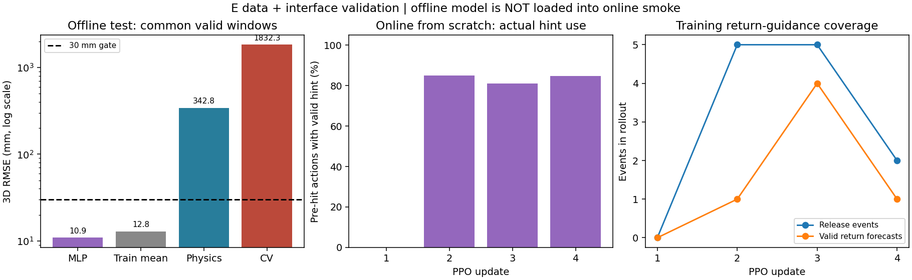
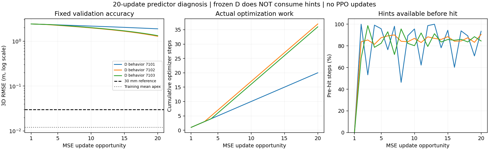
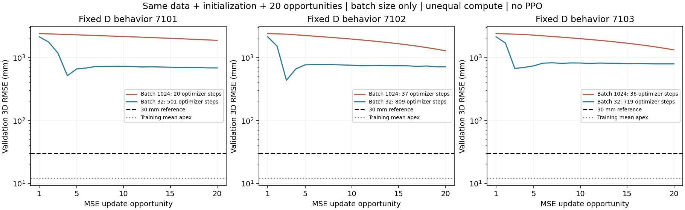
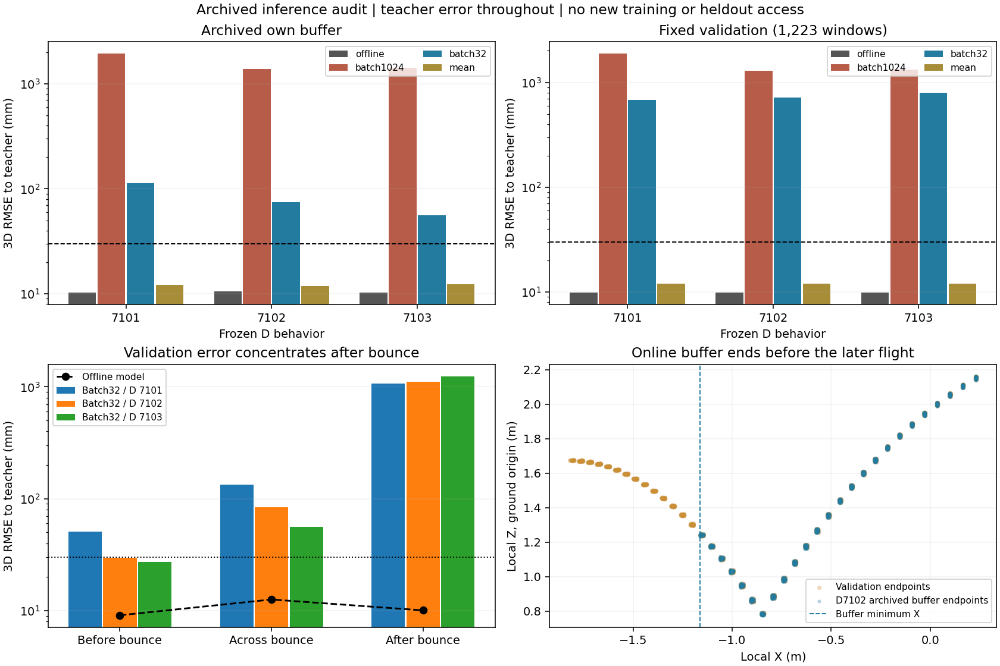

# E 前置驗證：預測得準，和訓練時真的用得到，是兩件事

主工作區回寫已獲授權；§10／§11保留隔離研究結果，當前整合來源的驗證另見[第12節](#12-主工作區選擇性回寫與整合驗證)。

2026-11-20完成原E-online的 **Z=2.3m 離線資料／精度驗證、真向量接口及runner smoke**；以下保留歷史結果。2026-11-24已完成獨立E-frozen的三seed短比較，結果見第10節。

隔離實驗完成（2026-11-24，第11節）：E-mean同維度／同初值比較已完成，CPU39、七GPU關卡、smoke、三seed各6144 transitions、416主要＋D96上下文評測及獨立CPU重算均PASS／exit0。兩組initial合法均31／0／0；learned-final32／3／0、mean-final0／0／0，各分母32，目標全0。這支持learned在本次固定短比較的合法回球指標上較好，主要差距是保住7101初始合法能力，未證明所有seed從零學會或普遍因果優勢。第11.6節保留首次10.251999μm相容重播FAIL及順序修正，第11.7–11.8節記完整結果、提示加權統計、所有故障與成本。

第10節的已完成基準：E-frozen的CPU27項、GPU五關、PPO smoke、三seed各6144 transitions及共同320episode評測均完成，程序PASS／exit0，新增predictor MSE更新0。共同7531／Z2.3題目上，D合法回球為0／7／0，E自身initial為31／0／0，E-final為32／3／0，各自分母32。**沒有取得跨三seed一致優於D的證據**；7101在PPO前已31/32接近上限，不能把final32/32全算作學習增益。第10.7節保留初始化、提示覆蓋、所有故障及成本；原E-online及此輪證據不被E-mean改寫。

第9節的既有依據：離線模型在在線buffer仍約10mm；在線32自己buffer為56–113mm，validation反彈後為1.06–1.24m。座標／時序／快照核對通過，兩種教師標籤僅差約1.5mm。這支持先測提示的策略價值，但尚未證明E-frozen能提升回球率。

前一輪接口驗證的結論：離線訓練後的MLP達到 **10.88mm**，但本次從零開始的在線MLP只做了 **5次optimizer更新**，提示對教師仍有 **約2.4m** 誤差。它能送到Actor，卻還不是可靠提示。不能拿離線精度替在線模型背書，也不能把這次smoke當成predictor沒有價值的證據。

## 1. 新資料怎樣避免洩漏？

- 沿用原配額：train128、validation32、test64條完整serve，初始Z中心改為2.3m，其餘位置／速度擾動沿M7.4。先依split的獨立seed產生serve，再各自開五點窗口；全域serve ID互不重疊。
- 每條在無球拍干預的960Hz PhysX場景中運行到反彈後apex，從垂直速度過零插值得到實測apex。五點輸入為48Hz球位置，監督標籤仍是既有CPU教師，不換可達擊球點。
- `tests/pace_m6.py`增加新資料目錄與高度入口；原M6檔案不覆蓋。`windows()`只接受同serve、等間隔、有限位置及有效教師的窗口，最後一個完整窗口也納入。
- 原20 epochs、batch32、學習率5e-4不變；只用validation選模型，凍結checkpoint後才評test。不用新結果修改30mm或優於等速門檻。

224條全部有apex，沒有排除發球。窗口數：train4,868、validation1,223、test2,428。test原始2,716筆中，有288筆因暖機歷史或教師無效不能形成可用窗口，覆蓋率 **89.40%**；物理／等速基準共同有效2,424窗，占可用窗口 **99.84%**。

**收集程序有一項負結果：** 完整檔案及結果已寫入，但啟動程序退出143，沒有正常退出確認，不能列成「收集啟動PASS」。另以獨立程序核對三個檔案雜湊、224條serve數、無重疊ID、每serve等間隔、有限值、固定apex真值及事件時間，資料完整性PASS／退出0，才使用這批持久資料。原因未定位，不修改原結果冒充退出0。離線訓練首次又遇系統`/tmp`空間不足；改用既有專案暫存目錄後重跑通過，未改資料或模型。

## 2. 離線結果到底代表什麼？

以下是3D RMSE，即 `sqrt(mean(||預測位置−實測apex||²))`。它不是三個座標平均MSE的平方根。

| 方法 | 整體RMSE | 比較範圍 |
| --- | ---: | --- |
| Learned predictor | **10.88mm** | 全2,428個可用窗口 |
| 固定訓練平均apex | **12.85mm** | 同2,428窗；先每條train serve平均教師標籤，再跨serve平均 |
| 同歷史估速＋物理模型 | **342.85mm** | 共同有效2,424窗 |
| 等速外推 | **1,832.27mm** | 同2,424窗；時間由同歷史估速的物理預測求得，不讀真值apex時間 |

MLP全樣本P95為19.20mm，通過原30mm及優於等速門檻。教師自身對實測apex的位置／時間P95為5.59mm／2.04ms，也通過原20mm／10ms門檻。

但平均點已經只有12.85mm：這個分布很窄，MLP的額外改善約2mm，不能拿低誤差宣稱已學會廣泛球動力學。XYZ分量中，MLP的Y誤差約3.86mm，優於平均點8.97mm；X、Z則未優於平均點，整體增益主要體現在橫向資訊。

### 把反彈拆開看

| 窗口階段 | 可用窗／原始筆數 | Learned | 訓練平均點 | 估速＋物理 | 等速 |
| --- | ---: | ---: | ---: | ---: | ---: |
| 反彈前 | 1,176／1,448 | 10.10mm | 12.85mm | 5.89mm | 2,285.72mm |
| 跨反彈 | 240／256 | 13.42mm | 12.76mm | 1,089.50mm | 2,833.59mm |
| 反彈後 | 1,012／1,012 | 11.08mm | 12.87mm | 2.34mm | 257.59mm |

物理／等速基準的反彈後數字只含共同有效1,008窗，其餘兩階段共同覆蓋100%。可用窗口覆蓋原始筆數分別81.22%、93.75%、100%；開頭四筆歷史不足也留在原始分母。

`verify_m6.py`的物理基準先對五筆位置做二次擬合，取最新時刻速度，再交給原`apex_teacher`。跨反彈窗口跨越速度不連續點，這個平滑擬合容易估錯速度，因此總誤差被跨反彈放大。不能把342.85mm寫成「物理模型普遍不準」：反彈前後它反而優於MLP；MLP跨反彈也略差於固定平均點。這輪保留原基準，不事後換成更好的估速器。

## 3. E 真正接進環境的資料流

```text
當步可觀測球位置
  → 每env五點history（同serve、固定策略採樣間隔）
  → 官方15→64→64→3 MLP，no_grad推論
  → prediction XYZ + valid
  → 原23維單幀 + 4維 = 27維
  → 五幀堆疊 = E actor135維
  → 六維關節action → 原驅動及PhysX
```

D仍是23×5=115維；critic仍是40×5=200維。教師點只供critic、獎勵、MSE及診斷，改教師真值不會改Actor的直接輸入。E的action、物理、D的hit／return公式與桌邊遮罩都未變。

- `pace_env.py`在物理步進後、回傳觀測前呼叫`refresh_prediction()`。用整數`policy_index × policy_dt`標時間，不用960Hz浮點累加值做嚴格等間隔檢查。
- `PredictionHook`遇reset、缺樣、無效或非有限位置就清對應history。未滿五點或模型尚未訓練，XYZ=0且valid=0，不把隨機網路當提示。
- `OnlinePredictor`在每個策略時刻收集有效五點窗口與教師標籤；近期buffer以**最多128個策略時刻的窗口條目**計，每條最多含各env一個窗口。空時刻也進buffer，使舊資料正常過期。
- runner每24步rollout後，在PPO之外做一次獨立MSE epoch，batch1024、原lr5e-4，恰好前20次更新資格；資料空就記跳過。局部RNG不影響PPO抽樣，PPO更新前後核對predictor不變，MSE前後核對policy不變。
- MSE更新後`refresh_after_predictor_update()`重算最新一幀提示，避免模型已更新但下一個action仍看到舊invalid；不再次把同一位置推入history。更舊的Actor幀保留當時的prediction，已保存的rollout觀測不被修改。

checkpoint包含predictor權重、Adam狀態、訓練旗標、更新次數、局部RNG、近期buffer與配置。從檔案重新載入後做推論比對；恢復環境時重新建立觀測history，不能把另一顆球的歷史帶入。無資料跳過與第20次資格截止都已測試。

### 你指出的九個採樣時刻，實測成立

當最新位置為`t8`時，Actor最舊一幀的prediction可能由`t0…t4`算出，最新一幀則用`t4…t8`。

- D直接位置歷史最遠是`t4…t8`：首尾 **83.3ms**。
- E歷史prediction間接涵蓋`t0…t8`：首尾 **166.7ms**。

真向量測試逐幀重算這五個prediction，與Actor實際切片一致。這個D/E比較同時增加學到的特徵和較長歷史壓縮，不能單獨證明哪一項有效；同維度平均提示等消融留後續。

## 4. 訓練時真正拿到了多少提示？

使用**從零在線MSE**，沒有載入上面的離線checkpoint。只做1個seed、16env×24步×4輪=1,536 transitions的runner smoke，未開三seed正式短對照。

| PPO輪 | 擊球前策略步 | 真正使用valid提示的步數 | 累計MSE epoch／optimizer步 | 本輪離拍／有效return |
| --- | ---: | ---: | ---: | ---: |
| 1 | 384 | 0 | 1／1 | 0／0 |
| 2 | 293 | 249（84.98%） | 2／2 | 5／1 |
| 3 | 233 | 189（81.12%） | 3／3 | 5／4 |
| 4 | 308 | 261（84.74%） | 4／5 | 2／1 |

總共699／1,218個擊球前動作使用提示，約57.39%；12次離拍中6次有效return預測並發出非零引導。這是所有rollout策略步／事件的統計，包含尚未結束回合，不能與只看已結束episode的數字混用。

34個已結束回合中，最先16顆球首次提示在0.5s出現，因為第一輪24步之前predictor完全未訓練；後續18顆是在五點湊齊的83.3ms。第一批球擊球前只有4–7步真正使用提示，後續有24–26步。完整回合的缺失原因是history不足136步、untrained320步、invalid0步；這些不含尚未結束的回合。

### 有提示，不等於提示已準確

第2、3、4輪，實際使用的提示對同時刻有效教師的3D RMSE是 **2.419m、2.395m、2.368m**。這不是對未實際發生的apex冒稱真值驗證，而是訓練時的教師誤差診斷。valid=1只表示歷史完整、資料有限且模型至少更新過。

這個差異有明確的更新量背景：離線模型用了20 epochs，每輪約153個batch，共約3,060次optimizer更新；在線smoke雖然叫「四次MSE epoch」，每輪資料很少且batch1024，實際只有 **1＋1＋1＋2＝5次** optimizer更新。不能把同一個MLP架構，當成已具有同等訓練程度。

因此本輪不是「提示大部分時間invalid」這一種問題。第一輪確實完全沒有提示；後三輪多數擊球前動作能使用提示，但內容仍很差。接下來應保留更新量／誤差曲線，不能直接把效用不佳歸因於predictor架構。

## 5. E 自己的初始化與驗證邊界

runner在任何PPO／MSE更新前保存E的`initial.pt`，包含135維Actor與未訓練predictor；最後checkpoint綁定initial的雜湊。D的115維輸入層不同，相同seed不代表同一初始策略。

同一批7201開發診斷16球，E初始有效碰拍2/16、合法0/16；四輪後碰拍6/16、合法4/16，目標框0。這只能說這次短smoke的最終模型有不同表現：只有一個seed、不是獨立效用測試，而且D原短跑是6,144 transitions，**不能拿這個1,536步結果與D作公平優劣比較**。

已通過：26項PACE單元、真向量same-step／reset／九時刻驗證、原lifecycle／control／parity／combined重播、真runner梯度隔離及磁碟checkpoint載入及獨立重評（16球結果一致）。離線精度與runner各自的PASS分開記錄；收集啟動退出143的負結果不被這些PASS覆蓋。

下一步先預先固定在線predictor學習曲線的診斷方式，核對原20次更新資格下實際能得到多少optimizer步、誤差是否收斂，再決定E的同預算短對照。若調整MSE更新量、暖機或改為離線預訓練，應另列條件，不能偷偷取代目前「在線從零」主線；不一起改action、reward、teacher。可達擊球點與BC仍留後續。

重載檢查初次因GPU policy與CPU保存張量直接比較而FAIL；修正為同裝置比對後通過。因runner來源雜湊改變，另重跑一次相同四輪smoke完成現碼驗證，主要結果與前次一致；兩次共3,072個工程驗證transitions，均非D/E效用實驗。原失敗、第一次smoke及驗證重跑的證據均保留，未挑選較好結果。

## 6. 重跑入口與證據

從倉庫根目錄執行，以下資料／輸出目錄須不存在；既有已驗證目錄不可覆蓋。

```bash
./run.sh --mode pace-data --pace-data-dir .agents/runs/foundation/m7/new_e/data --pace-serve-z 2.3 --device cuda:0 --headless --report .agents/runs/foundation/m7/new_e/collection.json
./verify_m6.sh --reuse-data .agents/runs/foundation/m7/new_e/offline .agents/runs/foundation/m7/new_e/data
./run.sh --mode pace-check --pace-check predictor --pace-envs 2 --device cuda:0 --headless --report .agents/runs/foundation/m7/predictor.json
```

`verify_m6.sh`會使用既有專案暫存位置，避免寫入已滿的系統`/tmp`。本輪E runner的離線驗證入口固定讀`m7/m74e/offline/validation.json`，校驗來源與Z=2.3；上面新實驗輸出不會自動取代它。先核對驗證來源再明確更新入口，不拷貝PASS字樣當新證據。

在本輪已驗證資料與當前lifecycle／control／parity／combined均存在且來源匹配時：

```bash
./run.sh --mode pace-smoke --pace-groups E --pace-serve-z 2.3 --pace-serve-y-half-range .015 --pace-envs 16 --device cuda:0 --headless --pace-output .agents/runs/foundation/m7/e_smoke_new --report .agents/runs/foundation/m7/e_smoke_new.json
./run.sh --mode pace-eval --pace-checkpoints .agents/runs/foundation/m7/m74e/smoke_verified --pace-output .agents/runs/foundation/m7/e_reload_new --pace-envs 16 --device cuda:0 --headless --report .agents/runs/foundation/m7/e_reload_new.json
```

完整本地資料在`m7/m74e/`：`data_integrity.json`、`data/`、`offline/validation.json`、`smoke.json`及`smoke_verified/E_7101/{initial.pt,policy.pt,result.json}`及`reload_verified.json`。接口關卡在`m7/predictor.json`；原始log保留CLI限制、暫存分區及收集退出異常，不冒稱所有程序都成功。



生成：`python scripts/plot_m7_results.py --predictor-interface --output doc/notes/images/m74e_predictor.png`。左圖是離線模型，右兩圖是另一個從零開始的在線模型；這兩者不是同一checkpoint。只追蹤這張圖，資料與模型留本地。本輪沒有commit／push、真機操作或D/E正式效用結論。


## 7. 跑滿原20次更新資格，predictor會學準嗎？

**這輪答案是還不會。** 三條資料流都跑滿原定20次資格，validation誤差雖逐步下降，但最後仍為1.88／1.28／1.33m，未達30mm參考門檻。這不能寫成網路永遠不會收斂，只能說原設定與這個有限更新預算不夠。

### 怎樣隔離這個問題？

我們固定D／7101、7102、7103的policy權重，三條流都使用相同發球seed7540。環境仍走原六關節動作、教師與D獎勵；只有predictor從零學習。**沒有建立PPO optimizer，policy權重前後逐值一致。**

`tests/pace_learning_curve.py`使用E的真實history、收集與MSE接口，但把五幀Actor各裁回原23維，再交給固定D的115維policy。D完全看不到新增提示，所以不準的prediction不會改變行為或後續資料。三個D行為本來就不同，buffer中可用窗口數因此不同；這是三條固定行為資料流，並不是三個不同predictor初始化，predictor仍共用既定seed6100。

每條流16env×24策略步×20次資格，共7,680個環境transitions；三條共23,040，PPO更新數為0。每次只呼叫原`OnlinePredictor.update()`一次，保留batch1024、lr5e-4、近期128時刻buffer與一個epoch。每次更新後只讀既有validation的1,223個窗口測實測apex誤差，沒有重開test，也不按曲線選checkpoint或增加更新次數。

### 結果與更新量

| 固定D行為 | 第1次更新後RMSE | 第20次更新後RMSE | 實際optimizer更新數 | 每次buffer窗口數範圍 |
| --- | ---: | ---: | ---: | ---: |
| 7101 | 2.409m | **1.878m** | **20** | 336–894 |
| 7102 | 2.409m | **1.282m** | **37** | 336–1,470 |
| 7103 | 2.409m | **1.325m** | **36** | 336–1,320 |

同一validation集上，固定猜train平均apex約**12.08mm**。此處是validation，不是前節test平均點12.85mm，不能混用數字。

關鍵在`fit_epoch()`按batch分割資料：

```text
本次optimizer步數 = ceil(當前有效窗口數 / 1024)
```

7101的buffer始終不到1,024窗，因此每次「一個epoch」其實只有一步梯度更新；另外兩條流部分時候能做兩步。20次資格不等於20次充分訓練，也不等於不同資料流得到相同的梯度更新量。buffer重用近期資料，所以不能把各次窗口數相加，當作互不重複的新資料總數。

離線MLP約做了3,060次optimizer更新；這輪只有20–37次。這是已確認的訓練量差異，但本輪沒有同資料的batch反事實對照，**尚不能說已唯一定位為batch大小造成失敗**。



左圖為每次更新後的固定validation誤差；中圖是實際optimizer工作量；右圖是擊球前「可提供」提示的比例。D沒有讀取提示，右圖不能叫D實際使用率。

### 提示與回球引導覆蓋

| 固定D行為 | 擊球前可提供提示／步數 | 有效return預測／離拍事件 |
| --- | ---: | ---: |
| 7101 | 3,021／3,870（78.06%） | 17／123 |
| 7102 | 5,077／6,278（80.87%） | 58／58 |
| 7103 | 4,445／5,582（79.63%） | 8／184 |

提示多數時間可以產生，卻仍不準；回球引導覆蓋也隨固定行為差異很大。這些結果支持繼續分開記錄「可用性、準確性、回球評分覆蓋」，不能只看一個valid旗標或總reward。此表包含全部rollout事件，不只已結束episode。

### 驗證和接下來的取捨

以下為本輪診斷當時的結論；其中batch對照已於第8節完成。

- 三條完整診斷執行PASS／退出0，約320.8秒；原模型權重不變、來源雜湊一致。第21次呼叫返回cutoff，predictor權重、局部RNG與optimizer計數均不變，沒有偷偷多學一次。
- **精度結論：本診斷的30mm參考三條都未達。** 工程PASS只表示程式完整執行，不能代稱提示品質PASS。這不是E與D共同學習的正式比較，也不是新heldout結論。
- 下一個最直接的隔離實驗是只比較**batch1024與batch32**，固定同一資料流、模型初始化、20次資格及其餘設定，同時報實際optimizer步數與耗時。這會刻意增加每個epoch的梯度更新量，因此不能宣稱計算預算完全相同；它用來檢驗更新量機制，不先加長PPO或更換教師。
- 若這個對照也未達精度，再檢查資料覆蓋／優化設定；若達到，才把該變更作明確條件安排E的同策略樣本預算短對照。離線預訓練、可達擊球點、BC仍不混入本輪。本輪未執行batch對照、未commit／push。

重跑命令（預設輸出目錄必須尚未存在，以免覆蓋本次證據）：

```bash
./run.sh --mode pace-check --pace-check predictor-curve --pace-envs 16 --device cuda:0 --headless --report .agents/runs/foundation/m7/m74e/learning_curve.json
```

依賴既有本地D三模型及E的train／validation資料。`learning_curve/protocol.json`在第一步更新前固定輸入雜湊、seeds與預算，各`D_<seed>.jsonl`保存完整20點，最後模型只留本地。圖生成入口：`python scripts/plot_m7_results.py --predictor-curve --output doc/notes/images/m74e_learning_curve.png`。


## 8. 只把batch1024改為32，增加梯度更新有幫助嗎？

### 這次只回答哪一個問題？

前一輪發現：每輪雖然叫「訓練一個epoch」，batch1024往往只讓模型改一次權重。這次固定20輪，只把每次送入optimizer的窗口數縮至32，看看多次小步更新能否把預測學準。正式E配置仍是1024，這是獨立診斷，沒有開始PPO對照。

### 怎樣保證只有batch不同？

- **同一資料**：三個既有D策略各自產生一條資料流，每輪24策略步、16個環境，共20輪。每條流只模擬一次，把同一份近期buffer交給兩個模型，沒有各自再抽一批球。
- **同一初始模型與資料順序**：兩者都從seed6100開始，程式逐值核對初始權重，並在每輪更新前後核對shuffle RNG。相同的排列只被切成不同大小的batch。
- **同一其他設定**：MLP、Adam、學習率、教師、buffer長度及20次資格不變。D不讀預測，故兩者的預測也不會反過來改變機械臂動作或資料。
- **固定評測**：每輪都評相同1,223個validation窗口，以第20輪作最終結果；沒有重開test、挑中途最好checkpoint或額外訓練。三條流是三種D行為，並非三個不同predictor初始化。

### 程式怎麼走？

入口為`--pace-check predictor-batch`，復用`tests/pace_learning_curve.py::verify(compare_batches=True)`。`env.online`保持batch1024；旁邊的`shadow`是獨立的`OnlinePredictor`，只有診斷實例的batch改為32。

```text
固定D動作 → 環境前進24步 → 近期五點窗口buffer
                                ├─ 原模型：batch1024 → update()
                                └─ 配對模型：batch32 → update()
兩者各自預測同一validation → 記誤差、optimizer步數、更新耗時
```

`shadow.buffer.extend(env.online.buffer)`共享本輪只讀資料；模型、optimizer和RNG各自持有，不共用權重。`fit_epoch()`仍是原實作，用同一randperm結果按batch切分。因此改變的是每輪梯度更新次數及每次梯度使用的樣本量，**並非等計算量的對照，也不能把它解讀為只改更新次數、其他優化效應完全不變**。

每輪保存buffer SHA；兩組都驗證第21次呼叫被cutoff且權重、RNG與更新計數不變。生產檔`configs/pace_online.json`沒有被改成32。

### 結果：有改善，但仍不夠準

以下只比較第20次更新後的模型，精度越小越好：

| 固定D資料流 | batch1024 RMSE（mm） | batch32 RMSE（mm） | 誤差降低 | optimizer步數：1024 → 32 | MSE更新總秒數：1024 → 32 |
| --- | ---: | ---: | ---: | ---: | ---: |
| 7101 | 1878.2 | 685.4 | 63.5% | 20 → 501 | 0.036 → 0.251 |
| 7102 | 1282.4 | 713.7 | 44.3% | 37 → 809 | 0.043 → 0.397 |
| 7103 | 1325.2 | 795.5 | 40.0% | 36 → 719 | 0.042 → 0.348 |

- **這輪確實有改善**：相同資料與初始化下，三條流都下降40–64%。原batch1024的整條20點誤差與coverage逐值重現上一輪，因此改進並非換了一批較容易的資料。
- **還不能當可靠提示**：batch32最後仍是685–795mm，遠高於既定30mm。固定猜train平均apex在同validation為12.08mm；這個窄分布基準仍比兩組好。
- **計算成本增加**：實際optimizer由20–37次增加為501–809次。表中耗時只涵蓋`update()`，不含資料生成、驗證和I/O，且是單次量測，不能當穩健效能基準。整輪仿真與比較約325.5秒。
- **沒有驗證策略變好**：本輪23,040個環境transitions、PPO更新0，D不讀兩組提示；因此不能把預測誤差改善換算成回球率改善，也沒有E/D正式策略結論。



三個面板分別是固定D行為產生的三條資料流；紅線為1024、藍線為32。藍線下降較快，但後期仍有波動，沒有接近30mm虛線。所有模型都取最後一輪，沒有選曲線最低點。

### 現在能下什麼結論，下一步查什麼？

能確認的是：**縮小batch這項改動有幫助，但單靠它仍不足以通過精度要求。** 它同時改變梯度更新量和每次梯度的樣本數，尚不能把改善全部歸因於其中一項；也不能因此判定網路永遠學不會。

下一步建議先做資料診斷：比較在線buffer與離線validation的輸入範圍、反彈前／跨反彈／反彈後覆蓋，以及同一窗口的教師標籤是否一致，再分開量測訓練buffer與validation誤差。這能幫助區分優化仍不足、資料覆蓋差異或標籤問題。目前只列建議，尚未執行；不把任何一項當作已確認根因。

### 驗證與重跑

工程執行PASS／exit0；三條流各20輪、7,680 transitions。初始權重、配對shuffle／樣本數、固定D權重、來源SHA、兩組cutoff通過，1024重播逐點一致；**兩組三條流的30mm精度參考均FAIL**。本輪未改生產predictor／教師／PPO設定，未commit或push。

```bash
./run.sh --mode pace-check --pace-check predictor-batch --pace-envs 16 --device cuda:0 --headless --report .agents/runs/foundation/m7/m74e/batch_comparison.json
python scripts/plot_m7_results.py --predictor-batch --output doc/notes/images/m74e_batch_comparison.png
```

診斷入口固定寫本地`m7/m74e/batch_comparison/`，若已存在會拒絕覆蓋；上面是本輪實際命令，重跑前需明確指定新的診斷目錄，不要刪原證據或只改report路徑就以為換了模型輸出目錄。`protocol.json`在第一次更新前固定條件，各`D_<seed>.jsonl`包含配對曲線／buffer SHA；兩組最終checkpoint留本地。倉庫只增加上面一張引用圖，沒有逐輪影像或影片。

## 9. 為什麼學不準：先分清擬合、覆蓋與資料契約

**這次找到的是兩個並存的問題：在線模型連自己的近期資料都還沒擬合到30mm；而它在validation的大部分誤差，集中於在線資料缺少的較晚反彈後軌跡。** 沒有查到足以解釋公尺級誤差的座標或資料快照錯誤。這支持把「怎樣從零在線學準」與「準確提示是否有助策略」拆開研究。

### 9.1 不再訓練，先交換模型與資料

使用已保存的離線MLP、三條流各自的batch1024／32最後模型，以及**固定的離線train平均apex**。沒有重新擬合平均點，沒有重新訓練、挑模型或開test。兩個資料來源為各流最後封存buffer與既有1,223個validation窗口。

本節表格統一報**預測對教師標籤的3D RMSE**，單位mm。validation對PhysX apex另保存在報告中；前節685–795mm是對PhysX，這裡685.1–795.1mm是對教師，不能混成一欄。validation已被先前開發讀過，本次不是新的獨立驗證。

| 模型／評測資料 | D7101 buffer（843窗） | D7102 buffer（1470窗） | D7103 buffer（1265窗） | validation |
| --- | ---: | ---: | ---: | ---: |
| 已驗離線MLP | 10.30 | 10.50 | 10.27 | 9.91 |
| 對應在線batch1024 | 1933.02 | 1389.45 | 1422.06 | 1879.09／1283.36／1326.24 |
| 對應在線batch32 | **113.11** | **74.84** | **56.24** | **685.11／713.44／795.14** |
| 固定train平均點 | 12.11 | 11.90 | 12.29 | 12.03 |

validation最後兩列在線數字依7101／7102／7103排序；每個在線模型只評自己的buffer及共同validation。buffer誤差是已用於訓練的近期資料擬合程度，不是泛化成績。兩個batch的封存buffer逐張量完全一致。

這張表能排除一些過早的解釋：離線模型在相同在線資料上仍約10mm，平均點也只有約12mm，因此不支持「五筆位置根本無法處理這批球」或「在線標籤整體錯了0.7m」。batch32自己的buffer仍未達30mm，也不能說它已學好訓練資料、只剩泛化問題。至於優化量、資料順序及近期buffer遺忘各占多少，這次沒有作反事實訓練，仍未唯一歸因。

### 9.2 大誤差發生在哪一段？

validation的階段由離線已保存的真實速度過零判斷，沿用原分組，不用網路猜測。所有指標仍對教師：

| validation階段 | 窗口數 | 在線32／7101 | 在線32／7102 | 在線32／7103 | 離線MLP |
| --- | ---: | ---: | ---: | ---: | ---: |
| 反彈前 | 594 | 50.9 | 29.8 | 27.2 | 9.1 |
| 跨反彈 | 126 | 134.3 | 83.9 | 56.4 | 12.6 |
| 反彈後 | 503 | **1064.7** | **1111.2** | **1239.2** | 10.1 |

三模型validation總平方誤差的**99.34%／99.77%／99.89%來自反彈後**。這不是說所有反彈後窗口都沒見過，而是後段誤差主導了總數。

在線資料在機械臂接觸、失敗或時間遮罩處停止收集；離線無球拍軌跡持續到apex。因此最後buffer的球心X最遠只到−1.21／−1.16／−1.11m，validation則到−1.82m。若只按「最後X是否落在該buffer的min/max」作投影檢查，validation反彈後503窗中，僅99／68／36窗在其範圍內；超出範圍的對教師誤差約1.18／1.19／1.28m。這證明沿飛行進度存在覆蓋差異，但一維範圍不能代表完整15維支撐域，也不能單獨證明唯一因果。



左上：模型在自己封存buffer上的誤差；右上：同一模型到validation的誤差。左下：大誤差集中在反彈後。右下：D7102在線buffer與validation的窗口末端位置；橙色延伸到更晚的反彈後軌跡。黑虛線為30mm參考，沒有改門檻。

### 9.3 0.7m是固定偏移，還是預測隨輸入變動？

`metric()`把每筆誤差分成平均偏移與去均值後的波動，並核對平方和等式。以validation為例，單位mm：

| 在線batch32 | 平均偏移X／Y／Z | 去均值後3D RMSE |
| --- | ---: | ---: |
| 7101 | −266.3／10.8／260.1 | 575.1 |
| 7102 | −287.1／12.0／280.5 | 589.7 |
| 7103 | −330.0／7.2／320.6 | 648.5 |

自己的buffer平均偏移範數卻只有約2.8／2.1／5.3mm，仍有56–113mm的波動。這不像把所有座標固定加錯同一個桌高；也不是只補一個XYZ常數就能解決。完整XYZ RMSE、各階段偏移均保存在`data_audit/cross.json`。

### 9.4 缺少metadata，所以另做一次不訓練的短重播

封存的`OnlinePredictor.state_dict()`只含各時刻的`(x,y)`，沒有env、serve、time或phase。因此我們沒有把行號當env，也沒有冒稱從舊buffer重建了反彈事件。

補採使用固定D7102、16env、serve7540，共72個策略步（1,152 transitions）。模型與PPO更新均為0，D仍只讀原115維。這是新重播的契約核對，不是原20輪final buffer的重建；不把兩者混在同一張按env／phase統計表。

診斷在`observe()`／`collect()`旁記錄實際當時的狀態、事件phase、origin和serve；原收集函式照常執行，再核對其真正保存的x/y。得到879個有效收集窗口：反彈前690、跨反彈120、反彈後69。

已實測核對：

- **座標與單位**：米制、局部球桌／地面座標，Z以地面為0，桌面為0.76m。`state()`先減env origin；沒有另減桌高。env0 origin=(7.5,−7.5,0)m，env15=(−7.5,7.5,0)m，兩者都不是世界原點。
- **窗口與時刻**：五點依舊→新展平，每筆間隔1/48秒，窗口不跨serve；最後位置等於當前局部狀態。reset後不足五點不收集。
- **有效性**：所有收集窗口皆outcome=0、未合法擊球、早於reset預測的apex時刻；按原遮罩收集，沒有悄悄加入終止或擊球後資料。
- **快照**：保留每次真正buffer張量及其拷貝，在後續步進／reset後逐值相同。`observe`複製位置，`collect`建立獨立tensor；沒有看到指向後續可變來源的引用。
- **按環境結果**：重播上離線MLP各env RMSE約6.7–13.2mm，在線32約58.2–77.8mm。完整各env的XYZ偏移／RMSE存於`replay_gate.json`，不是根據舊buffer猜身份。

一筆env15反彈後樣本可以具體看出契約。時間0.58333s、serve2，世界位置(−8.65175,7.48925,1.24535)m，減origin後為(−1.15175,−0.01075,1.24535)m。五點如下，全部event phase=1，尚未擊球：

| 相對該serve時間（s） | X（m） | Y（m） | Z（m） |
| --- | ---: | ---: | ---: |
| 0.50000 | −0.94958 | −0.01075 | 0.95519 |
| 0.52083 | −1.00098 | −0.01075 | 1.03537 |
| 0.54167 | −1.05178 | −0.01075 | 1.11040 |
| 0.56250 | −1.10203 | −0.01075 | 1.18036 |
| 0.58333 | −1.15175 | −0.01075 | 1.24535 |

原reset教師點為(−1.80184,−0.01075,1.67214)m；從最後一筆6D狀態重算約(−1.80352,−0.01075,1.67163)m。標籤仍是預測的未來apex，不是當前球位置。

### 9.5 固定教師與當前重算教師有差，但不是這輪的公尺級差異

在線`PaceEnv.reset()`計算一次`teacher_point`後沿用；離線每個48Hz時刻從當時狀態／bounced重算。879個重播窗口中，有871個可重算，兩種標籤的3D RMSE **1.49mm**、P95 **3.54mm**；分段RMSE為0.96／2.71／2.57mm。這個量級不足以解釋0.7m。

另8個重算失敗為`below_surface`：物理接觸期間球心短暫低於教師要求的桌面＋半徑平面。原reset教師仍有效，所以在線固定標籤遮罩會收進這些窗口，而離線當前教師會拒絕。這是明確的有效域差異，保留原樣及原因；標籤差異統計只用871個可比樣本，但模型交叉誤差仍包含全部879個窗口，沒有藉此排掉較差資料。這次未修改教師或遮罩。

### 9.6 重新核對官方更新量：同樣數字不代表同樣學習量

重新核對固定commit `fdb192f8`及來源SHA後，[PACE資料流筆記§4.3](pace_pipeline.md)記錄的原碼邊界仍成立：

- 官方命令／預設為4096env；buffer128、history5、batch1024、每輪1 epoch。原碼`range(5,L)`在buffer填滿時產生(128−5)×4096=503,808個窗口，即**492次optimizer更新／epoch**。這是程式結構推導，不是作者實測紀錄，更不是503,808個獨立有效樣本。
- cutoff配置為20，但fresh runner先檢查舊`current_learning_iteration`、再在輪末設成it，字面上允許it=0…20，共**21次資格**。AIRBOT這輪的恰好20次是已固定的適配契約，沒有偷偷改成21次。
- 官方訓練helper沒有shuffle，且正文使用全部環境，沒有docstring所說的跨reset過濾；AIRBOT的serve隔離、有效性過濾、保留最後完整窗口及局部shuffle都是明確適配差異。不能說只改了機器人、其他訓練量完全相同。

因此，下一輪若研究更新安排，可以明確改配方；但不能用相同的「20」宣稱已保留官方梯度更新量。這次沒有為了追齊492步而增加訓練。

### 9.7 研究決策與邊界

**下一個優先提案是E-frozen：用已驗證的離線predictor凍結推論，隔離測試準確提示是否有助策略。** 本次離線模型在封存在線buffer及新重播的擊球前窗口都約10mm，支持準備這項對照；不能僅靠先前離線test10.88mm外推。

E-online繼續保留為「小環境從零在線學準」的獨立問題，已確認擬合不足與後段覆蓋差異，但沒有把其中任一項宣稱為唯一根因。這輪不繼續逐項掃batch／lr／buffer，也不把E改名為離線初始化。

在本節2026-11-20診斷完成時，E-frozen尚未實作或訓練；2026-11-24的獨立接合見第10節。它必須明列預訓練資料／成本，沿用D的來球、六關節action、reward及PPO樣本預算，保存E自己的135維初始Actor對照，說明九採樣時刻歷史；先驗凍結推論、checkpoint及擊球前有效域，再作同預算策略比較。固定平均點在這批窄分布已很強，未來若要將效果歸因於「預測內容」，需另行設計同維提示對照，不能用E-frozen單組直接證明。

### 9.8 程式入口、驗證與限制

- `tests/pace_predictor_audit.py::cross_evaluate()`：讀取封存checkpoint／buffer和train／validation，使用原`Predictor`載入，純推論；`metric()`統一教師誤差、XYZ偏移與平方分解，validation另報PhysX真值。
- `replay()`：只在診斷內包裝原observe／collect補metadata，沒有改生產資料結構或增加永久紀錄。固定D與source SHA保持不變，無MSE／PPO更新。
- 交叉推論PASS／exit0；短重播PASS／exit0、約27.3秒；來源／checkpoint雜湊、配對buffer、舊validation重現、窗口時序、座標、快照不變等檢查通過。這是診斷執行PASS，**在線精度與E策略效用仍未通過**。既有same-step／梯度隔離／重載關卡沒有因本輪而全部重跑。

```bash
# 原有本地checkpoint與資料必須存在；只做推論，可重算本診斷的cross報告
PYTHONPATH=src python tests/pace_predictor_audit.py
# 新補採：若replay_samples.json已存在會拒絕覆蓋；這是本輪實際執行入口
./run.sh --mode pace-check --pace-check predictor-audit --pace-envs 16 --device cuda:0 --headless --report .agents/runs/foundation/m7/m74e/data_audit/replay_gate.json
PYTHONPATH=src python scripts/plot_m7_results.py --predictor-audit --output doc/notes/images/m74e_data_audit.png
```

實際使用倉庫既有Isaac容器內的Python／PyTorch。所有原始資料在本地`m7/m74e/data_audit/`；封存buffer沒有的metadata明確標不可還原。只追蹤一張代表圖與可重跑入口，完整879筆與六筆代表樣本留本地，沒有新增影片。本輪未commit／push，沒有真機或E-frozen訓練操作。

## 10. E-frozen：固定準確提示，再問策略能否使用

2026-11-24。E-frozen已接成獨立研究模式；CPU契約與五個GPU工程關卡後，使用者另行授權的smoke、三seedPPO及共同評測也已完成。工程驗證見§10.6，策略結果及限制見§10.7。目的在於讓「預測器尚未學準」不再混進「策略能否利用提示」這個問題。這是**固定預訓練模組的適配**，不是原PACE在線從零訓練的精確復現；也沒有換teacher、action、PPO架構或回球規則。工程接口通過不能代替策略效用證據。

### 10.1 為什麼值得做，又不能回答什麼

第9節的離線模型在真實在線buffer和短重播的擊球前窗口仍約10mm，說明這份既有模型至少適合目前狹窄的Z2.3題目。相比之下，在線模型的更新量與後段資料覆蓋仍未解決。先固定一個已驗模型，能直接觀察135維Actor得到可用提示後的學習情況，無需同時調batch、lr或buffer。

這個比較仍包含三件事：新增四個提示欄位、經過離線監督的特徵，以及更長的間接位置歷史。因此結果最多支持或不支持**這個提示模組整體**在固定預算下的效用，不能單獨歸因為物理預測內容。固定train平均點本來就約12mm；若未來要區分平均點與預測內容，需要另行預先設計同維對照，本輪不追加。

| 模式 | Actor／Critic | Predictor來源與更新 | 本輪用途 |
| --- | --- | --- | --- |
| D | 115／200 | 無提示欄位 | 保留既有三個固定模型，當前來源重評 |
| E-online；舊名稱E | 135／200 | 從零、獨立Adam/MSE、原batch1024與20次資格 | 保留既有主線，不在本輪重訓 |
| E-frozen | 135／200 | 已驗離線MLP，只有凍結推論 | 已完成工程契約及三seed配對短比較 |

相同seed不會讓115維與135維網路具有同一初始策略；即使隱藏層同為512／512／128，輸入層形狀與隨機數消耗都不同。故E-frozen在第一次PPO前保存**自己的initial**，initial和final都使用同一份凍結MLP，才能分清初始化行為與PPO之後的變化。

### 10.2 這個模型從哪裡來，已付出多少額外成本

唯一模型為本地`m7/m74e/offline/predictor.pt`，SHA256為`7e0f666b9a50394ff43ff7226e3456f86552b9238f983b184e39c02c5a0ffec2`。它先前以validation選定epoch20，本輪不重選。模型仍直接使用官方commit `fdb192f8fff9f5ca54c4ec4a8441fda5174ca078`的15→64→64→3 ReLU MLP；58份原檔與MIT／BSD授權由`configs/pace_sources.json`校驗，沒有複製另一套網路。

`configs/pace_frozen.json`把模型和既有`offline/training.json`、`offline/validation.json`、`data/dataset.json`的來源鏈綁定。資料的實際來球位置中心為(0.5,0,2.3)m，位置擾動Y±.015、Z±.01m，速度中心(−3.3,0,−1.4)m/s及原擾動；不能只看到manifest舊有M5版本名稱就誤當Z2.2。執行配置若不符合這份分布，應拒絕而不是把模型套到未驗分布。

歷史訓練程式與本輪推論適配的hash要分開理解。`source_snapshot.json`保存隔離準備時的來源記錄，讓舊receipt能核對當時版本；當前的球參數、教師與官方來源另由runtime清單檢查。新增凍結接口會改`pace_predictor.py`，不能因此改寫舊receipt假裝當年就使用新碼，也不能拿舊來源PASS取代本輪推論測試。

| 既有離線成本／結果 | 記錄值與解釋 |
| --- | --- |
| train | seed6101，128完整serve，4868窗口 |
| validation | seed6102，32完整serve，1223窗口；曾用於選模與後續開發，並非新測試 |
| 擬合 | seed6100，Adam5e-4，batch32，20epochs；153步／epoch，共3060 optimizer步 |
| 擬合時間 | 原training receipt為2.641097秒；不含資料收集、來源準備或本輪驗證 |
| 選定模型validation | 對PhysX真值3D RMSE10.389121mm；既有交叉審核對教師9.911151mm |
| 歷史held-out | 原報告記64serve／2428窗、10.878879mm；只引用已有結果，不重新讀取raw資料 |

離線資料收集launcher曾exit143，後續獨立持久資料完整性審核PASS。兩件事必須一起保留：完整資料有可查證依據，但不能把收集程序改稱正常退出。三份split原始資料及失敗紀錄仍保留原處；隔離E-frozen工作只需原模型、receipt／manifest及既有train／validation，無需重新收集或開held-out。

還有一個入口陷阱：`verify_m6.py`在stage分支前會讀所有split的serve ID，包括heldout。因此即使指定`--stage train`，也不適合作為本輪「不重開test」的驗證入口。本輪使用明確限定train／validation的讀取和既有receipt校驗；歷史`validation.json`的檔名則包含當時最終held-out驗收，不能把它誤認為本輪新算的validation。

### 10.3 一個策略步的資料怎樣走

```text
當步可觀測球位置 − env origin
  → 每env同serve、等間隔的五點history
  → 已驗SHA的凍結官方MLP（無梯度）
  → XYZ + valid，接在原23維frame之後
  → 五個27維frame形成135維Actor輸入
  → 原六維residual → 原插值／驅動 → PhysX

教師／真值 → 原D reward、200維Critic及診斷
PPO更新   → Actor／Critic；不更新MLP
```

米制局部座標以地面Z=0、桌面Z=.76m為基準；只減env origin，不再減一次桌高。五點由舊到新展平為15維，間隔1/48秒；最新點屬當步，先算prediction再組actor frame。教師有效性、真值速度及未來碰拍／落桌事件不能決定Actor的提示或valid。教師只在診斷時計算擊球前可比較誤差；這個遮罩不拿來暗中送給策略。

`PredictionHook`的history按env擁有，位置以快照存入。全量或部分reset只清相應env；serve改變、缺樣、無效或非有限觀測也會清除該窗口。未滿五點輸出XYZ=0、valid=0，滿足窗口且模型可用後才給提示。凍結MLP不需要等待第一輪MSE：本次2-env真向量關卡實測首次prediction在第4個48Hz tick，即83.3ms，八步零動作中各env有四步使用已可用提示。這個關卡只驗證短窗口時序，完整擊球前輸入覆蓋另由§10.7共同評測量測，不能由八步零動作外推。

較舊的actor frame保留當時產生的提示；沒有MSE更新，故不需要把它們重算為某個「最新模型」的輸出。最新frame用`t4…t8`算提示時，最舊frame可能保存`t0…t4`的提示，所以E整個輸入可間接看見`t0…t8`九個時刻，首尾166.7ms。D直接五點是`t4…t8`，首尾83.3ms；這是資訊跨度差異，並非採樣頻率變成96Hz。

### 10.4 凍結與checkpoint為什麼需要分別檢查

`eval()`只切換某些層的推論行為，不會阻止optimizer改權重。E-frozen同時需要參數不求梯度、推論不建圖、PPO optimizer不持有MLP參數，以及訓練前後逐值／雜湊核對。它不建立近期MSE buffer，也不執行在線optimizer；receipt裡的20次更新是過去的預訓練履歷，不能被寫成這輪又做了20次。

checkpoint必須記錄模式、凍結配置、來源SHA與模型權重。載入檢查包含錯誤來源、schema／球參數／分布不相容、未訓練旗標及權重被更動；不能只因檔案能`torch.load`就接受。重載時應得到同一135維Actor與同一推論值，且仍無可訓練predictor路徑；舊E明確維持online，不依檔名猜成frozen。

新環境的history由當前回合重新建立；本契約保證模型重載和評測一致性，不宣稱保存了PhysX全部狀態或能逐步精確續跑。PPO自身權重和optimizer仍按原流程保存，凍結模型與它的來源另行核對。

實作可沿下面五個位置閱讀，它們各自處理一個不同責任：

| 程式 | 負責的行為 |
| --- | --- |
| `pace_predictor.py::Predictor(inference_only=True)` | 使用原MLP，略過Adam／shuffle RNG建立，禁止`fit_epoch()`，凍結參數；新state不含optimizer或RNG |
| `pace_predictor.py::FrozenPredictor` | 驗artifact與歷史／當前來源，持有原`PredictionHook`；`validate_environment()`拒絕不同來球／採樣設定，save/load核對同一模型state hash |
| `pace_env.py::predictor_module` | 讓online／frozen走同一位置歷史及frame組裝；只有online擁有資料收集路徑，D仍真正移除提示欄位 |
| `train_pace.py::set_predictor()`、`update_ppo()` | 明確選模式；官方PPO更新前後驗predictor不變，僅online再做MSE，frozen記optimizer_steps=0 |
| `tests/pace_online.py::verify_frozen()`、`evaluate_frozen()` | 前者是真Isaac九時刻／reset／重載關卡，本次GPU PASS；後者按`configs/pace_frozen_experiment.json`核對輸入後重評固定320回合，已PASS／exit0 |

runner的`evaluate_initial()`在PPO前量測自己的initial，之後恢復policy抽樣RNG並重設原training serve RNG與history。這避免「多做一次initial評測」意外換掉後續訓練資料流；它也是需要獨立檢驗的行為，不只多保存一個檔名。

CPU審核還修正了兩個會破壞契約的邊界。第一，非有限時間戳也必須清history；只檢查位置有限仍會讓NaN時間繞過一般間隔比較，錯把不合法窗口當成連續採樣。第二，凍結模型雖在CPU建構，`torch.manual_seed()`卻同時觸及CUDA seeding，而原`fork_rng(devices=[])`只恢復CPU RNG。凍結路徑改為只設CPU default generator，避免建構／重載提示模型干擾policy的GPU抽樣流。測試在CPU以mock斷言不會呼叫CUDA seeding；它證明該呼叫被排除，**不是已在真GPU量過RNG逐值不變**，後者仍屬未執行的GPU驗證邊界。

### 10.5 配對研究先固定什麼

以下配對規格在訓練前固定。前一輪授權僅含五個GPU工程關卡，已如約停止；使用者本輪明確追加smoke、三seed訓練與共同評測授權，才繼續至§10.7。當前source的生命週期、控制、原reward、凍結提示與重載均先通過，沒有以離線10mm精度或過去E-online smoke替代。

訓練固定7101／7102／7103，每seed 16env×24steps×16次PPO更新資格=6144 transitions，三條共18432；使用固定最後checkpoint。來球只用原Z2.3／Y±.015m，保留D教師／reward、±.6rad六維action、48Hz／960Hz、初始lr1e-5及原PPO。既有D三個`m74d/d/D_<seed>/policy.pt`保持凍結，不重訓D或加長E。

共同評測在`configs/pace_frozen_experiment.json`預先固定：使用**已被查看的7531**，32個指定發球；零動作1、固定D3、E-frozen自身initial3與final3，共10種策略、320個計分episode。只評已驗Z2.3分布，不加入Z2.2。這是同題目的配對開發診斷，不是未見測試集；每個策略每球只取指定回合，後續自動reset與padding不替代尚未完成的球。runner另有7201的initial／final工程評測、重載與smoke；其額外回合及成本另列，不算入這320個配對回合或新的獨立證據。

舊D來源中的`pace_env.py`早於後續接口改動，因此必須在目前來源重新評估固定D，核對同來球、有效設定、模型hash及事件規則；如與舊結果不同，保留差異並先定位，不能直接搬舊0／7／0當成同碼基準。E的initial與final也使用相同已固定提示模型。每seed同時報`E-final − D`和`E-final − E-initial`：前者反映與既有D的差異，後者才能說明E自身經PPO後的變化。

所有拒絕、漏接、故障、非法接觸、出界與超時都在32球分母中。有效碰拍、合法回球、目標命中分開；落點誤差只對有實際落點的球計算時，另列其有效樣本數，不把缺失落點補成成功。提示首次可用／首次實際使用、擊球前覆蓋與教師誤差另列，不以total reward代替任務表現。

判讀時保留上限與下限：某個指標32/32已飽和，無法再由該指標量出改善；0/32表示這批球沒有觀察到成功，不能推出所有預算和分布都無效。歷史D某些seed已32/32有效碰拍但合法0/32，這兩個指標分別在上、下限，不能混成「接不到球」。三seed逐條報告，不挑最好模型、不以320個episode冒充320次獨立訓練；本輪不預設統計優勢，也不事後放寬門檻或追加預算。

### 10.6 實際驗證狀態與入口

| 驗證層 | 本輪狀態 | 可以支持的結論 |
| --- | --- | --- |
| 原模型／receipt／train與validation／官方58份來源的唯讀核對 | PASS | 搬入的是既有已選模型與來源；未重新選模或讀raw held-out |
| E-frozen CPU契約與相關單元 | PASS，27/27，exit0 | 既有資料推論、history／checkpoint、環境張量／AST及官方PPO合成更新的契約通過；非真PhysX |
| 當前來源的frozen2／lifecycle16／parity16／control2 | PASS，四個程序均exit0 | 真Isaac推論、局部reset、重載、共用生命週期及限定控制／parity通過；詳下表覆蓋範圍 |
| 當前來源的combined16 | PASS，exit0 | 六個既有A/B模型96球重播一致，D=C+hit及41個自由飛行樣本通過原門檻；非E-frozen策略效果 |
| E-frozen自身runner smoke | PASS／exit0，1536 transitions | Actor／Critic實際更新，凍結MLP零MSE更新、重載推論一致；成本另列 |
| 三seed策略訓練 | PASS／exit0，各6144 transitions | 固定最後checkpoint、共18432 transitions；不將工程PASS視為效用PASS |
| 320episode配對評測 | PASS／exit0 | 固定D重評及E-own-initial／final完成；跨seed效用未證實，詳§10.7 |

先前準備輪的統一CPU驗證於session32686退出0，27項執行1.088秒、零skip／error／failure：12項模型／教師／窗口契約、10項環境張量／事件／控制、5項runner與官方PPO合成rollout。真實既有validation1223窗與原已選模型輸出逐值一致，3D RMSE仍10.389121mm；模型與checkpoint來源不變。合成PPO更新確認Actor／Critic能更新、MLP沒有optimizer／gradient、保存的rollout storage不被更新修改，並檢查自身initial評測的RNG隔離與舊E的online別名。本次GPU關卡沒有重跑這組合成PPO測試。

本地receipt為`m7/e_frozen/cpu.json`。實際CPU容器執行入口是`/isaac-sim/python.sh scripts/verify.py frozen --report .agents/runs/foundation/m7/e_frozen/cpu.json`；可重跑的公開入口為`./run.sh --unit frozen`，使用相同27項選組，沒有predictor MSE擬合或真實策略實驗。環境相關檢查使用CPU張量及從生產檔抽出的函式，runner使用官方PPO配合合成rollout；這些不能替代AppLauncher之後的真向量場景、GPU張量、接觸與完整runner smoke。

2026-11-24前一輪追加GPU工程檢查時，先核對原工作區BC已結束，再於隔離工作區使用固定Isaac image與`cuda:0`依序執行。目的在於確認CPU／AST測不到的PhysX實際資料流、GPU張量、接觸與退出生命週期；沒有開始學習。五個指定dispatch均為推論或物理檢查，combined只建既有ActorCritic作均值重播，不建立PPO optimizer；frozen不建立MSE optimizer／buffer。

| 關卡／程序 | 實際結果與範圍 |
| --- | --- |
| frozen，2env，session73540 | PASS／exit0。真135／200維觀測、九時刻同一步提示、保存觀測不受後續步進改寫、正常步進無直接狀態寫入、局部reset／invalid history清除及磁碟重載通過；凍結權重不變、無梯度、eval模式。138.305s包含首次空快取的場景／資產準備，不能當作每次推論延遲 |
| lifecycle，16env，session81815 | PASS／exit0，15.985s。平移不變觀測、驅動保持、局部reset、reset TCP、完整episode與terminal observation／timeout清除通過 |
| parity，16env，session7430 | PASS／exit0。只對env0與既有SingleShot參考比對：同`legal_return`，最大位置差0.024512mm，終止時間1.147910s；此關卡未逐一驗16env軌跡，也未斷言完整事件序列 |
| control，2env，session43697 | PASS／exit0。原48Hz位置請求重播M5中央空揮拍；正式精度取env0，TCP位置0.906785mm、方向0.002197rad、線速度0.024794m/s、角速度0.059565rad/s、通過時刻0.583768ms，均在原門檻內；兩env共同監測接觸與追蹤峰值，接觸峰值0N |
| combined，16env，session67502 | PASS／exit0，62.666s。六個既有A/B模型的96球均重現；49次有效預測中8次有後續接觸，另列後剩41個自由飛行樣本。落點／網高P95誤差3.247415／4.413510mm、落桌／過網時間P95誤差0.845743／0.172956ms，均通過20mm／10ms原門檻；D=C+hit最大誤差1.05798×10⁻⁶，return不變，全量reset8次／局部15次隔離通過 |

證據統一在本地`m7/e_frozen/gates/`，五個JSON的status均為PASS，五個程序exit0另由`execution.json`記錄。`execution.json`另外記錄54份runner／gate／設定／資產的啟動前hash與額外參考檔SHA，補足各gate原`source_hashes()`未涵蓋的入口及資產；歷史模型／參考報告保持原始來源記錄，不能改寫為當前源碼的舊實驗。模型、receipt、58份PACE原檔及CAD網格的依賴核對通過，沒有新增raw held-out。96球的所有失敗保留在重播結果中，41個精度樣本不冒充全任務成功率。

仍有兩個精確邊界。frozen關卡改變`teacher_point`後確認Actor frame不變，但沒有以改變teacher validity再刷新prediction的方式做完整行為隔離；生產`refresh_prediction()`只依可觀測位置有限性建立提示有效性，該資料路徑可由原碼核對。該GPU關卡輪也沒有保存／比較真CUDA RNG state；後續訓練checkpoint雖保存CUDA RNG，仍未專門逐值驗證凍結建構／重載前後GPU RNG不變，故§10.4的此項驗證仍未完成。五個工程PASS不能升級為完整runner、PPO隔離或策略效用PASS。

`--pace-groups E-frozen`要求顯式`--pace-frozen-predictor configs/pace_frozen.json`；`E-online`及舊`E`保持在線語義。後續已授權的16-env smoke固定1seed×4輪×24步×16env=1536 transitions，確實更新PPO。它以`--pace-gate-dir`指定這些來源一致的工程報告，完成的`frozen_smoke.json`再作三seed短比較前置；工程成本獨立列帳。

三seed輸出固定在新`m7/e_frozen/paired_train`目錄。`--pace-check frozen-eval --pace-checkpoints`指向該目錄及顯式artifact，對固定10種策略完成7531配對評測。完整命令及每步前提統一維護於[README](../../README.md)，不依賴本地PLAN；各程序實際成本及重載範圍如下節。

本輪工程檢查、訓練、評測及文件更新都在隔離工作區；原工作區只做唯讀衝突檢查，沒有合併、commit／push或真機操作，沒有新增圖片、影片或預覽。

### 10.7 三seed短比較：提示已準確，策略效用仍不穩定

2026-11-24追加授權後，smoke、三seed訓練與共同評測都正常退出，**工程執行PASS；尚未證明E-frozen跨seed穩定優於D**。最好的7101最後32/32合法，但它自己的initial已31/32；另兩個seed最後只有3/32與0/32。這個結果把「模型尚未擬合好」與「策略學得如何」分開了，不能把單一seed成功或三seed合計分數當成提示內容已被因果驗證。

實驗沿用事前規格SHA256 `03b1a8adec14e514ac651864cc39586df2b1656960f719a8009b72824ded5f26`：Z2.3、原D reward／控制、seed7101–7103、各16env×24步×16輪、最後checkpoint。三個initial各在PPO前保存，沒有選中間checkpoint、挑seed、加長預算、重訓predictor或打開新held-out。共同7531是已用過的開發題目，每種策略固定32球。

| 程序 | 實際更新與成本 | 計分／重載範圍 |
| --- | --- | --- |
| E-frozen smoke，session71243 | PASS／exit0；4輪、1536 transitions；29.402s | 7201的initial／final各16球，共32個工程episode；Actor輸出及predictor磁碟重載一致 |
| 三seed訓練，session45614 | PASS／exit0；各16輪／6144、合計18432 transitions；187.301s | 各seed的7201 initial／final各16球，另zero16球，共112個工程episode；final以磁碟重載模型評估 |
| 共同配對評測，session65234 | PASS／exit0；無PPO／MSE更新；152.094s | zero1＋D3＋E自身initial3／final3，共320episode；全部從固定checkpoint讀取 |

以上秒數是各report的程序工作區間，含其內建評估，不是純optimizer耗時，也不包含容器啟動前的所有wall time。三seed逐條62.274／61.450／59.196s；它們的Actor更新norm為.406456／.404447／.431753，Critic為1.254124／.475873／.971279，確實做了PPO更新。smoke四輪加正式48輪的predictor記錄全部是`frozen`、`optimizer_steps=0`、`weights_unchanged=true`；模型仍是§10.2同一SHA。歷史3060次optimizer步與2.641s屬額外離線預訓練，不能併作此次MSE或省略後宣稱D/E總計算量相同。

runner重載先核對Actor對同一obs的輸出逐值一致，再核對凍結MLP固定probe推論一致，最後以重載模型做final工程評估。非bank路徑沒有另做一組「載入前／載入後各16球」的逐episode軌跡比較，`replay_evaluation`為null；共同320球則是另一個seed7531的固定模型評估。不能把這些工程episode加入320球分母、當成額外獨立訓練重複，或宣稱逐步恢復PhysX續跑已驗證。

下表每列分母都是32球。落點欄只統計本輪有記錄的**合法回球**，列出樣本數；目前環境只有合法回球寫入該落點誤差，錯誤落桌不能補成0，也不能據此宣稱全發球落點準確。目標為中央(0.75,0)m、半寬.2m；十種策略目標命中全部0/32。

| 策略／seed | 有效碰拍 | 合法回球 | 所有非合法結果 | 合法球落點誤差平均（n） |
| --- | ---: | ---: | --- | ---: |
| zero | 2 | 2 | unexpected_contact 30 | 573.62mm（2） |
| D7101 | 32 | 0 | wrong_bounce 32 | 無（0） |
| E-initial7101 | 32 | 31 | wrong_bounce 1 | 604.32mm（31） |
| E-final7101 | 32 | 32 | 無 | 533.88mm（32） |
| D7102 | 7 | 7 | unexpected_contact 25 | 593.39mm（7） |
| E-initial7102 | 31 | 0 | unexpected_contact 1；wrong_bounce 31 | 無（0） |
| E-final7102 | 3 | 3 | unexpected_contact 29 | 273.21mm（3） |
| D7103 | 32 | 0 | wrong_bounce 32 | 無（0） |
| E-initial7103 | 1 | 0 | unexpected_contact 31；wrong_bounce 1 | 無（0） |
| E-final7103 | 15 | 0 | unexpected_contact 17；wrong_bounce 15 | 無（0） |

共同320球中，`legal_return`75、`wrong_bounce`112、`unexpected_contact`133；arm_fault、illegal_hit、out、timeout均0，沒有丟掉失敗後縮小分母。固定D在當前來源的逐球離散結果與原7531評測一致，合法仍0／7／0、碰拍32／7／32；落點分量最大差2.861μm，未宣稱浮點逐值完全相等。這提供此次D比較的相容性依據，不會把舊checkpoint的歷史source hash改成新值。

| seed | E-final − D 合法率 | E-final − 自身initial合法率 | E自身碰拍變化 |
| --- | ---: | ---: | --- |
| 7101 | +100個百分點（+32球） | +3.125個百分點（+1球） | 32→32，已在上限 |
| 7102 | −12.5個百分點（−4球） | +9.375個百分點（+3球） | 31→3，減少28球 |
| 7103 | 0（0球） | 0（0球） | 1→15，增加14球但仍0合法 |

7101顯示「有一個可合法回球的E策略」，卻不是「PPO從零合法學到32球」：初始化已接近上限，合法率只增加1球。其落點平均縮短約70mm，但initial與final合法樣本集合不完全相同，且兩者都沒有命中目標。7102的合法增加3球伴隨有效碰拍大幅下降，對D還少4球；只報合法率或3顆較近落點會漏掉29次`unexpected_contact`。7103碰拍變多而合法仍在0的下限，說明接到與打回是不同問題；本次未見合法成功，不能推出更長預算或別的題目永遠無效。

描述性合計E-final35/96、D7/96、E-own-initial31/96；其中E對D的增量主要來自7101本來就很好的初始化。這些96球仍只有三個獨立training seeds，不能當96次訓練重複或宣稱統計優勢。三seed結果不足以支持穩定整體收益，也不否定此凍結模組在特定初始化下能回球；本輪不追加訓練或同維消融追逐正結果。

#### 提示實際覆蓋與故障

共同評測所有E回合的首次prediction與首次帶valid提示的Actor輸入都在第4個48Hz tick，83.333ms；六種E模型合計192回合，無untrained或invalid缺失，每回合只有最初四步history不足。這是觀測確實送到Actor的證據，**不是Actor對提示敏感或依賴提示的證據**。zero在凍結環境亦會產生同樣欄位，但零動作函式忽略obs，不列作學到使用提示。

| E模型 | 擊球前有提示步／所有擊球前步 | 覆蓋率 | 對同時刻有效教師3D RMSE |
| --- | ---: | ---: | ---: |
| initial7101／final7101／final7102／initial7103（各自） | 800／928 | 86.21% | 9.525762mm |
| initial7102 | 832／960 | 86.67% | 9.488775mm |
| final7103 | 799／927 | 86.19% | 9.525532mm |

六種E模型合計：initial輸入覆蓋2432/2816=86.36364%、教師RMSE9.513125mm；final為2399/2783=86.20194%、9.525685mm。誤差用全部可比較策略步的平方誤差合計除以窗口數再開根號，沒有平均每回合RMSE。提示與教師的比較遮罩只用於診斷，不能反過來決定Actor的valid。此處約9.5mm是**對教師**，不冒稱每顆被球拍改變軌跡的球都觀察到了原未來apex真值；對實際PhysX apex的既有離線精度另見§10.2。

共同評測零arm_fault不代表訓練完全無故障。三seed訓練完成的episode依序105／105／147，所有已終止結果如下；尚未完成的rollout尾端不在episode表，但仍計入各6144 transitions。

| 訓練seed | legal_return | wrong_bounce | unexpected_contact | out | arm_fault | illegal_hit | 完成回合 |
| --- | ---: | ---: | ---: | ---: | ---: | ---: | ---: |
| 7101 | 26 | 48 | 20 | 10 | 1 | 0 | 105 |
| 7102 | 3 | 36 | 8 | 52 | 5 | 1 | 105 |
| 7103 | 26 | 35 | 70 | 3 | 13 | 0 | 147 |

timeout均0；訓練中的目標命中為1／0／0，不能改寫為固定final共同評測已命中。smoke另外21個完成回合為legal4／wrong_bounce8／unexpected_contact5／out4；不納入三seed效用分母。保留這些失敗，才能分清探索中的回合結果與固定Actor均值評估。

本輪確認的是：約10mm的固定提示能持續送入Actor，PPO更新時保持凍結，完成既定預算後不同seed的表現差異很大。D與E仍同時差在輸入維度、預訓練及83.3對166.7ms資訊跨度；沒有同維平均點／移除提示對照，故不能把差異單獨歸因於預測內容，也不能以工程PASS代稱科學效用PASS。原E-online的從零擬合問題與主線BC的恢復問題仍是獨立研究結論。

獨立只讀重算PASS／exit0：核對四組initial／final checkpoint內的MLP權重與原模型逐值相等、Actor／Critic更新、全部320球指標與分母，以及D歷史重播相容性；沒有增加GPU回合或訓練。本地證據為`m7/e_frozen/gates/frozen_smoke.json`、`training.json`、`paired_train/`與`paired_evaluation.json`；獨立只讀重算入口及receipt為同目錄`verify_experiment.py`／`verification.json`。執行退出碼、前後source與主工作區保護檢查集中在`experiment_execution.json`，不改寫歷史CPU27或GPU五關報告。

### 10.8 與主線BC的衝突：文字可合，不代表歷史驗證可直接沿用

共同評測完成後，只讀檢查`airbot_tt`主工作區與`airbot_tt_e_frozen`隔離工作區，沒有執行合併。基線同為`df329ea51c7161209708a5692e22eaeb763f45ce`加當時記錄的未提交內容；以`source_snapshot.json`的SHA確認原共同版本，再用記憶體檔案進行`git merge-file --stdout --diff3`，不改checkout。

五份共用文件中，SPEC、DESIGN、README與notes索引文字合併乾淨；ROADMAP有一處雙方追加紀錄衝突，應保留E與BC各自的結果。主線沒有改動已納入快照的共用程式，故本次檢查沒有程式文字衝突；但主線新增`tests/pace_recovery_probe.py`及其圖，另有未帶入隔離快照的既有`scripts/run_recovery_bc.sh`／`scripts/plot_recovery_bc.py`。不能把隔離目錄整包覆寫回主線，亦不能宣稱快照涵蓋所有主線BC檔案。

實際阻礙在**歷史來源契約**。BC recovery資料與模型receipt要求整個`source_hashes()`字典完全相同。E實作改了`pace_env.py`／`pace_predictor.py`，並新增frozen配置、實驗規格、官方來源及`pace_online.py`檢查鍵；BC自身來源清單還會看到`train_pace.py`／`run_airbot.py`不同。因此直接套入E後，舊BC receipt會在`pace_recovery.py:54`、主線`pace_recovery_probe.py:132`、`pace_bc.py:96`或`contact_bc.py:107`的嚴格核對被拒絕。這證明來源不同，**還不是BC行為已退化的證據**；此次沒有在整合版本重播BC。

後續整合候選應只取E專屬差異，保留主線BC／recovery／probe、資料與模型；兩邊本地PLAN需人工對照，不能覆蓋主線的活動計畫。歷史receipt、來源hash和嚴格檢查均保持原樣；若要證明相容，另外建立明確映射歷史來源與當前來源的相容性證據，再在當前程式重播A、bank／reset／serve ID、原五條script、舊BC、修正BC及probe前綴／結果，並核對E-frozen／E-online別名、checkpoint、控制與事件契約。文字dry merge不替代這些行為驗證。

本輪狀態為**衝突檢查完成，整合NOT_RUN／尚不可宣稱可直接合併**，詳本地`m7/e_frozen/conflict_audit.json`。原修正BC三seed有效碰拍2/5、4/5、4/5的共同gate仍FAIL，與E共同評測互不替代；沒有改舊結果、放寬source檢查、新BC訓練、合併、commit或push。

## 11. E-mean：讓動態提示與固定平均點使用同一初值

E-frozen對D的比較同時改變Actor輸入維度、初始權重與提示內容，不能回答「準確的動態提示是否比同位置常數有用」。使用者後續授權另一個獨立E-mean比較：兩組都用135維Actor、200維Critic，並逐值核對Actor、Critic及動作std的同seed初始張量。E-frozen沿用已完成的固定模型；E-mean把每個有效提示XYZ換為只由train資料決定的平均點。這縮小了混雜因素，但動態提示所攜帶的較早歷史資訊也被一起移除，結果仍不能單獨解讀為預測準確度的因果效果。

本輪在另一隔離工作區與`m7/e_mean/`留證據，沒有延長、重訓或覆寫第10節的E-frozen。既有BC結果與整合限制保留。2026-11-24首次相容重播FAIL，後續順序診斷及新來源CPU39／七GPU關卡全部PASS見§11.6。smoke、三seedPPO與416主要／512實際回合共同評測已完成；learned在本輪合法回球指標上優於mean，逐seed初值、失敗及判讀邊界見§11.7。

### 11.1 常數從哪裡來：每個train發球等權

常數不是目標框中心，也不是用此次PPO回球挑出的好位置。它沿用封存資料診斷中的`train_mean_apex_m`：只取train seed6101的128條serve，依原`windows()`產生4868個合格五點窗口。先對每條serve的窗口教師label求平均，再對128個serve平均。因此觀測較久、窗口較多的發球不會取得較大的跨serve權重。

對第s條serve的合格窗口集合Wₛ及教師三維label yₛⱼ，配方是先求`cₛ = meanⱼ∈Wₛ(yₛⱼ)`，再求`constant = meanₛ(cₛ)`。保存的float32公尺值為：

```text
[-1.8077995777130127, 0.0010447774548083544, 1.6746927499771118]
```

座標仍是原桌面／地面原點的環境局部座標，沒有正規化或轉成base座標。教師仍是原反彈後apex，沒有為提高可達性換成攔截點。`configs/pace_mean.json`固定數值、配方與來源：train NPZ SHA為`965b33950bc58a901d9f53fcccf4580ae0151531093005ff7ff148037308ac3d`，manifest SHA為`254dd365adeb7fa47aa520c09d27957c0e2f75d7c37f56b0255bd102dededb3a`，既有cross報告SHA為`6ad8281864ed5e947ffdf469b1ae2420a88608ada7c421fe0d20f5458a5dea8b`。cross報告雖另有validation診斷，本輪只引用其train平均點與來源，沒有開raw validation／held-out選點或重新擬合。

`FixedMeanPredictor`建構時核對artifact、原資料來源、cross中的train值、設定及source snapshot，然後建立一個常數buffer。它沒有再次跑監督訓練；取平均的歷史資料成本與E-frozen既有MLP的3060步／2.641s離線擬合成本需分開理解。本輪兩組都沒有新增predictor optimizer更新。

### 11.2 常數仍等待五點history：只改有效XYZ的內容

如果mean一開始就填入XYZ，Actor會比learned早四步看到有效提示，這就同時改了時序。因此mean沿用原`PredictionHook`：每個env保有同serve、48Hz、由舊至新的五個實測位置；只有位置、時間與間隔都有效且五點齊全，才輸出常數與valid=1。不足窗口、非有限值、缺樣、跨serve或局部reset時，該env的提示清零／invalid並清相應history。valid不能依教師是否有效或未來是否碰拍決定。

資料流仍是`PaceEnv.refresh_prediction()`取當前球位置／時間→共用hook更新history→mean或learned provider產生XYZ→當步27維Actor frame→五幀堆疊成135維。Critic200、六維action、48Hz關節驅動與960Hz物理步進均沿用；直接狀態寫入仍只用於初始化／reset，D的hit與return獎勵不改。即使各有效時刻的XYZ相同，五幀中的valid與暖機排列也必須保留。

程式責任分為三層。`_MeanModel`以`register_buffer('point', ...)`保存float32常數，`forward()`只複製到batch各列，沒有可優化parameter；`_MeanPredictor`提供原predictor介面，optimizer與rng都是None，`fit_epoch()`直接拒絕；`FixedMeanPredictor`負責來源驗證、hook與checkpoint。`trained=True`只代表固定artifact已可用，`updates=0`才是實際更新數，不能把此旗標讀成做過訓練。

環境以顯式`predictor_mode=mean`進入不可更新提示路徑，不收集MSE buffer。mean checkpoint有自己的schema／mode、常數、設定、配方／來源與model hash，載回會清history；篡改常數、混入optimizer狀態、誤用learned／online模式都應被拒絕。只看135欄Actor不足以辨識模型模式，舊E與E-online仍保留在線語義。

### 11.3 配對的是所有初始張量，另記RNG能證明到哪裡

每個mean seed都只正常建構一次官方`ActorCritic(135, 200, 6)`。runner的`pair_mean_initialization()`先查固定learned initial與實驗規格，再比較整份policy state：Actor、Critic、std的key與各張量都必須逐值相同，通過才載入同一組權重。這比只設相同seed或在第二個網路上複製Actor嚴格；後者可能已消耗額外亂數，且沒有控制Critic與探索噪聲。

CPU RNG建構後狀態事前用同官方建構流程獨立重建，7101／7102／7103各有固定SHA。配對函式檢查該SHA，也保存並核對載入前後CPU／CUDA狀態。initial評測暫時使用獨立評測發球，結束恢復訓練serve序列與policy RNG；正式rollout前再次確認新PPO optimizer尚空，並把當前CPU／CUDA狀態保存到mean initial。常數provider本身不建立MLP、optimizer或隨機生成器，不能暗中挪動policy的抽樣序列。

這些檢查證明當前mean流程的配對與狀態保存；**舊learned initial沒有保存當時CUDA RNG**，所以不能宣稱兩次歷史訓練的GPU抽樣狀態已逐值證明相同。CPU亦是依相同建構流程重建並核對，不是從舊initial讀出原始RNG存檔。新mean資料把這個缺口明記於`old_initial_rng_saved=False`，不回寫舊checkpoint或receipt。

相同初始權重也不等於initial動作相同：warm-up後的輸入XYZ不同，網路輸出自然可以不同。因此共同評測必須同時保留learned initial與mean initial，分別看final對自己的initial，而不能把其中一組initial當作兩組共用行為基線。策略一旦分歧，接觸、episode長度、reset數與後續狀態也可能分歧；這些是實驗結果的一部分，不強制逐軌跡相等。

### 11.4 同維度消除了什麼，還留下什麼

| 比較條件 | learned與mean的關係 | 對判讀的意義 |
| --- | --- | --- |
| Actor／Critic／std初始張量 | 同seed逐值相同，135／200／6維與512／512／128網路相同 | 排除不同輸入維度造成的初始網路差異 |
| PPO、reward、控制、物理與發球 | lr1e-5、5epochs×4minibatches、std.3；D reward；Z2.3／Y±.015m；原速度等擾動 | 不以改獎勵、改題目或額外預算替提示爭取結果 |
| 五點history與五幀堆疊 | 同same-step、warm-up、valid及reset契約 | 常數不能提前提供，也不能跳過缺樣條件 |
| 有效提示XYZ | learned依五點位置推論；mean固定train平均點 | 這是主要操作變因 |
| 動態資訊跨度 | learned五幀提示可壓縮九個時刻、166.7ms；mean不攜帶較早動態位置 | 控制欄位／時序不等於控制資訊內容，不能只歸因預測精度 |
| 直接可見位置 | 兩組皆五時刻、83.3ms | mean仍可由自身位置歷史學控制，不是沒有球狀態 |
| initial行為與訓練後軌跡 | 允許隨輸入提示分歧 | 兩組各有initial評測，不能只比較final排名 |

這個比較可回答「在相同輸入尺寸、初始網路及固定預算下，動態learned提示是否比固定train平均提示帶來穩定收益」。它不能把動態歷史壓縮與物理apex預測拆開，也不能證明Actor一定使用了這三個欄位。若單一seed已32/32，合法率上限可能遮住改進；若兩組都是0/32，下限同樣不能代表動作、碰拍或提示完全相同。必須一起報碰拍、合法、目標、故障與有效落點樣本數。

### 11.5 先重播歷史，再執行固定預算

`configs/pace_mean_experiment.json`固定原E-frozen三seed initial／final checkpoint及其protocol、training、evaluation、verification與execution來源。新增mean程式使當前source hash與舊實驗不同；歷史receipt不改寫，另用`mean-compat`建立當前相容證據。它以當前程式評zero1＋learned initial3／final3，各32球共224個主要回合，核對舊模型與來源，並與原7531逐球離散結果及原10μm合法落點分量容差比對。評測保留歷史zero→D7101→learned initial／final7101→D7102→…順序，D三seed的96回合另列，實際共320回合。這是相容性檢查，沒有PPO／MSE更新，也不能以載入成功代替行為重播；順序固定的實測理由及PPO前修正記錄見§11.6。

通過當前CPU、六項GPU工程與224回合相容關卡後，才進行seed7101、16env×24步×4輪的mean smoke，共1536 transitions。正式短跑從三組配對initial重新開始，不接續smoke；7101–7103各16env×24步×16輪=6144、總18432 transitions，固定最後checkpoint，不挑中間模型、不換常數、不追加seed或預算。原learned模型不重訓。

正式`mean-eval`再次在同一當前程式評zero1＋learned initial3／final3＋mean initial3／final3，共13種×32球=416個主要計分episode；沿用同一歷史前綴後再評mean，D96上下文另列，實際共512回合。題目仍是已讀7531的Z2.3開發分布，不是新held-out。前置相容重播、D上下文、smoke與runner內建7201工程回合獨立列帳，不混入416分母，也不能充當更多training seed。

評測對每球只取事前指定的首回合；拒絕、故障、漏接、非法、出界、錯誤落桌與超時全部留在分母。報告逐seed列`learned_final_minus_mean_final`、`mean_final_minus_own_initial`及`learned_final_minus_own_initial`。落點誤差只對實際有記錄的合法回球計算並附n，沒有落點不能補0；提示覆蓋與對教師誤差也各用可比較步數作分母，不拿它們替代合法回球率。三個training seeds仍只有三個獨立重複，416回合不能當416次訓練。

### 11.6 當前驗證狀態與重跑入口

2026-11-24首輪CPU統一選組為**39/39 PASS、零skip／failure／error、exit0**，test耗時1.656s；3.539s是包括容器launcher的wall time，兩者不能混稱純測試耗時。原CPU27與本輪39分屬各自source及receipt。新測試涵蓋train平均來源、無MLP／optimizer／RNG、有效history／reset、mode／checkpoint拒絕、完整初始張量配對及runner不更新mean；CPU結果不冒稱Isaac物理已驗證。下列首輪證據不替代順序修正後的新來源重驗。

| 關卡／嘗試 | 結果 | 驗證範圍與證據 |
| --- | --- | --- |
| 首輪CPU mean選組 | PASS／39項／exit0 | `m7/e_mean/initial_checks/cpu.json`與同目錄`cpu.log` |
| 首輪frozen2／lifecycle16／parity16／control2／combined16 | PASS／五程序exit0 | 在首輪mean來源重新驗原凍結、物理生命週期、控制與D reward契約；各自覆蓋範圍仍依關卡，不擴大成完整策略效用 |
| 首輪mean2 | PASS／exit0 | 真向量same-step／invalid／gap／reset／checkpoint、CPU／CUDA RNG保持、三seed Actor／Critic／std配對及source一致 |
| 首輪mean-compat，預定224回合 | FAIL／exit1 | 首個learned initial7101的索引7（batch0／env7，第8球）合法落點分量差10.2519989μm，超過原10μm門檻；未完成全224回合 |
| 修正後CPU mean與六項工程GPU | PASS／39項＋六程序／exit0 | CPU test1.762s、含launcher wall3.762s；新來源六關全部重跑，不沿用首輪receipt |
| 修正後mean-compat | PASS／exit0 | 224主要＋96D上下文=320實際回合，十組全部分類相同、已記錄落點分量最大差0；report257.154s，含launcher wall266.665s |
| mean smoke1536 | PASS／exit0 | 4次PPO更新；report28.560s、含launcher wall46.003s；Actor／Critic更新norm .1487695／.3124306，mean optimizer0且常數不變 |
| 三seed mean PPO18432 | PASS／exit0 | 各seed16輪／6144、固定最後模型；report189.067s、含launcher wall204.830s；三組policy皆更新，mean新增更新0／常數不變 |
| mean-eval416主要／512實際 | PASS／exit0 | report237.066s、含launcher wall246.344s；全部固定模型共同評測，完整結果見§11.7，7201工程結果不混入 |

第一次相容性失敗的JSON保留`error=('landing', 7, 1.0251998901367188e-05)`與exit1；zero重播一致，但learned initial7101當次未通過完整檢查。差值約10.252μm只略高於原門檻，也仍是FAIL，沒有放寬容差或跳過關卡。首輪CPU與七個GPU嘗試已連同log封存至`initial_checks/`，原失敗為`initial_checks/mean_compat.json`與`initial_checks/mean-compat.log`；執行receipt保留原路徑與當時implementation hash。首個失敗receipt只有錯誤摘要，未保存完整逐球結果，因此不憑摘要補算已持久保存的回合數；下述兩次診斷則保留完整逐球資料。後續修復重跑使用新的`cpu.json`／`gates/`，不能把新PASS回填成原嘗試成功。

#### 相同reset不等於重播順序可以省略

兩個新GPU程序只改learned initial7101前是否執行歷史D7101，無PPO／MSE更新。`zero→learned initial7101`共64回合再次得到同一個10.2519989μm超限；learned的32個離散結果仍全部相同，只有一個落點超過10μm。`zero→D7101→learned initial7101`共96回合則重現三個策略的離散結果，所有已記錄落點分量與歷史值逐值相等、最大差0。這直接量到**微小落點對前置評測順序敏感**，不等於已查明PhysX的物理機制；是否來自求解器接觸狀態或其他內部狀態仍未證明。

| 獨立診斷 | 實際回合／report時間 | 比較結果與退出碼的意義 |
| --- | --- | --- |
| `replay_without_d.json` | 64／31.335s | checks FAIL，原超限可重現；exit0只表示診斷程序完整保存結果，不能當作相容關卡PASS |
| `replay_with_d.json` | 96／53.723s | checks PASS，zero／D7101／learned initial7101分類相同，已記錄落點差0；exit0，範圍尚只有這個歷史前綴 |

修正後的相容評測保留原順序`zero→D7101→learned initial7101→learned final7101→D7102→…`，D7101–7103合計96回合只恢復原評測上下文，另列工程成本；不把D加入此次mean對learned的主要比較或改變每策略32球。相容重播成為224主要回合＋96上下文=320實際回合；正式共同評測為416主要計分回合＋96上下文=512實際回合。三seed、PPO預算、常數、最後checkpoint與10μm門檻不變。PPO前只改`tests/pace_online.py`與mean實驗規格，未改物理、reward、控制、runner或mean核心；source refresh另記舊／新hash與原因。新的source已於session83832重做CPU／七項GPU關卡，全部PASS／exit0；完整十組歷史相容重播的分類相同、已記錄落點最大差0，才啟動後續PPO流程，沒有拿診斷的局部PASS直接開訓。

保留歷史順序能檢查舊learned結果重現，仍不能代稱reset消除了所有未觀測物理狀態。新mean在固定歷史前綴後依序評估，也受這個未明機制的證據邊界約束；本輪沒有另做隨機順序或全新場景的效用實驗。

公開的完整先後命令維護於[README](../../README.md)，CPU入口是`./run.sh --unit mean`，GPU及後續模式依序為`frozen`、`lifecycle`、`parity`、`control`、`combined`、`mean`、`mean-compat`、`pace-smoke`、`pace-ab`與`mean-eval`。mean系列`pace-check`在函式內固定Z2.3／Y±.015m，不接受只給訓練入口的來球覆寫旗標；`pace-smoke`／`pace-ab`則必須顯式指定該分布與`--pace-mean-predictor configs/pace_mean.json`。

新receipt、gate、checkpoint與程序退出碼留於`m7/e_mean/`，既有`m7/e_frozen/`不寫入。重跑需另選未使用的gate、smoke與paired_train目錄；不能覆蓋本輪證據或把歷史source換成當前hash以繞過嚴格檢查。所有狀態依實際report更新，工程PASS與跨seed效用分開記錄。

### 11.7 完成的短比較：learned保住了7101的合法回球，mean沒有

2026-11-24的mean smoke、三seed固定預算與共同評測均**PASS／exit0**。在同135維Actor、逐值相同初始Actor／Critic／std張量的這一輪比較中，learned-final合法回球為**32／3／0**，mean-final為**0／0／0**，各分母32；兩組initial都是31／0／0。這支持learned在本次固定短比較的合法回球指標上優於mean，最大差異是seed7101保住原有的31球合法能力並多1球，而mean訓練後失去這31球。它不是三seed都從零學會，也不是跨題目通用優勢或只由預測準確度造成的因果證明。

| seed | learned合法 initial→final | mean合法 initial→final | learned-final − mean-final | learned對自身initial | mean對自身initial |
| --- | --- | --- | --- | --- | --- |
| 7101 | 31→32 | 31→0 | +32球／+100百分點 | +1球／+3.125百分點 | −31球／−96.875百分點 |
| 7102 | 0→3 | 0→0 | +3球／+9.375百分點 | +3球／+9.375百分點 | 0 |
| 7103 | 0→0 | 0→0 | 0 | 0 | 0 |

完整主要評測如下，每列固定32球；目標命中全部0。合法球落點誤差對中央(0.75,0)m計算，只列實測合法樣本，無樣本不能補成0。兩組initial離散分類雖然相同，7101平均落點仍分別604.32／595.91mm，不能把它們當作完全相同的初始動作或軌跡。

| 策略／seed | 有效碰拍 | 合法回球 | 所有非合法結果 | 合法球落點誤差平均（n） |
| --- | ---: | ---: | --- | ---: |
| zero | 2 | 2 | unexpected_contact 30 | 573.62mm（2） |
| learned-initial7101 | 32 | 31 | wrong_bounce 1 | 604.32mm（31） |
| learned-final7101 | 32 | 32 | 無 | 533.88mm（32） |
| mean-initial7101 | 32 | 31 | wrong_bounce 1 | 595.91mm（31） |
| mean-final7101 | 32 | 0 | wrong_bounce 32 | 無（0） |
| learned-initial7102 | 31 | 0 | unexpected_contact 1；wrong_bounce 31 | 無（0） |
| learned-final7102 | 3 | 3 | unexpected_contact 29 | 273.21mm（3） |
| mean-initial7102 | 31 | 0 | unexpected_contact 1；wrong_bounce 31 | 無（0） |
| mean-final7102 | 32 | 0 | wrong_bounce 32 | 無（0） |
| learned-initial7103 | 1 | 0 | unexpected_contact 31；wrong_bounce 1 | 無（0） |
| learned-final7103 | 15 | 0 | unexpected_contact 17；wrong_bounce 15 | 無（0） |
| mean-initial7103 | 1 | 0 | unexpected_contact 31；wrong_bounce 1 | 無（0） |
| mean-final7103 | 20 | 0 | unexpected_contact 12；wrong_bounce 20 | 無（0） |

416個主要回合合計legal_return99、wrong_bounce165、unexpected_contact152；arm_fault、illegal_hit、out、timeout均0。D上下文96回合另外是合法7、wrong_bounce64、unexpected_contact25，合法仍0／7／0，不加入416分母。全部512實際回合都保留；正式評測的十組歷史zero／D／learned分類再次一致，已記錄落點分量最大差0。最初超限FAIL仍留在`initial_checks/`，不被本輪PASS覆蓋。

7101的兩組final都32/32碰拍，差在是否正確回到對側；mean的32次wrong_bounce不是漏接，也不能用100%碰拍掩蓋0合法。7102的learned雖多3球合法，碰拍卻只有3/32，比mean32/32少29球，且29次unexpected_contact仍保留。7103的mean碰拍由1升到20，learned升到15，兩者都0合法；這個下限結果不能推出提示毫無影響。所有目標命中仍在0下限，7101 learned合法32/32在上限，這些飽和都限制可觀察增益。

描述性合計learned-final35/96、mean-final0/96，兩組自身initial都31/96；碰拍合計則為learned50/96、mean84/96。這些96球各自仍只有三個獨立training seeds，不能把episode當成96次訓練重複。控制維度與全初始張量後，提示內容的選擇仍伴隨不同訓練結果；但最大差距是保留已有能力，且三個seed沒有一致的從零學習改善。結論限於已讀7531的窄Z2.3開發分布、固定16輪預算、指定最後模型及本次評測順序。

#### 提示確實同時到達；約1.8mm教師誤差差距不等於因果解釋

12種learned／mean策略的首次prediction與首次帶valid提示的Actor輸入均在第4個48Hz tick，83.333ms；每回合只有最初四步history不足，untrained／invalid缺失全0。下表合併每組三seed的96回合：覆蓋率以有效提示步數除以所有擊球前步數；教師3D RMSE先加總可比較步的平方誤差，再除以窗口數開根號，不平均各回合RMSE。

| 提示／模型階段 | 有提示步／所有擊球前步 | 覆蓋率 | 對教師3D RMSE | 有效比較窗口 |
| --- | ---: | ---: | ---: | ---: |
| learned initial | 2432／2816 | 86.36364% | 9.513125mm | 2432 |
| learned final | 2399／2783 | 86.20194% | 9.525685mm | 2399 |
| mean initial | 2432／2816 | 86.36364% | 11.314258mm | 2432 |
| mean final | 2425／2809 | 86.32965% | 11.321587mm | 2425 |

每組96回合的history_short均384步，zero忽略Actor輸入，不列作學會使用提示。這些數字排除「mean晚到或大量invalid」這個解釋，卻不證明Actor因果依賴提示。mean約11.3mm而learned約9.5mm，兩者本來就在同一窄分布內；策略改變後可比較步與球軌跡也不同，不能把兩個最終RMSE之差當作唯一受控變因。這是對同時刻教師的診斷，不是每顆被球拍改變後仍取得原未來apex真值。

固定常數同時移除了learned提示對較早位置歷史的動態壓縮；舊learned初始CUDA RNG沒有原始存檔，歷史完全同抽樣仍不可證；評測順序敏感的物理機制也未查明。這三個限制與僅三seed／窄分布／上下限一起保留。工程及本次描述性比較已完成，不追加seed、長預算、其他常數或中間checkpoint追逐更強結論。

### 11.8 實際成本、訓練故障與獨立重算

本輪新增PPO為smoke1536＋正式18432=19968 transitions；四個訓練trial均從配對initial開始，PPO optimizer起始為空。smoke4輪與正式48輪的52筆predictor記錄全部為`status=mean`、`optimizer_steps=0`、`weights_unchanged=true`。正式三seed的Actor更新norm為.452885／.427829／.490875，Critic為1.304839／.528700／1.141650；所以0合法不是沒有執行PPO或誤把initial當final。

| 程序 | 固定工作量 | report工作區間 | 含launcher wall time |
| --- | --- | ---: | ---: |
| 當前來源相容重播 | 224主要＋D96上下文=320實際回合，無更新 | 257.154s | 266.665s |
| mean smoke | 1536 transitions，另32個7201工程評估回合 | 28.560s | 46.003s |
| 三seed mean訓練 | 各6144，總18432；另112個7201工程評估回合 | 189.067s | 204.830s |
| 共同固定模型評測 | 416主要＋D96上下文=512實際回合，無更新 | 237.066s | 246.344s |

訓練report時間包含各自內建工程評估，不是純optimizer耗時；三seed各自工作區間為62.354／63.334／58.954s。7201的smoke initial／final各16球為32；正式三seed各initial／final16球，加zero16球為112，合計144工程回合。它們與7531的416主要計分回合、D上下文、相容重播及§11.6兩次64／96診斷分開列帳。combined工程重播另有首輪96＋修正後96=192回合，不能只計最新gate的96。首輪失敗嘗試與重跑工程成本都保存在execution receipt；首個相容失敗缺完整逐球資料，不用錯誤摘要推算持久回合總數，也不省略工程成本後宣稱總計算完全相等。

learned既有額外成本仍是原128條train／32條validation、4868train窗口、20epochs×153=3060次MLP optimizer步與2.641s擬合時間；2.641s不包含所有資料採集／檢查，也不是此次新增MSE。mean重用同一train資料的既有等serve平均，不使用validation選點，不做MLP擬合。本輪建構器只驗來源並建常數buffer，推論只展開該常數；歷史平均歸約沒有獨立計時，不能寫成「0秒計算成本」。相同PPO transitions控制的是學習樣本與更新預算，不等於兩種提示的預訓練／推論總計算完全相同。

共同評測零arm_fault不代表訓練沒有故障。mean正式三seed完成的回合為102／108／130，所有終止結果如下；尚未終止的rollout尾端仍計入6144 transitions，但不冒充已完成episode。訓練中的目標命中三seed均0，非法擊球與timeout也均0。

| mean訓練seed | legal_return | wrong_bounce | unexpected_contact | out | arm_fault | illegal_hit | timeout | 完成回合 |
| --- | ---: | ---: | ---: | ---: | ---: | ---: | ---: | ---: |
| 7101 | 28 | 43 | 17 | 13 | 1 | 0 | 0 | 102 |
| 7102 | 2 | 44 | 22 | 31 | 9 | 0 | 0 | 108 |
| 7103 | 22 | 41 | 48 | 9 | 10 | 0 | 0 | 130 |

smoke另有21個已完成回合：legal4／wrong_bounce8／unexpected_contact5／out4，目標0。訓練探索中有合法回球，與固定最後Actor均值評測的0／0／0並不矛盾；不能用訓練曾成功取代最後模型的共同題目結果。工程重載先比較同一obs的Actor輸出與固定provider probe，再用磁碟重載模型做final評估；`replay_evaluation`為null，沒有宣稱保存PhysX全部內部狀態後可逐步續跑。

獨立CPU只讀重算PASS／exit0，最終session54652已綁定定稿execution receipt的SHA：核對三seed全部初始policy張量與固定learned逐值相同、pre-rollout CPU／CUDA存檔與CPU SHA、空optimizer、常數不變、PPO確實更新、52輪記錄、全部主要／上下文分母、逐seed差值、提示加權統計及歷史重播。入口為本地`m7/e_mean/verify_experiment.py`，receipt為`verification.json`；程序退出碼、來源更新、首輪FAIL／兩次診斷與保護檢查集中在`experiment_execution.json`。無梯度／無optimizer的歷史隔離依據是已執行GPU關卡與更新時斷言，不只憑反序列化張量推論。這次重算沒有增加GPU回合或訓練，來源與模型保持固定。

舊E-frozen保護清單182/182檔案不變。主工作區BC在本輪期間有獨立並行改動，最後273項保護清單中13項變動；本任務沒有寫入或回復主工作區，不能宣稱主工作區所有檔案保持不變。E-mean仍留在隔離工作區，沒有合併、commit、push、真機或追加訓練；BC的歷史結果及其整合來源契約不由這次比較改寫。


## 12. 主工作區選擇性回寫與整合驗證

2026-11-24，依使用者授權完成E-frozen／E-mean選擇性回寫。當前整合來源的67項CPU、七項GPU工程關卡及62個固定相容重播回合皆PASS／exit0。§10與§11仍是各自隔離來源的研究結果與當時狀態，其中「尚未整合」及原PASS不改寫為本次驗證；本節另列主工作區的實際證據。

回寫以原source snapshot核證E專屬差異，轉入15份程式／配置／測試檔與95份既有證據，歷史receipt逐byte保留。六份共享文件保留主線後加的BC probe、792筆資料、cosine候選與後續PPO；M7主筆記沒有E專屬差異，保留主線版本。286份主線既有研究證據在預檢／重播前後保持不變。資料流仍由顯式online／frozen／mean選擇提示：E沿135維Actor及D reward，BC沿115維Actor-only初始化及固定bank，不混用模型或研究門檻。

CPU分為兩種證據。mean39/39與BC28/28合計67項單元PASS，零skip／failure／error，固定Docker內以CPU完成；另行`cpu_preflight_v2`嚴格載入12模型、核對286保護檔／40歷史receipt／5份歷史來源重建，PASS但不加進單元測試數，物理回合0。最早一版runner未完整重建，原initial由固定官方constructor及seed逐值重現全部policy張量，不能稱為已重跑該歷史runner。

GPU工程關卡為frozen、mean、lifecycle、parity、control、combined、bank，七程序均PASS／exit0、完成token有效、來源／輸入不變；證據為`m7/e_integration/gates/execution.json`。獨立相容入口[tests/pace_integration.py](../../tests/pace_integration.py)再以16env重播12模型×原五球，共60個計分首回合，逐球hit／outcome／net／target分類全部重現：

| 歷史固定模型 | seed7101有效碰拍 | seed7102 | seed7103 | 合法回球 |
| --- | ---: | ---: | ---: | ---: |
| legacy BC | 0/5 | 0/5 | 0/5 | 0/15 |
| recovery BC | 2/5 | 4/5 | 4/5 | 0/15 |
| candidate2 BC | 3/5 | 4/5 | 3/5 | 0/15 |
| candidate2 PPO | 1/5 | 0/5 | 1/5 | 0/15 |

60球全部保留：miss28、wrong_bounce16、out12、unexpected_contact3、arm_fault1；合法與目標命中全0。模型權重不變。由於沒有合法落點樣本，report中的`landing_max_abs_error_m=0`是空分支初值，**不能宣稱落點數值相容已驗證**。較早recovery 2/4/4 FAIL與後來candidate2 3/4/3門檻PASS、PPO後1/0/1退化均被重現，沒有以舊E分支的摘要取代最新BC研究。

probe只重播9378／recovery7101的自主與tick12=250ms接管，各一個首回合：自主miss，接管後wrong_bounce。此次兩案在切換前的obs、q／qd、前action、Actor請求及控制記憶最大差0；舊自主終局六個標量差也為0。這驗證當次兩案共同前綴與歷史自主終局／分類，沒有逐步重播所有歷史軌跡。其餘probe、300次噪聲及訓練續跑NOT_RUN，既有結果仍按其原來源保存。

bank_v2與probe_v2皆PASS／exit0（session41404），共62個固定回合；執行receipt的程序wall time為102.998／28.460s，report內工作區間為101.220／26.680s，不能冒稱純物理步進耗時。BC、PPO、predictor新增更新均0。這是既有模型的當前來源相容性，重播回合不當作新的獨立研究樣本。

`tests/pace_integration.py`獨立記錄歷史到當前來源映射；原BC／recovery／refinement validator維持嚴格，沒有放寬、替換或把舊receipt改成當前hash。來源驗證成功與特定模型重播成功，也不代表舊訓練入口可以直接續用不同來源的receipt。

兩個工具前置FAIL保留：首輪CPU預檢因既有Python沒有`hashlib.file_digest`而失敗、0回合，改用相容SHA256讀檔後v2通過；首輪專用GPU launcher使用`--network none`，場景建立時未發現固定URDF importer，FAIL／exit1、0計分球。第二次改為與`run.sh`相同網路設定，測試、來源與容差不改。原`cpu_preflight/`、`bank/`、`bank.log`與`replay_execution.json`保留，後續PASS不抹去失敗。

本次證據在`m7/e_integration/`：`baseline.json`／`transfer.json`記回寫基線，`cpu_mean.json`／`cpu_bc.json`記單元，`cpu_preflight_v2/`記嚴格載入，`bank_v2/`／`probe_v2/`保存protocol、完整結果與probe trace，`replay_execution_v2.json`保存兩個實際Docker argv及退出碼。獨立CPU只讀重算的`verification.json`為PASS／exit0（session33503），綁定527個輸入SHA，核對全分母、分類、probe trace、固定模型與來源；重算新增物理回合及訓練更新均0。probe的歷史數值比較僅涵蓋自主終局與六個標量，接管歷史比較僅分類，當次共同前綴另行核對。最初CPU失敗的程序exit未記錄，mean CPU wall time亦未記錄，不能由後續成功補造。

測試入口只做預檢或固定推論，不新增公用launcher。在固定Isaac映像及原專案掛載／環境中可用以下入口；輸出目錄必須尚未存在，歷史資料與模型須完整且通過來源契約：

```bash
/workspace/isaaclab/isaaclab.sh -p tests/pace_integration.py --stage bank --preflight --device cpu --output .agents/runs/foundation/m7/e_integration/cpu_preflight_new
/workspace/isaaclab/isaaclab.sh -p tests/pace_integration.py --stage bank --device cuda:0 --headless --output .agents/runs/foundation/m7/e_integration/bank_new
/workspace/isaaclab/isaaclab.sh -p tests/pace_integration.py --stage probe --device cuda:0 --headless --output .agents/runs/foundation/m7/e_integration/probe_new
```

完整容器命令以實際execution receipt為準，下列命令只列印本次argv，不啟動重播。若要重跑，需把列印命令中的`--output`改為未使用目錄，保留既有成功與失敗證據：

```bash
python - <<'PY'
import json, shlex
from pathlib import Path
receipt = json.loads(Path(".agents/runs/foundation/m7/e_integration/replay_execution_v2.json").read_text())
for stage in receipt["stages"]:
    print(shlex.join(stage["command"]))
PY
```

本輪未新增研究訓練、commit、push或真機操作，原隔離工作區與主線BC歷史結果保持各自來源。
