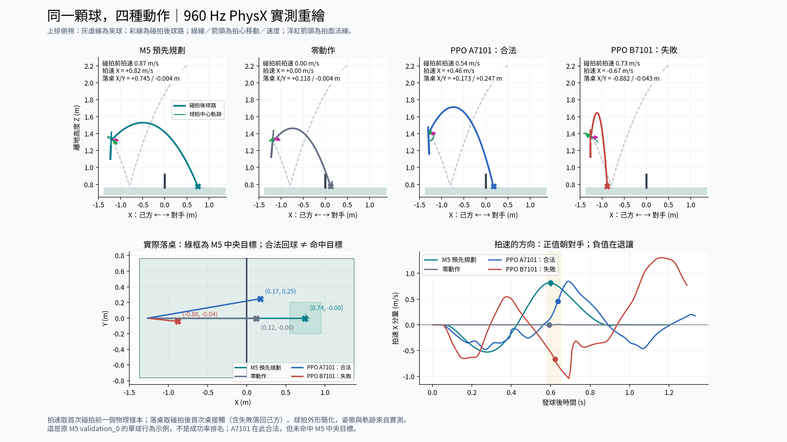

# 同一顆球：M5、零動作、成功與失敗 PPO 的動作對照

2026-11-20。這次先看動作，不增加訓練：用同一發球重播四種控制，從960 Hz PhysX實測狀態畫出球、球拍、拍面方向與落點，再製作同步慢放短片。

**最直接的觀察：B7101不是沒有碰到球；它碰拍時正在往己方退讓。它的拍速大小高於A7101，出球往對手方向的速度卻低很多，最後落回己方。** 零動作也能合法擋回這顆球，因此「這球回得過去」與「策略學會主動接球」需要分開理解。

## 1. 先看圖與短片



- **上排側視**：灰虛線為來球；彩線為碰拍後球路；綠線為拍心軌跡。洋紅箭頭是碰拍前拍面法線，綠箭頭是當時TCP速度。
- **左下俯視**：X標示真正發生的首次碰拍後落桌位置；綠色40×40cm框是M5原中央目標，不是四組共同訓練的新目標。
- **右下拍速**：畫的是朝對手方向的X分量，正值往對手、負值往己方；圓點標首次碰拍前樣本。它比只看速度大小更容易理解「正在迎球還是在退讓」。

本地短片：`.agents/runs/foundation/m7/motion_comparison/comparison.mp4`。6.4秒、0.25倍速、四組同步，並附碰拍區側視放大。畫面由實測資料重繪，機械臂為連桿線、球拍為簡化外形，**不是RTX攝影畫面**；球的位置、拍面姿態、連桿位置與速度都來自真正PhysX重播。各組在自己的終止時刻定格，不補造後續球路。

影片與逐步資料留本地；倉庫只保留本圖與生成入口。若本地沒有影片，先依第6節產生，避免在Git堆積影片或逐幀圖。

## 2. 四組到底做了什麼？

| 組別 | 行為來源 | 此球結果 |
| --- | --- | --- |
| M5 | 原名義來球預先計算的中央回球腳本，含指定擊球速度 | 合法，落在中央目標附近 |
| 零動作 | 六關節action都為0，驅動仍維持準備姿態 | 合法，自然擋到對方近網區 |
| A7101 | 既有A組最後PPO模型，基本獎勵 | 合法，但沒有命中M5中央目標 |
| B7101 | 既有B組最後PPO模型，加入hit guidance | 碰到球，但落回己方，wrong_bounce |

模型在重播前就選定，沒有為這次圖挑新checkpoint或訓練。A7101／B7101在既有Z2.2評測已有成功／失敗例；本球又重新核實結果。「成功PPO」在這裡只表示**這顆球合法回到對方桌面**，不表示它已達成整組研究門檻或精準目標回球。

選用M5已用過的`validation_0`：位置(0.5,−0.003660642,2.206297096)m，速度(−3.301360144,0,−1.408661379)m/s。它屬於原Z2.2窄分布，不是最近M7.4的Z2.3主動接球題目，也不是新獨立驗證球。

M5只使用原先針對名義位置(0.5,0,2.2)m、速度(−3.3,0,−1.4)m/s準備好的中央script，沒有為這顆擾動球重新規劃。沒有把M7.4的IK定點攔截腳本改名成M5。

## 3. 碰拍時，球拍究竟怎樣動？

速度取首次球拍接觸前一個物理樣本，距接觸區間最多約1.04ms；不是碰撞後已受衝量影響的球速。

| 組別 | 碰拍時刻(s) | TCP速率(m/s) | TCP速度X/Y/Z(m/s) | 首次解除接觸後球速X(m/s) |
| --- | ---: | ---: | --- | ---: |
| M5 | 0.6000 | 0.871 | +0.817／−0.000／−0.301 | 3.671 |
| 零動作 | 0.5917 | 約0 | 約0／0／0 | 2.532 |
| A7101 | 0.6365 | 0.543 | +0.456／−0.048／+0.292 | 2.346 |
| B7101 | 0.6219 | 0.730 | **−0.666**／+0.162／+0.251 | **0.582** |

這裡有三個容易只看成功率而忽略的事：

- **M5在碰拍時往對手方向送拍**，這顆球出射X速度較高，飛到指定中央落點附近。
- **A7101確實有動作**，拍心相對初始位置最大移動約129mm，碰拍時往前、往上；球也帶有橫向出射速度，所以落點偏到Y=0.247m。
- **B7101移動更多，不等於動作更有效**：最大位移約246mm，碰拍時X速度卻向後。這與其較低的出射X速度及己方落桌相符。這是單球的物理觀察，不能據此證明是某一條reward造成退讓。

零動作的拍心最大位移約0.25mm，屬接觸／驅動跟蹤造成的小幅變化；沒有策略主動揮拍，但球碰到固定姿態的拍面仍可反彈。M5最大位移約115mm。這些位移均以實測TCP相對初始位置計算。

拍面法線直接從實測RacketTCP旋轉取得；TCP-Z朝拍面外側：

| 組別 | 碰拍前法線X/Y/Z | 法線相對水平面傾角 |
| --- | --- | ---: |
| M5 | 0.99675／−0.00001／−0.08051 | −4.62° |
| 零動作 | 0.98545／−0.00011／−0.16998 | −9.79° |
| A7101 | 0.99342／+0.08612／+0.07550 | +4.33° |
| B7101 | 0.99975／−0.02162／+0.00574 | +0.33° |

角度僅為法線的上下傾角；完整方向還包含Y分量，不能用一個角代替全部姿態。短片的洋紅線會隨實測姿態改變。

## 4. 球最後真正落在哪裡？

| 組別 | 第一次碰拍後落桌X/Y(m) | 判定 |
| --- | --- | --- |
| M5 | (+0.7445,−0.0037) | 對方，距中央目標約6.6mm |
| 零動作 | (+0.1183,−0.0039) | 對方近網區，合法 |
| A7101 | (+0.1730,+0.2475) | 對方，合法，未命中中央框 |
| B7101 | (−0.8822,−0.0431) | 己方，wrong_bounce |

X=0是球網，正X為對方。落點取**實際新桌接觸時的球心XY**，不是教師預測或未來外推。對失敗B7101也保存首次碰拍後桌接觸，避免只有合法事件才有落點。沒有把wrong_bounce改成成功，也沒有修改擦網／碰撞規則。

## 5. 程式怎樣取得這些資料？

`tests/pace_motion.py`負責擷取，分兩個獨立程序建立PhysX場景：

```text
同一發球／同一機械臂與球拍資產／960Hz物理
  ├─ M5：plan_return(名義來球) → 原prepared StrikeTrajectory → SingleShot
  └─ zero／A7101／B7101：48Hz action → 原PositionCommand → PaceEnv
每個物理步：前一狀態 → 原物理步 → 接觸與新狀態
  → 首次碰拍前後、首次解除接觸、首次碰拍後落桌
  → 每8個物理步保存120Hz展示軌跡
```

- **姿態與運動**：TCP及連桿位置取實際剛體，不用目標關節角假裝已執行。球位置轉回環境局部座標。TCP速度用`v_COM + omega × (TCP−COM)`，包含球拍轉動的影響。
- **接觸時序**：首次接觸保存前一物理樣本與首個post-impulse樣本；首次解除接觸後的球速另存。展示資料確認分離時相對法線速度為正，不把首個受力樣本冒稱離拍狀態。
- **接觸點速度的限制**：主要表格使用可靠量測的TCP速度。原ContactSensor只保存接觸合力，沒有記錄solver接觸點；額外欄位用球心投影到實測TCP拍面來估計表面點速度，明標幾何近似，不能叫真實PhysX接觸點或精確衝量解。
- **不改物理**：只在診斷包裝原physics_step旁讀資料。普通運動未直接寫入關節／球狀態，沒有增加MSE／PPO更新或更換碰撞體；重播前後核對policy／生產來源SHA。

M5與PaceEnv使用不同既有控制入口：M5有位置＋速度軌跡目標，PPO是48Hz有界位置residual。因此本圖是同來球的行為示例，不是嚴格只改演算法的排名試驗。四組碰拍前的共同球路最大差約6.3×10⁻⁸m，確認展示中的來球一致；初始拍心仍可能有重置／settle的微小差異。

`scripts/plot_motion_comparison.py`只讀已完成報告，畫側視／俯視、接觸前方向與速度時間曲線；影片按60Hz源時間取樣、15fps播放，約0.25倍速。120Hz保存資料在顯示時取最近已發生樣本；不以插值製造接觸。短片的機械臂與球拍簡化外形只作說明，不代表CAD渲染或新的碰撞模型。

## 6. 驗證、產物與重跑

兩段重播皆PASS／exit0；四組都使用同一發球，無正常運動state write、無policy更新、無新訓練。PPO模型權重與來源SHA不變；原M5錄影中心落點與本次相差約0.01mm，結果一致。

影片為H.264、yuv420p、1280×800、15fps、96幀／6.4秒；已檢查畫面及編碼。這是可視化重播PASS，不能取代M7整體策略效用驗收。

```bash
# 擷取目錄預設固定；已有m5.json/policies.json會拒絕覆蓋，保留原始證據
./run.sh --mode pace-check --pace-check motion --device cuda:0 --headless --report .agents/runs/foundation/m7/motion_policies.json
./run.sh --mode pace-check --pace-check motion-m5 --device cuda:0 --headless --report .agents/runs/foundation/m7/motion_m5.json
# 用已擷取資料重畫／覆寫這項工作的穩定圖與短片，不會重跑物理
python scripts/plot_motion_comparison.py --video .agents/runs/foundation/m7/motion_comparison/comparison.mp4
```

擷取需要現有本地M7.4的A7101／B7101 checkpoint；公開倉庫不含訓練權重。實際使用既有Isaac容器；繪圖使用其中的NumPy／Matplotlib／SciPy／imageio-ffmpeg及主機CJK字體。`motion_comparison/protocol.json`固定發球與模型選擇，各段報告另保存執行程式SHA。兩段擷取間只修正M5分支的接觸名稱索引與分段程式SHA比對方式，PPO物理與量測路徑未改；兩份報告各自保留其版本，沒有把兩段冒稱同一檔案SHA。

原始`m5.json`、`policies.json`、兩段完成報告、影片與生成資訊留在本地runs；倉庫只新增一張引用圖。本輪沒有啟動E-frozen、訓練、真機操作或commit／push。
