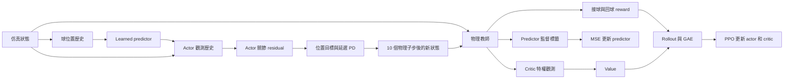

# PACE 完整資料流：從一個控制步到 PPO 更新

後續實作更新：M6離線適配已完成，見[M6筆記](m6_notes.md)。下文保留原始碼研讀當時的查證與限制。

2026-11-19。這輪完成的是**固定版本原始碼深讀與原函式隔離查證**，不是 AIRBOT 移植，也沒有啟動 PACE 機器人訓練或重現作者成功率。閱讀基準為 [論文 v5][paper]、官方 commit `fdb192f8fff9f5ca54c4ec4a8441fda5174ca078`，以及 Isaac Lab 2.1 的 buffer／actuator／reward manager。不同版本的行為不可混講。

**先抓住主旨：PACE 讓一個關節策略決定如何接球；物理預測同時提供學習標籤和獎勵，另一個小網路學會由球位置歷史提供預測提示。** 它沒有先用逆向規劃求出整段揮拍軌跡，再讓 policy 跟隨。本工程 M5 是比較基線，不是 PACE actor 的必經前處理。

本文的「原碼已確認」是指呼叫／公式可查；「隔離測試通過」是指合成張量上的實際行為可重現；兩者都不等於完整仿真或真機已驗證。獎勵細節及算例另見 [pace_rewards.md](pace_rewards.md)。

## 1. 三個網路與一個物理教師，誰負責什麼

| 元件 | 輸入 → 輸出 | 如何更新 | 是否部署需要 |
| --- | --- | --- | --- |
| 物理／啟發式教師 | 當前球位置、速度、反彈／擊球旗標、部分機器人位置 → 接球引導點、落點、到達時間等 | 公式計算，無網路權重 | 不是原版 actor 推論的必要元件 |
| Learned predictor | 5 次球位置，15 維 → 3 維接球引導點 | 單獨 Adam，以教師標籤做 MSE | predictor 版本需要 |
| Actor | 5 次觀測，共 405 維 → 21 維動作分布／均值 | PPO policy loss 與 entropy | 需要 |
| Critic | 5 次特權觀測，共 490 維 → 一個 value | PPO value loss | 純策略推論不需要 |

Actor 與 critic 各是獨立 MLP，隱藏層都是 `512→512→128`、ELU；predictor 是 `15→64→64→3`、ReLU。不是共享一個 backbone，也不是 RNN；時間資訊來自固定長度拼接。

「End-to-end」指單一 policy 從觀測決定關節動作。**並非 reward 的梯度穿過 PhysX、predictor，再一路反傳。** Rollout 在 inference mode，PPO 儲存的 observation 已是數值；predictor 有另一個 optimizer。我們以原版 PPO 的合成更新確認 actor 會變、predictor 權重與梯度不變。

## 2. 入口與實際設定：先找到跑的是哪條路

[train.py][train] 先由 task registry 把 `t1_tt` 對到 `TTEnv + T1TableTennisEnvCfg + T1TableTennisAgentCfg`。

- 有 `--predictor`：選 `OnPolicyPredictorRegressionRunner`。
- 沒有：選普通 `OnPolicyRunner`。
- T1 子配置覆蓋 base 配置，因此不能拿函式或 runner 預設值當實驗值。
- 真正使用的觀測函式是 `compute_current_observations_perception()`；另一個非 perception 版本不是 step 的正式入口。

| 設定 | T1 實際配置 |
| --- | --- |
| 物理 dt／decimation | 0.002 s／10 |
| 策略週期 | 0.02 s，即 50 Hz |
| action | 21 關節、nominal pose 的位置 residual，scale=0.25 |
| actor／critic history | 各 5 次策略觀測，最老在前、最新在後 |
| rollout | 每環境 24 步；4096 環境時共 98,304 transitions |
| predictor history／buffer | 5 次位置／最多 128 次策略取樣 |
| predictor 更新 | Adam lr=0.0005、每輪 1 epoch、batch=1024、cutoff 配置20 |
| PPO | 5 epochs × 4 minibatches、初始 lr=0.001、adaptive KL |
| 折扣／GAE | gamma=0.95、lambda=0.95 |
| clipping／entropy／gradient | 0.2／0.006／norm≤1 |
| normalization | empirical normalization 關閉；仍有欄位 scale、noise 和 obs clip |
| RND／symmetry | 此配置均未啟用 |

24 步是每環境 0.48 秒，**不是一球或一集**。四個 minibatch、五輪表示每個 rollout 有 20 次 PPO optimizer step。gamma=.95 以20ms為單位，約0.27秒後折扣到一半；若日後改控制頻率卻不改 gamma，實際時間上的信用分配也會改。

## 3. 沿一個控制步走完：圖是概念，時序看表



圖沒有表達呼叫先後；固定版本的 [runner.learn][runner] 與 [TTEnv.step][step] 實際順序如下：

| 順序 | 呼叫／狀態 | 發生什麼 |
| --- | --- | --- |
| 1 | `alg.act(obs, privileged_obs)` | actor 抽動作；critic 同時估目前 value；保留 observation、action、log probability、mean、std |
| 2 | `env.step(actions)` | 延遲／clip／縮放，建立關節位置目標 |
| 3 | 10 個物理子步 | 設關節目標→球空氣力→write→PhysX step→read→perception→拍球接近判定 |
| 4 | `compute_intermediate_values()` | 更新表面區域事件、接觸獎勵旗標、物理教師與落點 |
| 5 | ball reset／check_reset | 先按球落地／超時計算球重置；再判整個機器人 episode 是否結束 |
| 6 | reward manager | 每項 raw×weight×0.02；合成此步 reward |
| 7 | environment reset／observations | 必要時重置機器人；建立並回傳 actor／critic history |
| 8 | runner 收到結果 | 取下一步觀測，收集球位置／教師標籤，執行 predictor 並更新環境欄位 |
| 9 | `process_env_step` | 保存 reward、done；對 timeout 補 bootstrap |
| 10 | 收滿24步 | 用最後 critic observation 算 bootstrap／GAE；更新 predictor，再更新 PPO |

**關鍵時序差：新預測不是立即寫入剛回傳的 observation。** 例如：

```text
step 1 結束：obs1 已拼好，裡面仍是 pred0
runner：用球歷史算 pred1，寫 env.ball_prediction
下一次 actor：使用 obs1，仍看到 pred0
step 2 結束：obs2 才會包含 pred1
```

穩定取樣時，觀測中的 learned prediction 比同份 observation 的狀態舊一個策略步（20ms）。原函式測試確認 `update_prediction()` 不會回頭改已拼好的 tensor；eval/play 也是先 step，再更新 predictor。這不是網路推論耗時造成，而是程式排序。初始還會先等資料窗與 predictor 首次訓練。

## 4. Predictor 到底在學什麼

### 4.1 不是預測「下一幀」，也不是整條揮拍軌跡

[收集與推論][predict] 每個策略步記一次 `env.ball_pos`，按最舊到最新拼接：

```text
[p(t−4).x, p(t−4).y, p(t−4).z, …, p(t).x, p(t).y, p(t).z]
                              ↓ 15→64→64→3
                   物理教師定義的接球引導點
```

五個點首尾相差80ms（五次取樣，不是100ms首尾跨度）。沒有顯式速度輸入，MLP 可利用位置差估運動趨勢；也沒有時間戳、旋轉、機器人位置輸入或 recurrent hidden state。

原版 collector 讀的是 **當前仿真 ball_pos**，不是 actor 使用的 delayed_perception。訓練 dataset 在 add_noise 開啟時額外加標準差0.02m的 Gaussian noise；推論 helper 直接讀原始位置歷史，沒有套 actor 的4–10ms感知延遲或該Gaussian noise。不能說兩者已使用完全相同的可部署感知管線。

官方README稱擊球後預測屬OOD、只在擊球前使用；但此固定版本runner的推論呼叫及actor拼接沒有依has_touch_paddle停用。這是文件意圖與可見程式路徑的差異，不能把README敘述當成已存在的mask。

### 4.2 物理教師其實混有三種近似

在 [compute_intermediate_values][teacher]：

1. 未反彈時，用無阻力垂直拋物線求球心到 `z=0.78m` 的時間；反彈後垂直速度乘−0.9，水平用0.7倍速度估上升段。
2. 上升段採一維二次阻力解析式；水平 X、Y 各自用 `sign(v)/k · log(1+k|v|t)`。這不是耦合三維速度範數的精確軌跡積分。
3. 引導點 X 裁成≤−1.6m；來球已無效／已擊球時改成 `robot_pos + (0,−0.6, z重設為0.89)`，並非球未來真的會走到那裡。

例如球已朝對手飛去，兩個環境的球狀態完全相同，機器人站位不同，輸出的 `ball_future_pose` 也不同。隔離執行原函式已確認這點。**因此全部樣本的標籤不能統稱「真正最高點」；無效區域標籤甚至不是只憑球歷史就必然唯一決定的量。**

另外，仿真球質量3.4g、Cd=.4378；教師計算 k 用2.7g、Cd=.47。教師是指導與監督來源，不是已證明無誤差的真值。本工程 M4 的物理預測也不等於這個教師。

### 4.3 Dataset 與 optimizer

[訓練 helper][predtrain] 將CPU ring buffer展開為 `[L,N,3]`，對 `t in range(H,L)`：

- X = `seq[t-H:t]`，五個位置。
- Y = `gt_seq[t-1]`，與最後輸入位置同一採樣時刻計算的教師目標。
- MSELoss 對 batch 和 XYZ 平均；Adam 只更新 predictor。
- 訓練樣本來自近期 buffer，多個 rollout 會重用舊資料；不是只用當輪24步，也不是全部歷史。
- L=128、N=4096時，有(128−5)×4096=503,808個window；最後一個本可用的、結束於L−1的window被range排除。
- 沒有獨立validation、valid-before-hit mask或按serve_id剔除。docstring寫「跳過跨reset」，函式正文卻明寫使用全部環境，測試已重現跨球跳躍被收進來。
- T1 cutoff寫20，但條件讀 `current_learning_iteration`，該值在每輪末尾才設成it。從0開始實際可訓練it=0…20，共21輪；不是字面上的恰好20輪。這是靜態時序推導，不是完整訓練計時結果。

論文說「RMSE-based」，程式實際優化MSE。平方根不改理想最小點，但會改梯度尺度；訓練log的 `predictor_mse` 不能直接當公尺誤差，更不能當獨立驗證的3cm結果。論文的約3cm是作者報告，本輪未重現。

## 5. Observation：每個數字從哪裡來

以下以T1的21關節、雙腳、關閉height scan為準。scale配置多為1，單位主要為m、s、rad；不是自動變成無量綱且零均值。

### Actor：81 維 × 5 = 405 維

來源是 [perception observation][obs]，每次切片如下：

| 切片（Python右端不含） | 維度 | 內容／座標 |
| --- | --- | --- |
| 0:3 | 3 | 機身角速度，body frame |
| 3:6 | 3 | body frame的重力方向 |
| 6:27 | 21 | q−q_nominal，rad |
| 27:48 | 21 | 關節速度，rad/s |
| 48:69 | 21 | 最新已送入action buffer的動作，不是PD力矩 |
| 69:75 | 6 | 延遲的球XYZ＋機身XYZ |
| 75:78 | 3 | learned prediction |
| 78:80 | 2 | (prediction_x−0.1, prediction_y＋0.6) − 當前機身XY |
| 80:81 | 1 | heading，rad |

最後兩個相對目標欄位含**當前**robot_pos；六維perception則是延遲版本，並不是所有外部量都有同一時間戳。

- 球位置相對env origin，robot_pos相對table root；目前桌原點設定對齊，搬場景必須重新確認。
- 感知DelayBuffer在每個2ms物理子步更新，lag=2…5即4–10ms，不是40–100ms。
- actor加uniform noise：角速度±.2、gravity±.05、joint position±.01rad、joint velocity±1.5rad/s、六維perception及相對目標±.007m、heading±.05rad。prediction三維不再直接加噪。
- actor／critic history各自拼五份。Isaac CircularBuffer輸出最舊在前；第一次append會以同一筆填滿，不能把初始五格當成五次不同量測。
- observation最後clip到±100；不等於策略輸出tanh到±1。

### Critic：98 維 × 5 = 490 維

前69維與actor同類型本體量；後面依次是：

```text
ball_pos(3), ball_velocity(3), physics_future_pose(3),
paddle_touch_point(3), robot_pos(3), heading(1),
robot_future_pos−robot_pos(3), future_time(1),
ball_progress(1), episode_progress(1),
own_table_flag(1), paddle_flag(1),
body_linear_velocity(3), two_feet_contact(2)
```

Critic不用actor的learned point，改讀物理教師與其他特權資訊。它評價「這個狀態往後能拿多少折扣回報」，不直接給actor正確關節角，也不直接下控制指令。

原碼 `paddle_touch_point` 是**世界座標**，卻直接與其他局部座標拼進critic。多環境offset會滲入這三維，且可受±100 clip影響；原函式切片測試已確認。不能把整個critic向量籠統稱為同一局部座標。

## 6. Actor 動作如何真的讓球拍動

[ActorCritic][ac] 的訓練動作是各關節獨立Gaussian：

```text
mu = actor(obs)
a ~ Normal(mu, std)         # std是每關節可學參數，初始1
q_target = q_nominal + 0.25 * clip(a, −100, 100)
```

`noise_std_type="scalar"` 仍建立21個std參數，不是全機只共用一個。推論 `act_inference` 回傳mu，不再抽樣。輸出層沒有tanh；±100是很寬的數值clip，不能誤認為已做可安全部署的關節限幅。

例如某關節nominal=.1rad、a=2，目標是.6rad；下個策略步再輸出2，仍是.6rad，**不是再累加.5rad**。原step測試確認同一目標會下發10次物理子步。

實際T1資產是 [BOOSTER_T1_TT_P2_CFG][robot]，使用 **DelayedPDActuator**：

- 概念上 torque = Kp(q_target−q) + Kd(v_target−v) + feedforward，再受effort limit限制。
- 手臂Kp=30、Kd=3、effort limit=18Nm；腿與踝有不同參數。
- actuator延遲0…3個物理步，即0–6ms，每次reset抽樣。
- env層action_delay配置雖關閉，**不代表actuator延遲也關閉**。
- 正常步進用目標和力驅動物理，不直接把關節寫到目標位置。reset才寫狀態。

這也解釋為什麼將來AIRBOT適配不能只把21改6：真機的控制模式、頻率、增益、飽和與延遲必須能對得上。此處只列必要理解，尚未改本機控制器。

## 7. 新狀態如何得到 reward

[詳細獎勵筆記](pace_rewards.md)已拆公式；這裡看它如何接進整條學習鏈。

| 時機／項目 | 原碼用途 | T1權重 |
| --- | --- | --- |
| 擊球前，future_ee_target | 把拍參考點提前帶近教師引導點 | 2 |
| 擊球前，body／velocity guidance | 提前移動人形機器人到正手站位 | 5／5 |
| 幾何擊球代理觸發 | 強化接近並離開拍參考點的事件 | 150 |
| 首次擊球評分，landing | 由出球狀態預測落點，分數3−距固定目標距離 | 60 |
| 同一擊球評分，pass_net | 預測過網高度接近1.11m | 100 |
| 擊球後處於對方桌面區域 | 結果獎勵代理 | 100 |
| 全程 | 能量、動作變化、碰撞、姿態等正則及終止懲罰 | 依T1配置 |

RewardManager乘dt=.02。所以拍子距引導點30cm時，raw≈.3012，此項實際每步≈.01205；15cm內raw≈.5488，實際≈.02195。這只表示準備位置較好，不保證打中。

如果觸發擊球評分且落點距目標.1m，landing raw=2.9，貢獻3.48；若預測高度恰為1.11m，net項再加2。這是該次事件的兩項貢獻，還沒扣其他懲罰，不能稱為整集回報。

原版回球引導是**數值連續、事件時刻稀疏**：不是每個物理步一直發return reward。接球引導則可在有效來球期間每個策略步發。

兩個必須知道的限制：

- 拍球contact用球心到固定拍參考點距離，球半徑.02＋threshold .05形成約7cm區域，並在接近後開始遠離時置旗標。不是PhysX接觸力訊號。
- table_success只乘「已碰拍」與「此刻球在對方桌面高度區間」。沒有本函式內的首次進入latch、法向碰撞或完整球網規則。持續兩步滿足就能回傳兩次1，原函式測試已確認。runner的每球success log另以bool累積，兩者不可混為一談。

## 8. Critic 與 PPO：為什麼好動作之後更容易出現

[PPO.act/process_env_step][ppo] 保存的是抽樣時的：

```text
(actor_obs, critic_obs, action, old_log_prob, old_mu, old_std, old_value)
                       + 後來的 reward、done
```

24步收完，用critic評最後狀態，接著 [RolloutStorage.compute_returns][storage] 倒序算：

```text
delta_t = r_t + gamma * (1−done_t) * V_(t+1) − V_t
A_t     = delta_t + gamma * lambda * (1−done_t) * A_(t+1)
R_t     = A_t + V_t
```

例如r=.02、V_t=.5、下一步V=.6且未終止，delta=.02＋.95×.6−.5=.09。若後面也比預期好，GAE會把優勢往前傳：提前移拍的動作即使當時沒得到碰球獎勵，也可能因後續成功而被提高機率。這不是把某一步reward直接當「這個動作的全部好壞」。

- 全rollout的advantage先標準化；本配置不在每個minibatch重做。
- timeout時，process_env_step先補 `gamma * transition.values` 到reward，再由done阻斷GAE。這裡使用的是該transition保存的value，不能自行改述為已用terminal_observation算末態value。
- 真正failure done不補timeout value；只重置球不一定done，value可跨連續發球。

PPO重新算舊動作在新policy下的log probability，形成：

```text
ratio = exp(new_log_prob − old_log_prob)
L_policy = mean(max(−A*ratio, −A*clip(ratio,.8,1.2)))
L_total  = L_policy + L_value − .006*entropy
```

例如A=2、ratio從1增到1.1，未裁切目標改善；超過1.2後，這個正優勢樣本不再因單純增加機率而獲得同樣收益。這是限制策略更新幅度，不是限制機械臂角度。

Critic以GAE return為目標，使用clipped value loss，係數1；actor和critic一起由PPO optimizer更新，各有獨立網路參數。KL>.02會降lr、0<KL<.005會升lr，並做gradient norm≤1。不是無論偏移多大都固定lr，也不是KL達標就必然early stop。

**PPO對predictor沒有反傳；predictor對物理教師沒有反傳；PhysX也不是可微分的這條梯度鏈。**

## 9. Reset、評測、checkpoint：光看網路會漏掉的部分

### 發球與機器人episode不同

球低於.1m或滿1.8秒重發；機器人跌低、超出站位範圍、達10秒或serve counter超限才結束episode。配置 `max_serve_per_episode=5`，實作比較是counter>5，counter在reset_ball內增加，不能只看名字就推精確計數。

球reset在reward之前，部分接觸旗標已清除，而教師／perception在reset前算過；整個環境reset後也未在同一步重新計算全部派生量。因此reset邊界可能同時有新root狀態和舊快取。原step隔離測試確認順序，但其對成功率的量化影響尚未跑完整仿真。

另有timeout資訊生命週期問題：`extras["time_outs"]`只在非空env reset內更新；下一步若沒人reset，當前time_out_buf已是新tensor，extras卻仍可指向上一輪timeout。原step＋空reset測試重現「當前False，傳給PPO仍True」。這可能讓後續transition錯加bootstrap，必須在完整整合前處理；本輪未修上游。

- 整個env reset會清actor／critic history、action／perception buffer。
- 單球reset不清上述全部history。
- runner自己的球history兩種reset都未依環境清除，訓練也不篩跨reset窗口。

### 關掉旗標不等於論文消融

普通runner不更新learned prediction，但TTEnv仍保留prediction三維及derived base-shift兩維，零prediction的shift還包含−robot_pos。論文「no predictor」說移除這兩組觀測，**不是簡單不加 `--predictor` 的同一件事**。要做論文消融需另外確認／實作，這輪未做。

同理，reward消融不應連帶改來球、噪聲、episode和物理步長，否則無法歸因。

### 保存可用，但不是完整續跑狀態

原版save有actor/critic、PPO optimizer、predictor及其optimizer、iteration和pred_cfg；load可還原匹配網路權重。合成checkpoint roundtrip已通過。

但不保存球history、環境狀態、RNG或 `_pred_trained`。即使save前predictor尚未訓練，load看到權重就把 `_pred_trained=True`；有權重不等於曾收斂。pred_cfg保存後也未自動用來重建網路；尺寸不合可能被except吞掉而停用predictor。完整resume不能宣稱逐步重現。

[eval.py][eval]的predictor分支還用了 `from rsl_rl.rsl_rl.runners ...`，與train的 `rsl_rl.runners` 不一致；標準安裝下存在入口風險。此處屬靜態發現，未啟動完整eval驗證。廣泛的except/pass亦可能讓predictor失效時PPO繼續跑，因此「程式沒崩」不等於預測真的接入。

## 10. 哪些已查證，哪些仍不能說完成

[原始碼查證測試](../../tests/test_pace_source_audit.py)只讀本地已驗SHA256的官方檔案，不修改上游，不把trainer複製進AIRBOT。純PyTorch模組直接import；依賴Isaac場景的函式以原AST抽取執行，使用合成輸入／場景替身，因此不測真實物理。

2026-11-19，既有Isaac容器內PyTorch2.5.1+cu124、CPU執行，9項通過：

| 查證 | 已確認的行為 |
| --- | --- |
| observation與hook | 81／98維、history後405／490維推導、更新不回填既有obs、critic世界座標欄位 |
| predictor dataset | 五個位置順序、末端教師label、跨reset仍被收取、最新window被漏掉 |
| predictor inference | 讀raw ball_pos，非delayed_perception；輸出無gradient |
| reward | 15cm平台、遠落點負分、success無本函式latch |
| 原始step | scale=.25、每動作10子步、先教師／球reset再reward／obs、空reset保留舊timeout extras |
| teacher fallback | 相同球狀態但不同robot_pos可有不同無效標籤 |
| PPO／GAE | timeout補值、failure不補、原版合成optimizer更新、predictor未被PPO更新 |
| checkpoint | 權重roundtrip、未訓練flag丟失、history不保存 |
| no-noise反例 | `init_obs_buffer(add_noise=False)` 的actor_obs未賦值，確實UnboundLocalError |

「測試PASS」包含成功重現缺陷，**不是說缺陷修好了**。上游原檔全部保留原樣。關閉noise的錯誤不代表預設noise=True也會在該處失敗。

尚未完成：原版完整環境啟動、作者checkpoint評測、端到端GPU訓練、論文成功率／3cm誤差重現、真機部署。不能用這9項代替這些驗收。

重跑（先有本地固定來源；來源不隨Git發布，缺少時測試會SKIP）：

```bash
mkdir -p .agents/runs/foundation/pace/tmp
docker run --rm -i --user "$(id -u):$(id -g)" \
  -v "$PWD:$PWD" -w "$PWD" \
  -e TMPDIR="$PWD/.agents/runs/foundation/pace/tmp" \
  --entrypoint /isaac-sim/python.sh \
  sha256:9c5b00fb775c65913f78f22eadb56912853c1f9f1c38828e53fb99369e29c49e \
  -m unittest discover -s tests -p test_pace_source_audit.py -v
```

來源取得：以本文固定commit下載官方檔案到 `.agents/runs/foundation/pace/source/`，保留MIT／內含BSD授權；[公開來源清單](../../configs/pace_sources.json)記錄58個選讀／依賴文字檔案的path、Git blob SHA與SHA256（不含機器人USD資產）。新的電腦依清單從固定commit取得原檔，再核對雜湊；測試不會自動下載或靜默換到main。

## 11. 對 AIRBOT 的意義：保留方法，辨識必改處

| 原方法值得保留 | 固定六軸必須重新定義 | 屬實驗改良，不能先冒充原版 |
| --- | --- | --- |
| 物理教師→predictor的監督、預測提示→actor、特權critic、PPO | 21→6關節；nominal／scale／驅動；可部署球觀測；座標／TCP；去除腳步／平衡項 | 把apex改成動力學可達擊球點、residual predictor、混合規劃控制 |
| 接球前稠密引導、擊球後立即評出球 | 固定臂工作空間、實際接觸與合法性；延遲與reset契約 | 更換HITTER架構或以M5規劃器取代actor |
| 同條件消融的研究方法 | 統一球物理參數、區分原版行為與修正 | 目標條件化擴展、廣來球與強旋 |

我們下一步不應直接複製已發現的reset／資訊／時序問題。若進入適配，需要保留「忠實原版對照」與「明確修正後版本」的差異記錄，不能默默修掉後宣稱精確復現。

這輪讓我們能解釋：每個網路看什麼、何時更新、誰產生標籤、動作如何落到PD、分數如何影響機率、哪些資訊真機拿不到。使用者仍可按自己的速度學習；**筆記完成不代表使用者已理解，也不啟動下一階段移植。**

## 12. 從原碼理解到遷移設計：本輪補充

2026-11-19：已把上述查證整合進本地活動計畫的詳細M6–M9工作包。本節只記錄設計理解；完整計畫依使用者要求留本地。**沒有開始AIRBOT移植、訓練或真機操作；以下接口仍是待驗證草案。**

- **保留學習方法，分清適配差異。** 保留物理教師、獨立MSE predictor、actor／critic及PPO；將21軸改為6軸，移除腳步／平衡觀測與獎勵。固定臂不用人體的X裁切和站位fallback；改用本機物理與有效apex標籤屬明確的方法差異，不能稱為原版精確復現。可達擊球點與HITTER仍屬後續研究。
- **先定資料時序，再接網路。** 本策略步先更新球歷史與prediction，再組actor observation；在末態計reward、保存terminal observation後才reset。timeout須每步刷新並以reset前末態value處理。這些是由原碼反例導出的工程驗收，不只是換網路輸入尺寸。
- **物理頻率會影響學習的時間意義。** M5驗證的960Hz無法用固定整數decimation取得50Hz。候選是20子步／48Hz，五點歷史跨度83.33ms；gamma、lambda和事件獎勵尺度也必須核對。候選尚未通過控制測試，不當成已選定的正式設定。
- **觀測應有可追溯來源。** 草案actor只讀關節回饋、前動作、球位置及valid／age；predictor也讀同一球觀測。真值速度、教師和事件階段留在critic／監督／評測。未使用predictor的組別實際移除預測欄位，不能只關runner旗標。這驗證的是資訊邊界，尚未代表相機已接通。
- **先比較同一個預測問題。** 五個球位置預測有效的反彈後apex；資料按整條發球切分，窗口不得跨reset或使用填充歷史。分開量對teacher的擬合及對獨立PhysX事件的誤差；3D RMSE是位置誤差向量長度的均方根，與對XYZ平均MSE開根差一個尺度，不能混報30mm門檻。
- **單場景不能直接變成批量RL。** 目前SingleShot有固定世界路徑、CPU讀回及單個事件狀態。適配需共用既有資產／驅動／合法性，補batched狀態與每環境reset，並以單環境交叉驗證、多環境平移及reset隔離測試確認語義沒有變。官方Lab／RSL-RL接口優先，不重寫PPO。
- **用消融回答問題。** 五組共用稀疏成功獎勵及正則，只切換hit guidance、return guidance與actor預測提示；critic的特權設定保持一致。因此sparse不表示完全沒有教師資訊。記錄相同樣本量與實際時間兩種比較，不能以reward高或最佳seed代替合法回球率。

後續每個小步都要有「原方法→適配原因→公式／程式→正例／反例→驗證」的筆記。先做M6接口與離線教師／reward／predictor，再做M7向量環境與PPO；M8加goal，M9做重建與交付。這份規劃完成不解除先學習、後實作的界線。

[paper]: https://arxiv.org/html/2509.21690v5
[train]: https://github.com/purdue-tracelab/PACE-ICRA2026/blob/fdb192f8fff9f5ca54c4ec4a8441fda5174ca078/legged_lab/scripts/train.py
[runner]: https://github.com/purdue-tracelab/PACE-ICRA2026/blob/fdb192f8fff9f5ca54c4ec4a8441fda5174ca078/rsl_rl/rsl_rl/runners/on_policy_predictor_regression_runner.py#L81
[step]: https://github.com/purdue-tracelab/PACE-ICRA2026/blob/fdb192f8fff9f5ca54c4ec4a8441fda5174ca078/legged_lab/envs/base/tt_env.py#L733
[predict]: https://github.com/purdue-tracelab/PACE-ICRA2026/blob/fdb192f8fff9f5ca54c4ec4a8441fda5174ca078/rsl_rl/rsl_rl/runners/on_policy_predictor_regression_runner.py#L314
[predtrain]: https://github.com/purdue-tracelab/PACE-ICRA2026/blob/fdb192f8fff9f5ca54c4ec4a8441fda5174ca078/rsl_rl/rsl_rl/runners/on_policy_predictor_regression_runner.py#L368
[teacher]: https://github.com/purdue-tracelab/PACE-ICRA2026/blob/fdb192f8fff9f5ca54c4ec4a8441fda5174ca078/legged_lab/envs/base/tt_env.py#L883
[obs]: https://github.com/purdue-tracelab/PACE-ICRA2026/blob/fdb192f8fff9f5ca54c4ec4a8441fda5174ca078/legged_lab/envs/base/tt_env.py#L484
[ac]: https://github.com/purdue-tracelab/PACE-ICRA2026/blob/fdb192f8fff9f5ca54c4ec4a8441fda5174ca078/rsl_rl/rsl_rl/modules/actor_critic.py
[robot]: https://github.com/purdue-tracelab/PACE-ICRA2026/blob/fdb192f8fff9f5ca54c4ec4a8441fda5174ca078/legged_lab/assets/booster/booster.py#L300
[ppo]: https://github.com/purdue-tracelab/PACE-ICRA2026/blob/fdb192f8fff9f5ca54c4ec4a8441fda5174ca078/rsl_rl/rsl_rl/algorithms/ppo.py#L136
[storage]: https://github.com/purdue-tracelab/PACE-ICRA2026/blob/fdb192f8fff9f5ca54c4ec4a8441fda5174ca078/rsl_rl/rsl_rl/storage/rollout_storage.py#L145
[eval]: https://github.com/purdue-tracelab/PACE-ICRA2026/blob/fdb192f8fff9f5ca54c4ec4a8441fda5174ca078/legged_lab/scripts/eval.py#L108
