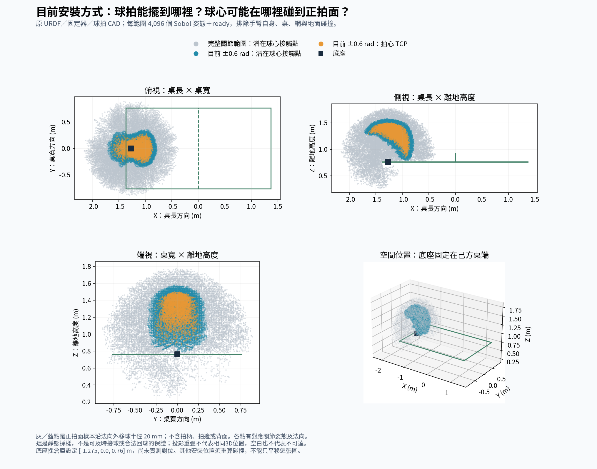
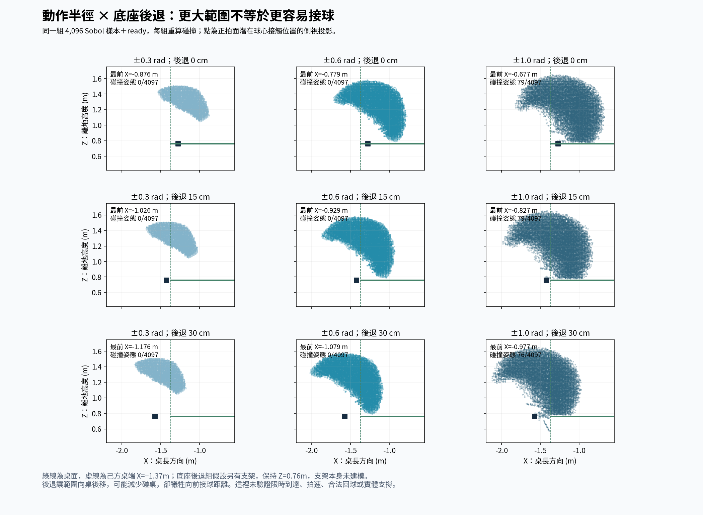

# 目前安裝方式的球拍工作空間與潛在接觸範圍

2026-11-23。**已取得可重建的第一版幾何範圍集，可供判斷接球位置與討論底座安裝。** 它同時保留拍心位置、正拍面可接觸的球心位置、對應關節姿態與拍面法向。不是只畫一個「半徑多大」的球。

現在六關節±0.6rad的限制，確實只用到完整關節幾何範圍的一部分。但這還不能證明前輪回球姿態求解失敗是它造成的；還需要在指定接觸位置查方向、速度與時間。



另已完成[九組動作半徑與底座後退比較](#九組對照動作半徑與底座後退)，不是只估算原安裝。

## 圖怎麼看？

- **橙色：目前動作範圍內的拍心TCP。** 球拍中心可以擺在哪裡。
- **藍色：目前動作範圍內，球心可能接觸正拍面的位置。** 使用實際CAD拍面樣本，向外移一個20mm球半徑；比只看拍心更完整。
- **灰色：完整URDF關節範圍下的潛在接觸點。** 已剔除被現有碰撞檢查拒絕的姿態，不等於允許PPO或真機使用整個範圍。
- **綠線：球桌／球網；深色方塊：底座。** Z以地面為零，桌面為0.76m；X朝對方，Y沿桌寬，網在X=0。

灰色中有低於桌面的點，因為手臂可以在桌外下探；不代表球拍穿過桌面。俯視／側視的投影會重疊，不能只憑一張投影判斷某個三維點有解。

**點雲是採樣，不是填滿的實心可達區。** 空白處可能只是尚未採到；整體最大／最小值形成的方盒，也不代表方盒裡每個位置都能到達。這一版不計算虛假的「可接球體積」或完整邊界。

## 依據哪個安裝方式？

使用既有官方來源URDF、已確認的固定器／球拍CAD安裝與TCP，不修改工具變換。底座採`configs/single_shot.json`的世界座標 **(−1.275, 0, 0.76)m**、無旋轉。準備姿態採`configs/strike.json`，目前範圍採`ready ± configs/pace_rl.json`的每關節0.6rad，並裁切到URDF上下限。

這是倉庫的仿真安裝設定，**尚未以實測完成真機底座到球桌的對位**。如果現場安裝有高度、平移或傾斜差異，應先更新獨立診斷的安裝條件，不能把這張圖當作真機實測工作空間。

## 大概多大？

以下都是本輪採樣極值，單位m。X/Y/Z三欄的極值可能來自不同姿態，不能拼成一個可達角點。

| 範圍集 | X：桌長 | Y：桌寬 | Z：離地高度 |
| --- | --- | --- | --- |
| 目前動作：拍心TCP | −1.649～−0.862 | −0.272～+0.278 | 0.843～1.500 |
| 目前動作：正拍面潛在接觸球心 | −1.720～−0.779 | −0.355～+0.358 | 0.791～1.582 |
| 完整關節：拍心TCP | −2.090～−0.460 | −0.802～+0.816 | 0.310～1.699 |
| 完整關節：正拍面潛在接觸球心 | −2.169～−0.379 | −0.884～+0.895 | 0.229～1.780 |

例如目前接觸點在桌寬方向約涵蓋71cm，但這是所有高度、前後位置與拍面方向的合併投影，**不是說任一高度都能左右接71cm**。如果球在X=−1.1m、Z=1.0m，必須查該位置附近的樣本，不能引用整體Y極值。

每種關節範圍使用相同固定Sobol序列的4,096個姿態，加ready，共4,097個：

| 原始採樣 | 無靜態碰撞 | 有碰撞／不足裕量 |
| --- | ---: | ---: |
| 目前±0.6rad | 4,097 | 0 |
| 完整URDF範圍 | 2,953 | 1,144（約27.9%） |

為避免兩組不同採樣密度造成假差異，完整集合另外納入全部已驗證的目前集合，去重後共7,049個姿態。碰撞比例只按各自原始4,097個計算，不能拿合併後數量當分母，也不是整個工作空間的可達百分比。

## 怎麼算出來的？

```text
官方URDF＋目前固定器／球拍CAD＋底座位置
  → 完整關節範圍／目前±0.6rad範圍的固定Sobol採樣
  → 原CollisionChecker：自身／工具／地面／球桌／球網
  → 保留無碰撞姿態，原FK取得TCP與拍面法向
  → 正拍面CAD點沿法向外移球半徑，轉到世界座標
  → 排除球體穿入桌／網／地面的位置
  → 保存q、TCP、法向、拍面點及20mm格點代表
```

使用原`CollisionChecker.check()`及原裕量，沒有自己簡化手臂成球體、忽略桌面或排除更多碰撞對。求解器異常會使流程失敗，不會被算成「無碰撞」。這輪只檢查靜態姿態，沒有PhysX、PPO或實體運動。

接觸面使用CAD正面平面，裁到既有拍柄／拍頭分界link6 Z≥0.205m；不納入拍柄、拍邊、背面。保留裁切後頂點，再按三角形面積取256個固定隨機內部點。初版直接丟掉跨分界三角形會漏掉大部分正面，面積檢查抓到後改成真正裁切；沒有縮小面積驗收來讓它通過。

每個潛在球心由`ball_center = TCP_position + R × (face_local_point + [0,0,0.02])`得到。還會檢查球體與桌／網AABB的距離及地面，但**尚未逐球檢查球體與手臂、固定器的遮擋**，也沒檢查球的接近方向。所以稱「潛在接觸點」，不把它冒稱完整接球保證。

## 後面怎樣用它排查失敗？

按順序問四個問題，避免一開始就怪PPO：

1. **位置：**預測球路經過哪一部分點雲？附近是否已有能放到該位置的姿態見證？沒有鄰近樣本只能觸發更密採樣／IK，不能直接判不可達。
2. **方向：**該位置附近的姿態有哪些拍面法向？有位置但方向不合，才支持位置／姿態耦合的問題。
3. **時間和速度：**從ready沿無碰撞路徑，在來球前能否趕到，並取得需要的局部接觸速度？這需要原控制器／軌跡驗證，本圖沒有回答。
4. **回球：**真實碰撞後是否過網並合法落桌？這需要獨立PhysX事件，不能由幾何範圍代替。

若某位置在目前集合沒有見證、在完整集合有合適姿態，只能先說「擴大動作範圍值得受控診斷」。要比較前輪三顆球的指定法向，仍須查同一位置的姿態，不是看到灰色大就斷言±0.6rad是唯一根因。

## 如何作為改安裝位置的參考？

先比較同一批來球的幾何位置與拍面方向覆蓋，再對有希望的安裝驗證到達時間、拍速及完整回球。不能用「點雲看起來最大」選位置：範圍可能往桌後擴張，對接球幫助不大。

入口支援覆寫診斷用底座XYZ，原配置不改，每種安裝另存輸出。它會以新底座位置重新做全部碰撞檢查，而非平移舊的已過濾點雲。**目前只支援同方向的平移；旋轉安裝、支架、桌腿、線纜與支撐穩定性不在模型內。**底座／桌面配合仍按原安裝接觸排除規則；候選安裝必須另確認底座有實際支撐且未穿桌，不能因範圍腳本完成就認定安裝可用。

## 檔案、重跑與驗證

計算入口：[tests/racket_workspace.py](../../tests/racket_workspace.py)。圖的入口：[scripts/plot_racket_workspace.py](../../scripts/plot_racket_workspace.py)。使用專案既有含NumPy／SciPy的環境，不啟動Isaac場景：

```bash
PYTHONPATH=src:tests python tests/racket_workspace.py
python scripts/plot_racket_workspace.py
```

本地`.agents/runs/foundation/workspace/`保存協議、`workspace.json`摘要及`samples.npz`；已有結果不覆寫。要比較另一個已確認可安裝的XYZ，傳`--base-position X Y Z --output <另一個本地結果目錄>`；重畫時用`--runs <該目錄> --output <本地圖片路徑>`。XYZ必須換成實際候選數值。現有預設圖只保留一張進Git，原始點集留本地。

NPZ中每組的`*_q / *_tcp / *_normal / *_rotation`同列對應。`*_contact_xyz`是每個20mm格子的一個實際採樣代表，`*_contact_pose_index`和`*_contact_face_index`能還原該點的姿態／拍面點；不是格子中心，也不是說整個格子都能接球。若要查同一位置的所有方向，必須用保存的所有姿態與`face_local_m`重建，不能只查該格的一個代表。

本輪CPU計算正常退出，來源hash不變；姿態法向單位長度檢查通過。另驗證格點代表的幾何還原、完整集合包含目前集合、抽樣FK與碰撞重查。靜態幾何診斷PASS；連通路徑／限時到達／合法回球與真機實測均NOT_RUN。


## 九組對照：動作半徑與底座後退

依追加要求，比較每關節±0.3／±0.6／±1.0rad（約±17.2／±34.4／±57.3°），以及底座沿−X退0／15／30cm，共九組。各組ready、球拍安裝、球桌、采樣seed與4096+1姿態數不變，仍裁到URDF限制；**這只是幾何診斷，不修改PPO action_scale**。



後退時底座中心X依序為−1.275／−1.425／−1.575m，Y=0、Z=0.76m不變。後兩組假設另有等高支架，支架本身尚未建模。0cm指目前仿真位置，並不是底座中心恰好在桌邊；己方桌邊為X=−1.37m。

**放大關節範圍會擴大幾何覆蓋；向後退主要把範圍移向桌後，不會憑空增加向前的臂長。** 以下把最前球心的X極值換成「從己方桌邊往桌內伸入多少」，更容易比較。這仍是不同高度／方向合併後的採樣極值，不是每顆球的攔截距離保證。

| 每關節半徑 | 原位置 | 後退15cm | 後退30cm |
| --- | ---: | ---: | ---: |
| ±0.3rad | 49.4cm | 34.4cm | 19.4cm |
| ±0.6rad（目前） | 59.1cm | 44.1cm | 29.1cm |
| ±1.0rad | 69.3cm | 54.3cm | 39.3cm |

保持原位置，從±0.6擴到±1.0rad，最前採樣接觸位置增加約10.2cm，橫向極值由−35.5..+35.8cm增至−53.6..+51.7cm。但新增範圍並不都是好用姿態：±1.0rad有79/4097個姿態碰桌或不足碰撞裕量（約1.93%），前兩組半徑為0/4097。這是固定取樣的拒絕比例，不是連續範圍安全率。

底座退15cm時，±1.0rad仍拒絕79個，沒有因此改善這個計數；退30cm才變成76個，只多出3個靜態可用姿態。最低潛在接觸點因此降到約0.567m離地，但那些點在桌外，**不是桌面上多出了可打低球的區域**。不能因為接觸點雲更大或更低就判定這個安裝更好。

所以「後退30cm＋擴大到±1.0rad」的最前端，仍比「原位置＋目前±0.6rad」後退約19.8cm。後退可能讓某些來球多飛一段才接觸，然而球同時可能下降或離開可用位置；反應時間、法向、拍速與合法回球都還沒驗，不能只用這張靜態圖選最佳安裝。

### 公開重跑入口與證據

```bash
# 完整比較；已完成的目錄會拒絕覆寫，新比較須另給本地output
PYTHONPATH=src:tests python tests/racket_workspace.py --compare
python scripts/plot_racket_workspace.py --compare

# 單一幾何候選示例：後退15cm、±1.0rad；另存，不改正式配置
PYTHONPATH=src:tests python tests/racket_workspace.py \
  --action-radius 1.0 --base-position -1.425 0 0.76 --only-current \
  --output .agents/runs/foundation/workspace_candidate
```

相同Sobol單位樣本映射到各關節box；不同半徑是相同採樣規則，並非完全相同q，也不保證稀疏小半徑點集是大半徑點集的子集。不同平移會改變20mm格子的對齊，所以格點數小幅變化不能解讀成工作空間增大；本比較不把占據格點數乘格體積當真實容積。

九組的JSON／NPZ都在原workspace本地目錄，各子目錄保留當時的source/code hash，`comparison.json`索引原始報告，原位置±0.6直接復用已完成基線。圖與筆記的數字使用全採樣，只有畫圖作固定稀疏顯示。執行後把小型排程整合進同一公開入口，沒有重跑物理或改寫歷史code hash；保留各次版本，不聲稱舊整檔hash等於現在新增CLI後的檔案。

九組生產source／NPZ hash與全部格點代表的幾何還原通過，另抽查36個姿態的碰撞；基線另有32次FK／碰撞重查及current包含於full的檢查。流程正常退出，沒有實體運動／PPO／PhysX。整組限時可達、回球可行與支架碰撞仍NOT_RUN。


後續已對固定三球做[±0.6／±1.0rad回球姿態比較](deepmind_feasibility.md)：較寬範圍的幾何點雲較大，不代表指定位置與法向有解；兩組81候選均未過IK，J5模型上限是重要線索，完整結果見該節。
